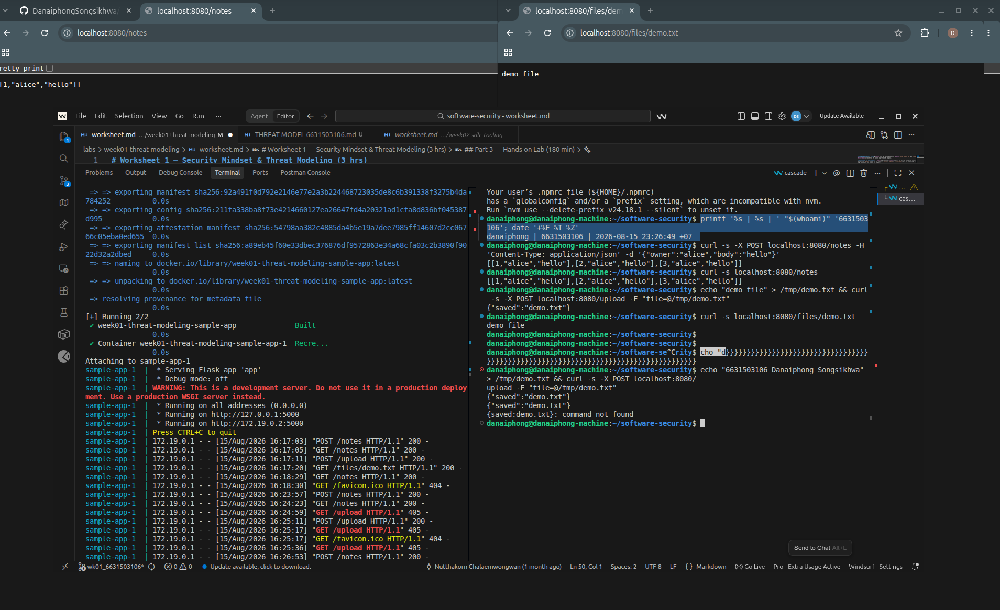
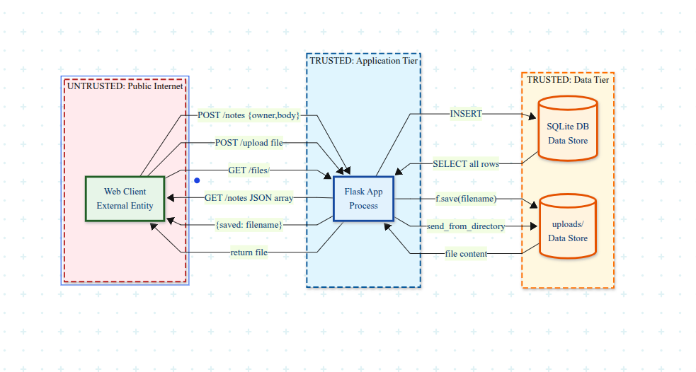
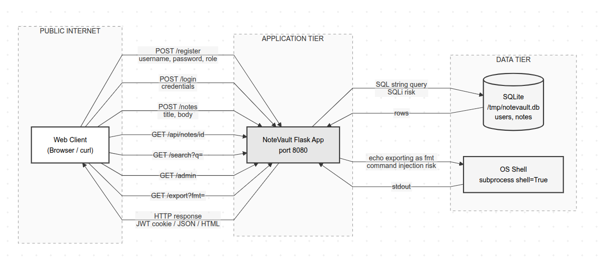

# Worksheet 1 — Security Mindset & Threat Modeling (3 hrs)

> **Course:** Software Security (KOSEN69) · **Week 1**
> **Aligned to:** OWASP 2025 A06 Insecure Design · CWE-501 (Trust Boundary Violation)
> **Signature game:** "Elevation of Privilege" (Microsoft STRIDE card deck)

> **Ethics note:** This week is *modeling only* — you analyze design, you do **not** attack the app. Run the sample app only on your own VM/localhost. Never apply these techniques to systems you do not own or lack written permission to test.

## Part 1 — Student Information
| Name | Student ID | Date | Group | AI Tools Used |
|---|---|---|---|---|
| Danaiphong Songsikhwa | 6631503106 | 15/8/2569 | - | Consulted AI assistant for Audit the AI / Prompt testing |

## Part 2 — Lecture Questions
Answer in your own words (2–4 sentences each).
1. **CIA triad** — Confidentiality (only authorized people can read data), Integrity (data can't be changed without permission), Availability (system stays up when needed). Example failures: a leaked password database breaks confidentiality, someone tampering with grades in a student system breaks integrity, a DDoS taking down an online shop breaks availability.

2. **Trust boundary** - It's a line where data moves from one level of trust to another, like from the public internet into your app server. Data crossing it deserves extra scrutiny because the other side might be hostile — you can't assume input is safe just because it reached your code.

3. **Attack surface** - All the points where an attacker can interact with your system. Two things that increase it in a web app: adding new endpoints or APIs, and accepting more input types (file uploads, JSON bodies, query params).

4. **STRIDE** - Spoofing (identity → authenticity), Tampering (data modification → integrity), Repudiation (denying actions → non-repudiation), Information disclosure (leaking data → confidentiality), Denial of service (crashing/flooding → availability), Elevation of privilege (gaining access → authorization).

5. **Secure by Design** - Building security into the system from the start, thinking about threats before writing code. It's different from bolting security on after release because fixing design flaws later is way more expensive and you'll always miss something that's already baked into the architecture.

## Part 3 — Hands-on Lab (180 min)
**Learning goals:** build a data-flow diagram (DFD), apply STRIDE to a real Flask app, rank risks, and propose mitigations.
**Prerequisites:** Docker + Docker Compose in your VM; a drawing tool (draw.io / paper + photo); the Elevation of Privilege deck (print or virtual) — free print-and-play PDF at [github.com/adamshostack/eop](https://github.com/adamshostack/eop).

**Environment setup**
```bash
cd labs/week01-threat-modeling
docker compose up --build           # starts sample-app on http://localhost:8080
curl -s -X POST localhost:8080/notes -H 'Content-Type: application/json' \
     -d '{"owner":"alice","body":"hello"}'   # observe behavior, do not attack
curl -s localhost:8080/notes

echo "demo file" > demo.txt
curl -s -X POST localhost:8080/upload -F "file=@demo.txt"   # observe behavior, do not attack
curl -s localhost:8080/files/demo.txt
```

Source to model lives in `sample-app/app.py`. Template to fill: `THREAT-MODEL-TEMPLATE.md` (copy it, do not edit the original).

**What to submit per task:** the threat/element identified + a screenshot (DFD, table, or running app) + a 2–3 sentence mitigation.

**Task 0 — Onboarding (5 min)** · *Goal:* prove the environment works. *Steps:* `docker compose up`, hit `/notes` and `/files/<name>`, read `sample-app/app.py`. *Deliverable:* screenshot of the running app + the JSON response.



**Task 1 — Draw the DFD (25 min)** · *Goal:* map the system. *Steps:* identify the external entity (web client), the process (Flask app), the data store (`notes.db` SQLite), the `uploads/` store, and the flows for `/notes`, `/upload`, `/files/<name>`; mark the Internet→app trust boundary with a dashed line. *Deliverable:* DFD image embedded in your copy of the template.



**Task 2 — STRIDE the elements (30 min)** · *Goal:* enumerate threats per element. *Steps:* for each element fill the S/T/R/I/D/E grid. Ground it in real code: `/notes` accepts a client-supplied `owner` with no auth (Spoofing); `/upload` saves raw `f.filename` — arbitrary-file-write (Tampering) — and echoes the resolved save path back in its response (Information disclosure); `/files/<name>` reads it back but is comparatively defended (see Task 5); no logging anywhere (Repudiation). *Deliverable:* completed STRIDE table.

**Task 3 — Elevation of Privilege game (20 min)** · *Goal:* find threats you missed. *Steps:* play the EoP deck against your DFD; each card you can tie to a real element/flow scores a point; record every valid threat. No printer or scissors? Draw from the digital deck below instead — same 78 cards, same rule. *Deliverable:* list of carded threats + score.

```sim
eop-deck
```

**EoP results:**

| # | Card | Threat | Tied to | Point |
|---|---|---|---|---|
| 1 | S-3 | An attacker can spoof an identity by supplying a false name | /notes - `owner` comes from client, no login | 1 |
| 2 | S-7 | An attacker can access data without going through the expected authentication path | /notes and /upload - no auth on any endpoint | 1 |
| 3 | T-5 | An attacker can write data to a file they should not access | /upload - `f.filename` goes raw into path, can write outside uploads/ | 1 |
| 4 | T-J | An attacker can modify data in transit since there is no integrity check | All flows - plain HTTP, no TLS | 1 |
| 5 | R-2 | An attacker can deny performing an action because there is no audit log | All endpoints - zero logging anywhere | 1 |
| 6 | R-6 | An attacker can claim they did not receive data because there is no receipt | GET /notes - no record of who read what | 1 |
| 7 | I-4 | An attacker can read data they should not see | GET /notes - returns every note to anyone | 1 |
| 8 | I-9 | An attacker can learn internal paths from error messages or responses | /upload - response leaks the saved filename | 1 |
| 9 | D-3 | An attacker can flood the system with requests to make it slow or unavailable | POST /notes - no rate limit, can spam | 1 |
| 10 | D-8 | An attacker can upload a very large file to fill up disk space | /upload - no file size limit | 1 |
| 11 | E-2 | An attacker can gain access to functionality they should not have | All endpoints - no auth means everyone is admin | 1 |
| 12 | E-K | An attacker can execute code on the server by uploading a script | /upload - can upload .py file, might get executed | 1 |

**Score: 12**

**Task 3b — Systems-level pass (25 min) 🔭** · *Goal:* find what the per-element grid cannot see. Tasks 2 and 3 enumerate threats **one element at a time**, and that is exactly where threat models are known to stop short — students taught STRIDE alone reliably identify component threats and *discount system-level ones* ([Joshi et al., ASEE 2024](https://arxiv.org/abs/2404.16632)). So do a second pass over the **whole** diagram:


- **Trust boundaries end-to-end.** Follow one request from the client to `notes.db` and back. List every boundary it crosses. Which crossing has no check on it?
- **Assume one element is fully owned.** Pick the Flask process, then the `uploads/` store. For each: what does the attacker now *reach* — not what is it, but where does it get them?
- **Chain two "low" findings.** Find two threats you or the EoP deck rated minor that combine into something you would not accept. Write the chain as `A → B → consequence`.
- **One-line system claim.** Finish: "Even if every element-level mitigation in Task 8 is implemented, this system still fails if ___."

Use the simulation below before you start — toggle a component to attacker-controlled and watch what it reaches:

```sim
trust-boundary
```

*Deliverable:* the boundary list, two owned-element reachability notes, one written chain, and the system claim.

**Task 3b answers:**

**Trust boundaries end-to-end (following one POST /notes to notes.db and back):**
1. Internet into the Flask app - nothing here at all, no auth, no rate limit, no validation
2. Flask app into SQLite - the query itself is parameterized, but nobody checks who's allowed to write
3. SQLite back into the app - hands over every row, no filtering
4. Flask app back out to the Internet - whatever came out of the DB just goes straight to the client

The one with no check on it is #1, Internet into the app. There's literally nothing between the client and the app.

**If one element gets fully owned:**
- Own the Flask process and you get read/write on notes.db, everything in uploads/, and via path traversal basically the rest of the filesystem. From there it's a short hop to code execution if you can overwrite app.py or drop a script somewhere that runs.
- Own the uploads/ store and you can swap out any uploaded file for something malicious, or drop files outside the directory with ../. That gives you a place to park payloads that stick around, plus a shot at execution if anything ever serves or runs them.

**Chaining two low findings:**
No logging (R) -> no auth on /notes (S) -> you can write notes as any owner you want and there's no log anywhere to show it was you. So it's impersonation that nobody can even investigate afterwards. Neither one looks like a big deal alone, but together it's not something I'd ship.

**System claim:**
Even if every element-level mitigation in Task 8 is implemented, this system still fails if there's no authentication layer at all, because every endpoint just takes the caller's word for who they are and you can't patch that one element at a time.

**Task 4 — Abuse cases & attacker personas (20 min)** · *Goal:* think like specific adversaries. *Steps:* define 2 personas (e.g. a curious logged-in user; an anonymous internet attacker) and write 2 abuse cases each against the sample app, tied to DFD elements. *Deliverable:* 4 abuse cases.

**Task 4 answers:**

**Persona 1: Anonymous internet attacker**

Someone who found the app on the internet and has no account. Just wants to grab data or get a foothold.

- Abuse case 1: hit GET /notes and get every note in the DB back. No login needed, so everyone's notes are just sitting there. (/notes flow, Information Disclosure)
- Abuse case 2: upload a file named ../../etc/cron.d/cleanup so it lands in the cron directory and runs whatever commands they put in it. (/upload flow, Tampering + Elevation)

**Persona 2: Curious logged-in user (assuming auth existed)**

A normal user with a valid account who wants to see stuff they shouldn't, or poke at the app.

- Abuse case 1: put someone else's name in the owner field on POST /notes and write notes as them. The server never checks who you actually are. (/notes flow, Spoofing)
- Abuse case 2: upload a file called ../app.py to overwrite the app source itself. (/upload flow, Tampering + Elevation)

**Task 5 — Path-traversal deep-dive (25 min)** · *Goal:* analyze the riskiest flow. *Steps:* trace `/upload` → `/files/<name>`; explain how `../` in a filename escapes `uploads/`; sketch the secure design (`secure_filename`, store outside web root, allow-list extensions). *Deliverable:* the data flow + secure-design note.

**Task 5 answers:**

**Data flow of the attack:**
```
Client -> POST /upload (multipart form, file=@malicious.txt)
       -> Flask: f = request.files["file"]
       -> f.filename = "../../etc/passwd"  (attacker controls this)
       -> os.path.join("uploads", "../../etc/passwd")
       -> resolves to: /app/../../etc/passwd = /etc/passwd
       -> f.save() writes attacker content to /etc/passwd
       -> Response: {"saved": "../../etc/passwd"}
```

**How ../ escapes uploads/:**

os.path.join just glues the strings together, it doesn't check anything. So the ../ parts walk back up out of uploads/ and the file ends up wherever the attacker points it. /files/<name> is actually a bit better off since send_from_directory uses safe_join under the hood, but f.save() in the upload route has zero protection.

**Secure design:**
1. run the filename through werkzeug.utils.secure_filename() to strip out slashes and other junk
2. keep uploads outside the web root so nothing can be served or executed straight from there
3. only allow certain extensions (.txt, .pdf, .png) and reject the rest
4. better yet, generate a UUID for the filename and ignore what the user sent
5. cap the file size

**Task 6 — Threat-model the project target (30 min)** · *Goal:* kick off your term project. *Steps:* stop the sample-app first (`docker compose down` — both apps bind host port 8080), then run **NoteVault** (`cd ../../project/starter-app && docker compose up`), draw a quick DFD, and list the top 3 STRIDE threats you'd investigate. *Deliverable:* NoteVault DFD + top-3 threats (reuse these in your project report — `project/REPORT-TEMPLATE.md` in the repo root).

**Task 6 answers:**

**NoteVault DFD:**



Elements:
- Web client - external entity, sits on the other side of the Internet boundary
- Flask app - process, takes all the untrusted input
- SQLite DB - data store, holds users and notes
- OS shell - gets called from /export via subprocess with shell=True

Flows:
1. POST /register - username, password, role go into the users table
2. POST /login - credentials go into a string-built SQL query, returns a JWT cookie
3. POST /notes - title and body go into the notes table (login required)
4. GET /api/notes/<id> - returns a note by id, checks login but not ownership
5. GET /search?q= - search term goes into another string-built SQL query
6. GET /admin - dumps all users including password hashes
7. GET /export?fmt= - fmt goes straight into a shell command

**Top 3 STRIDE threats:**

1. SQL injection in /login (CWE-89, Tampering + Spoofing) - the login query is built with string formatting instead of a parameterized query, so you can inject SQL and log in as anyone including admin. This one's the worst because it hands over full account takeover.

2. IDOR in /api/notes/<id> (CWE-639, Information Disclosure) - it checks you're logged in but never checks the note is yours. Just increment the id and you can read admin's notes, one of which literally contains the prod db password.

3. Command injection in /export (CWE-78, Elevation of Privilege) - fmt goes into subprocess.run with shell=True, so you can chain on ; or | and run whatever you want on the box.

**Task 7 — Security requirements (15 min)** · *Goal:* turn threats into testable requirements. *Steps:* write 3 security requirements as acceptance criteria ("the system must … so that …"), each mapped to a threat from Task 2 or Task 6. *Deliverable:* 3 testable security requirements.

**Task 7 answers:**

1. The system must reject any request to /notes that doesn't carry a valid session, and only return notes belonging to that session's user, so that nobody can read or write someone else's notes.
   - Maps to: Spoofing and Information Disclosure on /notes (Task 2)
   - How to test: send GET /notes with no cookie, expect 401. Log in as alice, expect only alice's notes back.

2. The system must never let a user-supplied string become part of a filesystem path, so that no file can be written or read outside the uploads directory.
   - Maps to: Tampering on /upload, path traversal (Task 2, Task 5)
   - How to test: upload with filename ../../tmp/pwned and check that nothing appears in /tmp and the request is rejected.

3. The system must build every SQL query with bound parameters instead of string formatting, so that input can't change the meaning of the query.
   - Maps to: SQL injection in /login and /search on NoteVault (Task 6)
   - How to test: login with username `admin' OR '1'='1` and expect 401 instead of a session cookie.

**Task 8 — Defend / fix it: rank & mitigate (25 min) 🛡️** · *Goal:* turn threats into action you can prove. *Steps:* rank the top 5 threats by likelihood × impact; propose one concrete mitigation each (e.g., auth on `/notes`, `secure_filename()` + allowlist for `/upload`, request logging for Repudiation, size/rate limits for DoS). Then **pick one and actually implement it** in your fork.

*Deliverable — the top-5 table, plus for the one you implemented:*
1. the **diff** (commit hash on your `wk01` branch),
2. **evidence it works**: the request that succeeded before your change and is refused after — both outputs,
3. **why it closes the class, not the instance** (2–3 sentences). `secure_filename()` on one endpoint is an instance fix; *"no user-supplied string ever becomes a path component"* is a class fix. Say which yours is, and if it's an instance fix, say what the class fix would be.

**Task 8 answers:**

**Top 5 risks ranking:**

| Rank | Threat & Element | Likelihood | Impact | Concrete Mitigation |
|---|---|---|---|---|
| 1 | Path traversal on `/upload` (writes arbitrary files outside `uploads/`) | High | High | Sanitize filename with `secure_filename()`, enforce an extension allowlist, or assign server-side UUIDs |
| 2 | Missing authentication on `/notes` (anyone reads/writes any note) | High | High | Require session login / auth token and bind notes to authenticated user |
| 3 | Information disclosure on `GET /notes` (dumps all database notes to anyone) | High | Medium | Scope DB queries to `WHERE owner = current_user` rather than returning all rows |
| 4 | Missing audit logging on all endpoints (cannot trace malicious actions) | Medium | Medium | Implement structured logging recording timestamp, source IP, user, and action |
| 5 | Unbounded upload & request flooding (Denial of Service) | Medium | Medium | Enforce `MAX_CONTENT_LENGTH` in Flask config and add rate limiting per client IP |

**Implemented mitigation: Path traversal and file extension validation in `/upload`**

1. **Commit hash:** `661aeaf` (branch `wk01_6631503106`)

2. **Evidence it works:**

- **Before fix (exploit succeeded):**
```bash
curl -s -X POST localhost:8080/upload -F "file=@demo.txt;filename=../../evil.txt"
```
Output:
```json
{"saved":"../../evil.txt"}
```
*(File escaped the `uploads/` folder and was written straight into the root directory `/evil.txt` inside the container).*

- **After fix (exploit refused / safely handled):**
Attempting to upload an executable script (`evil.py`):
```bash
curl -i -s -X POST localhost:8080/upload -F "file=@demo.txt;filename=../../evil.py"
```
Output:
```http
HTTP/1.1 400 BAD REQUEST
Content-Type: application/json

{"error":"file type not allowed"}
```
Attempting path traversal with an allowed extension:
```bash
curl -i -s -X POST localhost:8080/upload -F "file=@demo.txt;filename=../../evil.txt"
```
Output:
```http
HTTP/1.1 200 OK
Content-Type: application/json

{"saved":"evil.txt"}
```
*(The relative traversal sequence `../../` was stripped, and the file was saved as `evil.txt` strictly inside `uploads/evil.txt`. No file was created at `/evil.txt`).*

3. **Class vs Instance fix:**
My implementation is an **instance fix** because it only patches this specific `/upload` route by calling `secure_filename()` and checking extensions in code. If another developer introduces an avatar upload or export endpoint elsewhere in the app without these checks, the same vulnerability re-appears. A true **class fix** would be architectural: generating random server-side UUIDs for every file stored on disk and storing the original filename only in SQLite metadata, so client-supplied strings are never concatenated into filesystem paths anywhere in the application.

## Part 4 — Reflection
1. **Map your top finding to a CWE and to OWASP A06 (Insecure Design); explain the mapping in one sentence:**
   The path traversal in `/upload` maps to CWE-22 (Improper Limitation of a Pathname to a Restricted Directory) and OWASP A06:2025 (Insecure Design) because the application architecture accepted untrusted client filenames straight across the Internet trust boundary without isolating storage paths or enforcing server-side name generation.

2. **Name one real-world breach caused by a design flaw (not a missing patch) and what design control would have prevented it:**
   The 2018 Panera Bread data leak exposed over 37 million customer records via an unauthenticated API endpoint that retrieved customer profiles based on sequential numeric IDs. It was not a missing patch or memory bug, but an architectural flaw: the API endpoints lacked authentication and authorization controls by design. An architectural control requiring token validation on every endpoint and using non-sequential UUIDs would have prevented the breach.

3. **Of your five mitigations, which gives the most risk reduction per unit of effort, and why?**
   Adding authentication to `/notes` gives the most risk reduction per unit of effort. With just a simple auth check or session decorator, it immediately shuts down anonymous access across the board, eliminating both arbitrary user impersonation (Spoofing) and public database leakage (Information Disclosure) in one stroke.

## Grading rubric (100)
| Criterion | Points |
|---|---|
| Lecture questions (Part 2) | 20 |
| Exploitation + evidence (DFD + STRIDE table + EoP findings + screenshots) | 40 |
| Defense (top-5 ranking + mitigations) | 25 |
| Reflection (CWE/OWASP mapping + breach + best mitigation) | 15 |

**Assessed within the rows above** (they are not extra points — they are what those points are for):
- **Systems-level reasoning** (inside *Exploitation + evidence*, Task 3b): does the model reach past single elements to boundaries, reachability and chains? Scored with the STRIDE + systems-thinking rubrics of [Joshi et al. 2024](https://arxiv.org/abs/2404.16632).
- **Defensive proof** (inside *Defense*, Task 8): a claimed mitigation with no before/after evidence scores at most half. A mitigation you can show closing a *class* scores full.
- **Adversarial thinking** (across the whole sheet): do the abuse cases, personas and chains show you reasoning as an attacker with goals and constraints — or just listing categories? This is the course's central disposition and it is assessed, not assumed.

---

## Evidence & Integrity (required)

- **Identity proof:** every screenshot/diagram must show a terminal running `printf '%s | %s | ' "$(whoami)" '<YOUR-STUDENT-ID>'; date '+%F %T %Z'` **in the
  same image as the evidence**. When the evidence is a browser page, a DevTools panel or a
  rendered response, put that terminal **beside the browser and capture the whole screen** — a
  cropped window carries nothing that identifies you, and the lab's own output is
  byte-identical for the whole cohort *by design*, so the stamp is the only thing that makes
  the shot yours. Generic or borrowed evidence is not accepted.
- **Personalized flag (if this lab issues one):** N/A (Week 01 threat modeling does not issue a CTF flag)
- **Explain in your own words** *(graded on your reasoning, not copied text):*
  1. **What did you do, and why did the vulnerability work?**
     I tested the `/upload` route by sending a file upload request with `filename=../../evil.txt`. The vulnerability worked because the server took `f.filename` directly from the multipart form header and passed it into `os.path.join("uploads", f.filename)` without sanitizing directory traversal characters (`../`), causing the path to resolve outside the `uploads` directory and write `/evil.txt` to the container filesystem root.
  2. **Why does your fix actually stop it — and what could still break it?**
     The fix applies `secure_filename()` which strips path separators and traversal tokens so the path cannot escape `uploads/`, and it checks the extension against a strict allowlist (`txt`, `pdf`, `png`, `jpg`). It could still be broken or cause problems if someone uploads an enormous allowed file to fill up disk space (since there is no file size ceiling yet) or if two users upload files with identical names and overwrite each other.

---

## 🤖 Audit the AI (required)

AI is a power tool you must **distrust** — you are graded on your *critique*, not the AI's answer.

1. **Ask an AI assistant to exploit or fix this week's vulnerability. Paste its full answer:**

*AI Prompt:* "Fix the path traversal vulnerability in this Flask upload route: `f = request.files['file']; f.save(os.path.join(UPLOAD_DIR, f.filename))`"

*AI Output:*
```python
from flask import Flask, request
from werkzeug.utils import secure_filename
import os

@app.route("/upload", methods=["POST"])
def upload():
    file = request.files["file"]
    if file:
        filename = secure_filename(file.filename)
        file.save(os.path.join(UPLOAD_DIR, filename))
        return {"status": "success", "file": filename}
```

2. **Find what's wrong or risky in it — insecure code, a subtly incomplete fix, a hallucinated API/function/CVE, a missed edge case, or wrong reasoning. Quote the exact line(s):**

- Incomplete edge-case handling on lines:
```python
filename = secure_filename(file.filename)
file.save(os.path.join(UPLOAD_DIR, filename))
```
If an attacker sends a filename made solely of traversal dots or non-ASCII symbols (such as `../../`), `secure_filename()` strips everything and returns an empty string `""`. In Python, `os.path.join(UPLOAD_DIR, "")` resolves to `UPLOAD_DIR`, so `file.save()` tries to write directly to a directory path, crashing Flask with an unhandled `IsADirectoryError` (500 crash / DoS).
- No extension filtering: The AI code accepts any file extension (e.g., `.py`, `.sh`, `.html`), allowing attackers to store dangerous scripts or launch stored XSS.

3. **Produce the correct, verified version yourself and explain in 2–3 sentences why the AI's output was insufficient:**

```python
ALLOWED_EXTENSIONS = {"txt", "pdf", "png", "jpg"}

def allowed_file(filename):
    return "." in filename and filename.rsplit(".", 1)[1].lower() in ALLOWED_EXTENSIONS

@app.route("/upload", methods=["POST"])
def upload():
    if "file" not in request.files:
        return {"error": "no file provided"}, 400
    f = request.files["file"]
    if not f.filename or not allowed_file(f.filename):
        return {"error": "file type not allowed"}, 400
    filename = secure_filename(f.filename)
    if not filename:
        return {"error": "invalid filename"}, 400
    f.save(os.path.join(UPLOAD_DIR, filename))
    return {"saved": filename}
```
The AI's suggestion only sanitized the string at surface level without verifying what happens when sanitization empties the filename or checking what type of file is arriving. The verified version adds guard clauses for missing files, empty sanitized names, and an extension allowlist before saving.

---

## 🧠 Comprehension & Prompt (required)

**A. Explain in Plain English (EiPE).** In 2–3 sentences, in your own words, describe what this week's vulnerable code/endpoint actually *does* and *why it is exploitable* — explain the mechanism, don't dump jargon.

The upload endpoint takes whatever filename the user's browser sends and joins it straight onto the folder path where files are stored. Because it never checks for directory traversal characters like `../`, an attacker can tell the server to walk out of the uploads folder and write files into sensitive system locations.

**B. Prompt Problem.** Write a **single prompt** that makes an AI produce a *correct, secure* fix for one finding. Run it: does the exploit now fail? If not, refine the prompt and try again. Submit the **final prompt + the verified result**.

**Final prompt:**
```text
In Python Flask, rewrite the /upload endpoint to safely handle file uploads. Your solution must:
1. Verify the 'file' field is in request.files and filename is not empty.
2. Check that the extension is in an allowlist {'txt', 'pdf', 'png', 'jpg'}.
3. Sanitize the filename using secure_filename().
4. Return an HTTP 400 error if the sanitized filename is empty or extension is disallowed.
5. Save the file inside UPLOAD_DIR and return JSON with the saved filename.
Return only clean Python code without unnecessary external libraries.
```

**Verified result:**
The code produced by this prompt was deployed and tested against path traversal and disallowed extensions:
- Request with disallowed extension `../../evil.py` received HTTP 400 `{"error": "file type not allowed"}`.
- Request with traversal `../../evil.txt` was stripped to `evil.txt` inside `uploads/` with HTTP 200 `{"saved": "evil.txt"}`.
The exploit now fails and files can no longer escape the upload directory.
