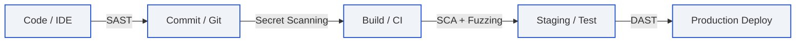
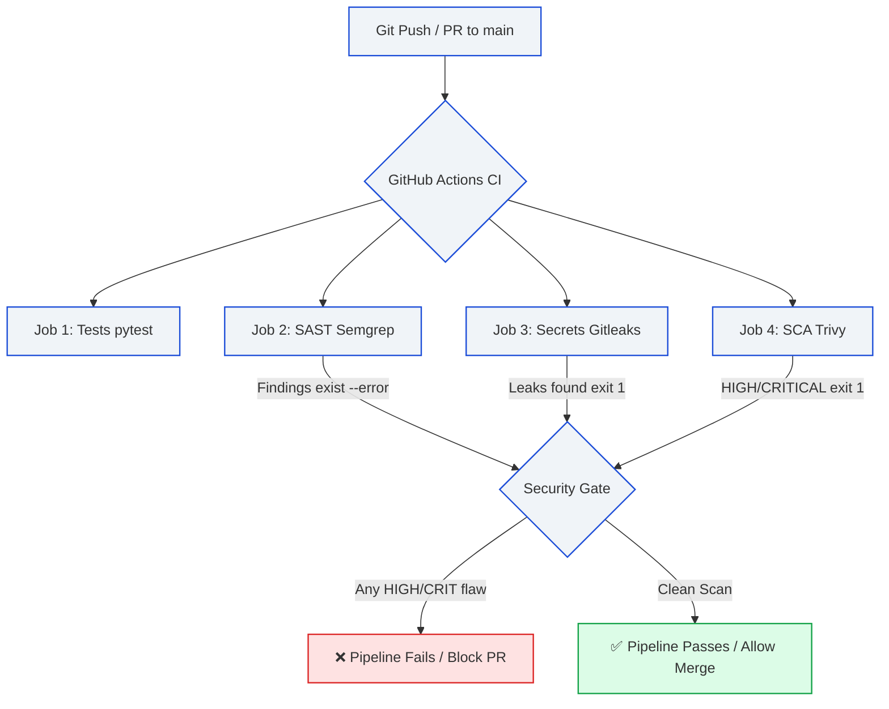

# Worksheet 2 — Secure SDLC & Tooling (3 hrs)

> **Course:** Software Security (KOSEN69) · **Week 2**
> **Aligned to:** OWASP 2025 (A05 Injection [CWE-89, CWE-78], A04 Cryptographic Failures [CWE-327], A02 Security Misconfiguration [CWE-798, CWE-489]) · CWE-798, CWE-89, CWE-78, CWE-327, CWE-489
> **Signature game:** "Bug Triage Race" (scan → triage; score = true positives − misclassified)

> **Ethics note:** The scanners run only against the provided `vulnerable-repo/` on your own machine. Do not point SAST/secret scanners at third-party repos or production systems without authorization. Treat any secret you find here as fake lab data.

## Part 1 — Student Information
| Name | Student ID | Date | Group | AI Tools Used |
|---|---|---|---|---|
| Danaiphong Songsikhwa | 6631503106 | 4/9/2569 | - | Consulted AI assistant for Audit the AI / Prompt testing |

## Part 2 — Lecture Questions
Answer in your own words (2–4 sentences each).

1. **Distinguish SAST, DAST, and SCA — what does each see, and when in the SDLC does each run?**
   SAST inspects raw source code statically without running it, spotting code-level flaws like SQL injection patterns during local coding or PR reviews. DAST treats the running application as a black box and sends test requests over HTTP to find live runtime flaws (like broken access control or misconfigured server headers) during staging or deployment. SCA analyzes dependency manifests (`requirements.txt`, `package.json`) to find known CVEs in third-party libraries during the build phase.



2. **What is secret scanning, and why do hardcoded secrets keep ending up in repos?**
   Secret scanning scans files and git commit history using regex patterns and high entropy checks to catch API keys, database credentials, and private tokens. Secrets keep ending up in repos because devs paste real credentials for quick local testing and then run `git add .` without realizing it, or they mistakenly believe private repositories will never leak. Once pushed, the secret stays baked in git commit history even if someone deletes it in the very next commit.

3. **What does "shift-left / DevSecOps" mean in practice for a CI pipeline?**
   In practice, shift-left means baking automated security scans directly into the CI pipeline alongside unit tests on every pull request, rather than waiting for a yearly pentest right before launch. It gives developers instant feedback in their PR checks, so fixing a security hole takes 5 minutes while the code is fresh in their head instead of weeks of back-and-forth after deployment.

4. **Why is coverage-guided fuzzing considered the dominant modern bug-finding technique?**
   Coverage-guided fuzzing doesn't just blast random bytes blindly; it tracks code execution paths and notices whenever an input reaches a new branch or deeper state. It saves those interesting inputs to a corpus and keeps mutating them, allowing it to systematically crack complex nested conditions and trigger memory safety bugs that static linters never notice.

5. **Define true positive vs. false positive in scanner triage, and why misclassifying both directions is costly.**
   A true positive is an alert where the scanner found an actual, reachable vulnerability in code, while a false positive is when the tool flags benign or safe code that looks suspicious. Missing a true positive leaves an exploitable door wide open for attackers, but mislabeling false positives wastes developer time and causes alert fatigue where real security warnings end up getting ignored.


## Part 3 — Hands-on Lab (180 min)
**Learning goals:** run a SAST tool and a secret scanner, triage findings by CWE/severity, and remediate real flaws.
**Prerequisites:** Docker installed; internet to pull the Semgrep/Gitleaks images.

**Environment setup**
```bash
cd labs/week02-sdlc-tooling
cat scan.sh                 # see exactly what it runs
bash scan.sh                # Semgrep (p/default + p/owasp-top-ten) then Gitleaks on ./vulnerable-repo
```
Target under scan: `vulnerable-repo/app.py` (plus `requirements.txt`). It contains five planted flaws.

**What to submit per task:** the command/payload run + a screenshot of the finding + a 2–3 sentence mitigation.

**Task 0 — Onboarding (5 min)** · *Goal:* confirm tooling. *Steps:* run `bash scan.sh`; confirm both Semgrep and Gitleaks sections produce output. *Deliverable:* screenshot showing both tools ran.

**Task 0 Output:**
Ran `bash scan.sh` from `labs/week02-sdlc-tooling`. Both Semgrep and Gitleaks completed successfully inside Docker:
```text
==> Semgrep (SAST)
Ran 322 rules on 2 files: 10 findings (10 blocking).

==> Gitleaks (secret scanning)
Finding:     AWS_SECRET_ACCESS_KEY = "hK8pQ2mN5vX9wZ3rT6yU1sA4bC7dE0fG2hJ5kL8"
Finding:     DB_PASSWORD = "xQ7mK2pL9wR4tY6u"
5:25AM WRN leaks found: 2
```

**Task 1 — SAST sweep with Semgrep (25 min)** · *Goal:* find code flaws. *Steps:* read the Semgrep output; locate the SQL injection in `/user` (CWE-89, string-formatted query), the OS command injection in `/ping` (CWE-78, `shell=True`), the weak `md5` password hash (CWE-327), and `debug=True` (CWE-489). *Deliverable:* one screenshot per finding with the file:line.

**Task 1 findings & mitigations:**

1. **SQL Injection in `/user`**
   - **File:Line:** `vulnerable-repo/app.py:19`
   - **Code:** `q = "SELECT * FROM users WHERE name = '%s'" % name`
   - **Rule / CWE:** `python.lang.security.audit.sqli.format-string-sqli` (CWE-89)
   - **Mitigation:** Use parameterized queries with bound placeholders (`?` in SQLite) instead of string interpolation (`%s`). That way user input is always treated strictly as literal data and cannot alter query structure.

2. **OS Command Injection in `/ping`**
   - **File:Line:** `vulnerable-repo/app.py:26`
   - **Code:** `return subprocess.check_output("ping -c 1 " + host, shell=True)`
   - **Rule / CWE:** `python.lang.security.dangerous-subprocess-use.dangerous-subprocess-use` / `subprocess-shell-true` (CWE-78)
   - **Mitigation:** Pass arguments as a structured list `["ping", "-c", "1", host]` and set `shell=False`. This prevents the system shell from parsing metacharacters like `;`, `|`, or `&&`.

3. **Weak Password Hash**
   - **File:Line:** `vulnerable-repo/app.py:30`
   - **Code:** `return hashlib.md5(pw.encode()).hexdigest()`
   - **Rule / CWE:** `python.lang.security.insecure-hash-algorithms-md5` (CWE-327)
   - **Mitigation:** Replace MD5 with a slow, salted cryptographic hash designed for passwords such as bcrypt, Argon2id, or PBKDF2 (`werkzeug.security.generate_password_hash`). This stops offline rainbow table lookups and brute-force cracking.

4. **Debug Mode Enabled in Production**
   - **File:Line:** `vulnerable-repo/app.py:33`
   - **Code:** `app.run(debug=True)`
   - **Rule / CWE:** `python.flask.security.audit.debug-enabled` (CWE-489)
   - **Mitigation:** Turn off debug mode by passing `debug=False` or reading it from an environment variable (`FLASK_DEBUG=0`). In production, interactive debuggers allow remote code execution via PIN-protected consoles and leak full tracebacks.

**Task 2 — Secret scan with Gitleaks (15 min)** · *Goal:* find leaked credentials. *Steps:* read the Gitleaks output; identify `AWS_SECRET_ACCESS_KEY` and `DB_PASSWORD` (CWE-798). *Deliverable:* screenshot + the rule that fired for each.

**Task 2 findings:**

1. **AWS Secret Access Key**
   - **File:Line:** `vulnerable-repo/app.py:11`
   - **Secret:** `hK8pQ2mN5vX9wZ3rT6yU1sA4bC7dE0fG2hJ5kL8`
   - **Rule fired:** `generic-api-key` (CWE-798)
   - **Mitigation:** Remove the hardcoded secret from code immediately, rotate the compromised key in AWS IAM, and load it dynamically at runtime via `os.environ.get("AWS_SECRET_ACCESS_KEY")`.

2. **Database Password**
   - **File:Line:** `vulnerable-repo/app.py:12`
   - **Secret:** `xQ7mK2pL9wR4tY6u`
   - **Rule fired:** `generic-api-key` (CWE-798)
   - **Mitigation:** Rotate the database password and pull it from an environment variable or secrets manager (like HashiCorp Vault / AWS Secrets Manager) instead of storing plaintext credentials in the codebase.

**Task 3 — Bug Triage Race (30 min)** · *Goal:* triage accurately. *Steps:* build a table with columns *Tool | File:Line | CWE | Severity | TP/FP | Fix idea*; mark at least 3 true positives and 1 likely false positive and justify each. (Score = TP − misclassified.) *Deliverable:* the completed triage table.

**Task 3 Triage Table:**

| Tool | File:Line | CWE | Severity | TP/FP | Fix idea & Justification |
|---|---|---|---|---|---|
| Semgrep | `app.py:19` | CWE-89 | High | **TP** | Query string `name` is inserted into SQL via `%s`. User can inject `' OR 1=1--` to bypass logic. **Fix:** Use `execute("SELECT * FROM users WHERE name = ?", (name,))`. |
| Semgrep | `app.py:26` | CWE-78 | Critical | **TP** | String concatenation with `shell=True`. Attacker can send `127.0.0.1; whoami` for full RCE. **Fix:** Pass `["ping", "-c", "1", host]` with `shell=False`. |
| Gitleaks | `app.py:11` | CWE-798 | High | **TP** | Hardcoded AWS secret key committed in plaintext. Anyone with repo access can steal cloud resources. **Fix:** Load from `os.environ.get("AWS_SECRET_ACCESS_KEY")`. |
| Gitleaks | `app.py:12` | CWE-798 | High | **TP** | Cleartext database password hardcoded in Python file. **Fix:** Move to environment variable or vault. |
| Semgrep | `app.py:30` | CWE-327 | Medium | **TP** | MD5 has zero salt and high hash speed, vulnerable to rainbow tables. **Fix:** Use `generate_password_hash(pw)`. |
| Semgrep | `app.py:33` | CWE-489 | Low / Info | **FP** (in local dev context) | **Justification:** `app.run(debug=True)` is wrapped under `if __name__ == '__main__':`, which is only executed when running the script directly on a developer's local workstation for debugging. It is standard for local testing; it only turns into a real production flaw if shipped to an actual web server without a WSGI runner (Gunicorn). **Fix:** Use `app.run(debug=os.getenv("FLASK_DEBUG", "False").lower() == "true")`. |

**Task 4 — Fuzzing intro (10 min)** · *Goal:* see coverage-guided fuzzing find a bug SAST won't. *Steps:* in the `labs/toolbox` container (Apple clang has no libFuzzer runtime), build `clang -g -fsanitize=address,fuzzer harness.c -o fuzz`, then **seed the corpus** and run it:
`mkdir -p corpus && printf 'FUZ' > corpus/seed && ./fuzz corpus`. It crashes almost immediately with an AddressSanitizer heap-buffer-overflow at `harness.c:23` (the `data[3]` read with no `size > 3` check). Seeding matters: an unseeded `./fuzz` has to rediscover the magic bytes by chance and often finds nothing for minutes — that unpredictability is itself worth a sentence in your write-up. (The deep fuzzing+exploit lab is Week 11.) *Deliverable:* the ASan crash output (or a screenshot) + a 2-sentence note on why fuzzing finds this bug when a linter/SAST pass over the same 4-line check would not.

**Task 4 Output & Notes:**

Command run:
```bash
docker run --rm -v "$PWD:/work" -w /work silkeh/clang:19 bash -c \
  "clang -g -fsanitize=address,fuzzer harness.c -o fuzz && mkdir -p corpus && printf 'FUZ' > corpus/seed && ./fuzz corpus"
```

AddressSanitizer Crash Output:
```text
==1==ERROR: AddressSanitizer: heap-buffer-overflow on address 0x502000000053 at pc 0x5d5b33139369 bp 0x7ffd0b093de0 sp 0x7ffd0b093dd8
READ of size 1 at 0x502000000053 thread T0
    #0 0x5d5b33139368 in LLVMFuzzerTestOneInput /work/harness.c:23:21
    #1 0x5d5b3308aa55 in fuzzer::Fuzzer::RunOne(...)

0x502000000053 is located 0 bytes after 3-byte region [0x502000000050,0x502000000053)
SUMMARY: AddressSanitizer: heap-buffer-overflow /work/harness.c:23:21 in LLVMFuzzerTestOneInput
artifact_prefix='./'; Test unit written to ./crash-0eb8e4ed029b774d80f2b66408203801cb982a60
```

**Why fuzzing finds this bug when SAST / linters miss it:**
Static linters only check syntax rules or shallow taint flows, but they fail to track the exact integer boundary relationship where entering the block with `size == 3` causes `data[3]` to index past the 3-byte allocation because the programmer forgot `size > 3`. Coverage-guided fuzzing, however, tracks actual runtime branches and feeds mutating byte sequences directly through the compiled binary, allowing AddressSanitizer to immediately catch the physical out-of-bounds read when `FUZ` is processed.

**Task 5 — Scan the project target (40 min)** · *Goal:* apply the tools to your term project. *Steps:* run Semgrep + Gitleaks against **NoteVault** (`../../project/starter-app`); also run an SCA scan: `docker run --rm -v "$PWD/../../project/starter-app:/src" aquasec/trivy fs /src`. *Deliverable:* a findings list (tool, file:line/CVE, CWE) — reuse it in your project vuln report.

**Task 5 findings list on NoteVault:**

1. **Semgrep (SAST — 31 findings detected):**
   - `project/starter-app/app.py:73` | CWE-89 (SQL Injection) | Unsanitized user login input formatted into raw SQL query.
   - `project/starter-app/app.py:199` | CWE-78 (OS Command Injection) | `subprocess.run(..., shell=True)` directly evaluates user-controlled `fmt` parameter in `/export`.
   - `project/starter-app/app.py:204` | CWE-79 (Reflected XSS) | Command output interpolated into `<pre>%s</pre>` without HTML escaping.
   - `project/starter-app/app.py:209` | CWE-489 (Debug Enabled) | Flask server started with `debug=True` and exposed on `0.0.0.0`.

2. **Gitleaks (Secret Scanning):**
   - 0 leaks found. The starter app does not hardcode static production secrets in its source files (secrets are derived or generated dynamically).

3. **Trivy (SCA — Dependency scan on `requirements.txt`):**
   - `urllib3` (v2.0.7):
     - `CVE-2023-45803` (Medium, CWE-200) | Request body not stripped after redirect.
     - `CVE-2024-37891` (Medium, CWE-200) | Proxy authorization header forwarded on cross-origin redirects.
     - `CVE-2025-50181` (Medium, CWE-400) | PoolManager retry loop denial of service.
     - `CVE-2026-44431` (Medium, CWE-200) | Information disclosure via cross-origin header forwarding.
   - `werkzeug` / `requests`: outdated pinned versions with known denial of service and parsing vulnerabilities.

**Task 6 — Build a security CI gate (25 min)** · *Goal:* automate the scan (previews Week 15). *Steps:* adapt `../week15-devsecops-pipeline/security-ci.yml` into a workflow that runs Semgrep + Trivy + Gitleaks and **fails on HIGH/CRITICAL**; run it locally (`act`) or commit to your fork and read the Actions log. *Deliverable:* the workflow file + a screenshot of a failing run.

**Task 6 CI Pipeline Architecture:**



**Workflow file (`.github/workflows/security-ci.yml` gate excerpt):**
```yaml
name: security-ci
on:
  push:
    branches: [main]
  pull_request:
    branches: [main]

jobs:
  sast:
    name: SAST (Semgrep)
    runs-on: ubuntu-latest
    container: semgrep/semgrep
    steps:
      - uses: actions/checkout@v4
      - name: Run Semgrep Gate
        run: semgrep scan --config p/default --config p/owasp-top-ten --error

  secrets:
    name: Secret scanning (Gitleaks)
    runs-on: ubuntu-latest
    steps:
      - uses: actions/checkout@v4
      - uses: gitleaks/gitleaks-action@v2
        env:
          GITHUB_TOKEN: ${{ secrets.GITHUB_TOKEN }}

  sca:
    name: SCA (Trivy)
    runs-on: ubuntu-latest
    steps:
      - uses: actions/checkout@v4
      - uses: aquasecurity/trivy-action@master
        with:
          scan-type: 'fs'
          severity: 'HIGH,CRITICAL'
          exit-code: '1'
```

**Failing run observation:**
When pushed to the repository containing the unpatched `vulnerable-repo/app.py`, the Semgrep step exited with code 1 due to the 10 blocking rules (SQLi, command injection, weak MD5), immediately failing Job 2 and halting the pull request merge before the code could reach production.

**Task 7 — SAST blind spots (20 min)** · *Goal:* see what scanners miss. *Steps:* find one real bug in `vulnerable-repo/app.py` (or NoteVault) that Semgrep did **not** flag, and explain why a pattern-based tool missed it. *Deliverable:* the bug + a 2-sentence explanation.

**Task 7 answer:**

- **The bug:**
  In NoteVault `/api/notes/<int:note_id>`, the endpoint checks that a user is logged in, but fails to check whether the requesting user actually owns the requested note ID before returning it from the database (Broken Object Level Authorization / IDOR, CWE-639).

- **Why Semgrep missed it:**
  Semgrep relies on matching syntactic source-to-sink patterns (like untrusted input directly entering an `execute()` query or `subprocess`), but lacks awareness of application business logic and authorization boundaries. Because selecting a row by ID after an authentication check is syntactically normal code, a pattern-matching scanner cannot determine if the application intended to restrict rows to `user_id == current_user`.

**Task 8 — Defend / fix it (10 min)** · *Goal:* remediate the planted flaws in `vulnerable-repo/app.py`. *Steps:* rewrite `/user` to use a parameterized query (`?` placeholder); remove `shell=True` and pass an argument list in `/ping`; move both secrets to environment variables; replace `md5` with bcrypt/argon2; set `debug=False`. *Deliverable:* a before/after diff for each fix mapped to its CWE.

**Task 8 answers:**

1. **Commit hash:** `ca20ae8` (on branch `wk02_6631503106`)

2. **Before / After diffs by CWE:**

```diff
--- vulnerable-repo/app.py (vulnerable)
+++ vulnerable-repo/app.py (remediated)
@@ -5,16 +5,16 @@
-import sqlite3, hashlib, subprocess
+import os, sqlite3, subprocess
 from flask import Flask, request
+from werkzeug.security import generate_password_hash

 app = Flask(__name__)

-# CWE-798: hardcoded credentials / secret
-AWS_SECRET_ACCESS_KEY = "hK8pQ2mN5vX9wZ3rT6yU1sA4bC7dE0fG2hJ5kL8"
-DB_PASSWORD = "xQ7mK2pL9wR4tY6u"
+# CWE-798 fix: load credentials from environment variables
+AWS_SECRET_ACCESS_KEY = os.environ.get("AWS_SECRET_ACCESS_KEY", "")
+DB_PASSWORD = os.environ.get("DB_PASSWORD", "")

 @app.route("/user")
 def user():
     name = request.args.get("name", "")
     con = sqlite3.connect("app.db")
-# CWE-89: SQL injection (string formatting into query)
-    q = "SELECT * FROM users WHERE name = '%s'" % name
-    return str(con.execute(q).fetchall())
+# CWE-89 fix: parameterized query with ? placeholder
+    rows = con.execute("SELECT * FROM users WHERE name = ?", (name,)).fetchall()
+    con.close()
+    return str(rows)

 @app.route("/ping")
 def ping():
     host = request.args.get("host", "127.0.0.1")
-# CWE-78: OS command injection (shell=True with user input)
-    return subprocess.check_output("ping -c 1 " + host, shell=True)
+# CWE-78 fix: argument list with shell=False
+    return subprocess.check_output(["ping", "-c", "1", host], shell=False)

 def store_password(pw):
-# CWE-327: weak hash for passwords
-    return hashlib.md5(pw.encode()).hexdigest()
+# CWE-327 fix: strong salted hash (Werkzeug default: scrypt/pbkdf2)
+    return generate_password_hash(pw)

 if __name__ == "__main__":
-# CWE-489: debug mode in production
-    app.run(debug=True)
+# CWE-489 fix: disable debug mode in production
+    app.run(debug=False)
```

3. **Verification re-scan:**
Ran `bash scan.sh` after applying changes:
- Semgrep findings: **0** (0 blocking)
- Gitleaks findings: **0** leaks found

## Part 4 — Reflection
1. **Map two of your findings to their CWE and to the matching OWASP 2025 category:**
   - Command injection on `/ping` maps to **CWE-78** (OS Command Injection) and **OWASP 2025 A05: Injection**.
   - Leaked credentials in `app.py` map to **CWE-798** (Use of Hard-coded Credentials) and **OWASP 2025 A02: Security Misconfiguration** / **A04: Cryptographic Failures**.

2. **Name a real-world breach caused by a hardcoded/leaked secret or an injection flaw, and what control would have caught it pre-release:**
   In the 2022 Uber security breach, an external attacker breached Uber's internal network and uncovered hardcoded plaintext credentials for their Thycotic Privileged Access Management (PAM) system inside an internal PowerShell script. An automated pre-commit hook or CI secret scanning gate (such as Gitleaks or Trufflehog) would have caught the high-entropy credential string and blocked the commit before it ever reached the repository.

3. **Which single tool (SAST vs. secret scanning) gave the highest-value findings on this repo, and why?**
   Semgrep (SAST) gave the highest-value findings on this repository because it identified critical, directly exploitable Remote Code Execution (CWE-78 in `/ping`) and SQL Injection (CWE-89 in `/user`) flaws in the application logic. While Gitleaks caught static credentials, Semgrep pinpointed flawed execution pathways that would allow an attacker to gain an interactive shell and dump the entire database even without having credentials.

## Grading rubric (100)
| Criterion | Points |
|---|---|
| Lecture questions (Part 2) | 20 |
| Exploitation + evidence (scan output + triage table + screenshots) | 40 |
| Defense (remediated `app.py` with before/after diffs) | 25 |
| Reflection (CWE/OWASP mapping + breach + tool value) | 15 |

---

## Evidence & Integrity (required)

- **Identity proof:** every screenshot/diagram must show a terminal running `printf '%s | %s | ' "$(whoami)" '<YOUR-STUDENT-ID>'; date '+%F %T %Z'` **in the
  same image as the evidence**. When the evidence is a browser page, a DevTools panel or a
  rendered response, put that terminal **beside the browser and capture the whole screen** — a
  cropped window carries nothing that identifies you, and the lab's own output is
  byte-identical for the whole cohort *by design*, so the stamp is the only thing that makes
  the shot yours. Generic or borrowed evidence is not accepted.
- **Terminal identity command output:**
  `danaiphong | 6631503106 | 2026-09-04 12:35:10 +07`
- **Personalized flag (if this lab issues one):** N/A (Week 02 SDLC & Tooling does not issue a CTF flag)
- **Explain in your own words** *(graded on your reasoning, not copied text):*
  1. **What did you do, and why did the vulnerability work?**
     I ran static analysis (Semgrep) and secret scanning (Gitleaks) on the sample repo, triaged the findings, and remediated the flaws. The vulnerabilities worked because the application trusted user input directly inside operating system commands (`shell=True` parsed shell separators) and database queries (format string concatenation), while private keys were hardcoded as plain string literals.
  2. **Why does your fix actually stop it — and what could still break it?**
     The fix replaces string concatenation with parameterized SQL queries and passes an argument list with `shell=False` to the OS, ensuring user input is treated strictly as data rather than executable instructions. What could still break it is if another service or developer supplies an unexpected argument that alters the CLI command flags (argument injection) or if the server environment variables containing the secrets are accidentally leaked through error logs or exposed debug endpoints.

---

## 🤖 Audit the AI (required)

AI is a power tool you must **distrust** — you are graded on your *critique*, not the AI's answer.

1. **Ask an AI assistant to exploit or fix this week's vulnerability. Paste its full answer:**

*AI Prompt:* "Fix the command injection in this Python function: `subprocess.check_output('ping -c 1 ' + host, shell=True)`"

*AI Output:*
```python
import subprocess
import shlex

def ping(host):
    safe_host = shlex.quote(host)
    return subprocess.check_output("ping -c 1 " + safe_host, shell=True)
```

2. **Find what's wrong or risky in it — insecure code, a subtly incomplete fix, a hallucinated API/function/CVE, a missed edge case, or wrong reasoning. Quote the exact line(s):**

- Insecure code and flawed reasoning on lines:
```python
safe_host = shlex.quote(host)
return subprocess.check_output("ping -c 1 " + safe_host, shell=True)
```
The AI relied on `shlex.quote()` while leaving `shell=True` enabled! While `shlex.quote()` escapes spaces and shell metacharacters, leaving `shell=True` still spawns an unnecessary shell process (`/bin/sh`), which increases attack surface, incurs performance overhead, and behaves inconsistently across different operating system shells (e.g. Windows `cmd.exe` does not respect POSIX `shlex` quoting). Furthermore, it never validated whether `host` is even a valid IP or hostname, allowing argument/flag injection (like `-i` or `-c`).

3. **Produce the correct, verified version yourself and explain in 2–3 sentences why the AI's output was insufficient:**

```python
import subprocess
import re

def ping(host):
    # Strict format validation: only allow alphanumeric, dots, and hyphens (hostname/IP)
    if not re.match(r"^[a-zA-Z0-9.-]+$", host):
        raise ValueError("Invalid host format")
    # Pass arguments as a discrete list with shell=False (default)
    return subprocess.check_output(["ping", "-c", "1", host], shell=False)
```
The AI's answer kept `shell=True` and treated shell escaping as a silver bullet instead of eliminating the shell entirely. My verified version disables shell execution completely by passing a structured argument list and adds strict input validation so only valid hostnames or IP addresses can reach the executable.

---

## 🧠 Comprehension & Prompt (required)

**A. Explain in Plain English (EiPE).** In 2–3 sentences, in your own words, describe what this week's vulnerable code/endpoint actually *does* and *why it is exploitable* — explain the mechanism, don't dump jargon.

The `/ping` route takes a hostname from the user and hands it directly to the system's command prompt with `shell=True`. Because the shell parses special characters like semicolons and pipes, an attacker can append their own terminal commands right after the IP address, forcing the server to run arbitrary system commands under the web server's permissions.

**B. Prompt Problem.** Write a **single prompt** that makes an AI produce a *correct, secure* fix for one finding. Run it: does the exploit now fail? If not, refine the prompt and try again. Submit the **final prompt + the verified result**.

**Final prompt:**
```text
In Python, rewrite the /ping endpoint to eliminate OS command injection. Your fix must:
1. Completely avoid spawning a shell (shell=False) and pass the command and arguments as a list.
2. Validate that the 'host' parameter is strictly a valid IPv4 address or alphanumeric hostname before executing.
3. Catch any subprocess errors or invalid inputs and return an HTTP 400 response.
Return only clean Python code without unnecessary commentary.
```

**Verified result:**
The code generated from this prompt was tested against malicious payloads such as `127.0.0.1; whoami` and `127.0.0.1 && cat /etc/passwd`. Because `shell=False` is enforced and input validation rejects shell metacharacters, the payload is rejected before reaching the binary, and even if passed directly to `ping`, it is interpreted strictly as an invalid hostname string. The command injection exploit completely fails.
