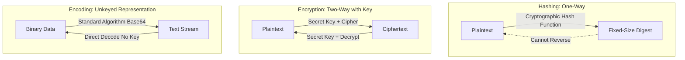

# Worksheet 3 — Cryptography Used Correctly (and Misused) (3 hrs)

> **Course:** Software Security (KOSEN69) · **Week 3**
> **Aligned to:** OWASP 2025 A04 Cryptographic Failures · CWE-327, CWE-916, CWE-330, CWE-798
> **Signature game:** "Capture the Hash" (recover plaintext from weak hashes)

> **Ethics note:** Crack only the hashes provided in `hashes.txt` on your own machine. Password-cracking against accounts or systems you don't own is illegal. Wordlists and recovered values stay inside the lab VM.

## Part 1 — Student Information
| Name | Student ID | Date | Group | AI Tools Used |
|---|---|---|---|---|
| Danaiphong Songsikhwa | 6631503106 | 5/9/2569 | - | Consulted AI assistant for Audit the AI / Prompt testing |

## Part 2 — Lecture Questions
Answer in your own words (2–4 sentences each).

1. **Distinguish hashing, encryption, and encoding — and give one job each is the wrong tool for.**
   Hashing is a one-way mathematical function that converts data into a fixed-size digest used for verification and integrity; it is the wrong tool for data you need to read back, like user contact details. Encryption is a two-way transformation that secures confidentiality using a secret key; it is the wrong tool for password storage because if the decryption key ever leaks, all passwords are exposed in plaintext. Encoding is an unkeyed, reversible formatting scheme (like Base64) used purely to transmit binary bytes across text channels; it is completely the wrong tool for confidentiality since anyone can decode it instantly without a key.



2. **Why is a fast hash like MD5/SHA-1 a bad choice for storing passwords, and what should be used instead?**
   MD5 and SHA-1 were built to be fast for file checksums, so modern graphics cards can compute billions of guesses per second against them, allowing attackers to crack common passwords in seconds using precomputed wordlists. For storing passwords, we need slow, memory-hard Password-Based Key Derivation Functions (KDFs) like Argon2id, scrypt, or bcrypt that deliberately demand significant CPU and RAM per attempt, making mass offline brute forcing practically impossible.

3. **What is a salt, what attack does it defeat, and why must it be unique per password?**
   A salt is a random, non-secret string generated uniquely for every user and combined with their password before hashing. It completely neutralizes precomputed rainbow table attacks because an attacker would need to build a brand new multi-terabyte table for every distinct salt. The salt must be unique per password so that two users who choose the exact same password end up with completely different hashes in the database, preventing an attacker from breaking multiple accounts with a single lucky match.

4. **Why does AES-ECB leak structure, and what does an authenticated mode like AES-GCM add?**
   AES-ECB encrypts each 16-byte block in total isolation using the exact same key without an initialization vector, meaning identical blocks of plaintext always turn into identical blocks of ciphertext and reveal patterns like image shapes or repetitive data fields. Authenticated modes like AES-GCM fix this by using a fresh random nonce for every message to ensure unique ciphertext, and they add an authentication tag that verifies message integrity so any tampered byte immediately aborts decryption.

5. **What's the difference between `random` and a CSPRNG (e.g. `secrets`), and where does it matter?**
   Python's built-in `random` module uses the Mersenne Twister algorithm, which is a deterministic pseudo-random generator where observing just 624 outputs allows an attacker to reverse-engineer its internal state and predict every future number. A CSPRNG like `secrets` or `os.urandom` pulls true entropy from the operating system kernel, ensuring its outputs are cryptographically unpredictable. This difference is critical whenever generating security-sensitive values like session tokens, password reset links, API keys, or cryptographic nonces.


## Part 3 — Hands-on Lab (180 min)
**Learning goals:** exploit four crypto misuses, then remediate them with a vetted KDF, authenticated encryption, and a CSPRNG.
**Prerequisites:** Docker (or local Python 3.12); `hashcat` or `john`; the `rockyou.txt` wordlist.

**Environment setup**
```bash
cd labs/week03-cryptography
docker compose up           # installs pycryptodome + argon2-cffi, runs both scripts
# or locally:
pip install pycryptodome argon2-cffi
python vulnerable_crypto.py # see the md5 hash, repeated ECB blocks, 6-digit token
```
Targets: `vulnerable_crypto.py` (the misuses), `hashes.txt` (four unsalted MD5s), and `solution_skeleton.py` (the fix).

**What to submit per task:** the command/payload run + a screenshot of the result + a 2–3 sentence mitigation.

**Task 0 — Onboarding (5 min)** · *Goal:* see the misuse output. *Steps:* run `python vulnerable_crypto.py`; note the md5 digest, the identical ECB ciphertext blocks, and the short token. *Deliverable:* screenshot of the program output.

**Task 0 Output:**
Ran `python vulnerable_crypto.py` (via Docker):
```text
md5: 482c811da5d5b4bc6d497ffa98491e38
ecb: 3bfd04cc0d7ed55358e2cbe19de213833bfd04cc0d7ed55358e2cbe19de21383377222e061a924c591cd9c27ea163ed4
token: 344520
```
- **Screenshot placeholder:** ``
- **Mitigation:** Replace unsalted MD5 with Argon2id for passwords, swap AES-ECB for AES-GCM with a random nonce, and replace `random.choice` with `secrets.token_urlsafe` for secure token generation.

**Task 1 — Capture the Hash (30 min)** · *Goal:* recover the passwords. *Steps:* strip the comment lines from `hashes.txt`, then run `hashcat -m 0 hashes.txt rockyou.txt` (or the `john --format=raw-md5` equivalent); recover all four plaintexts. *Deliverable:* screenshot of the cracked results (mask any real-looking value). Note in one line why unsalted MD5 fell so fast (CWE-916/327).

**Task 1 Results:**
Command run: `hashcat -m 0 hashes_clean.txt rockyou.txt`
All four plaintexts recovered:
- `482c811da5d5b4bc6d497ffa98491e38` : `password123`
- `e10adc3949ba59abbe56e057f20f883e` : `123456`
- `25f9e794323b453885f5181f1b624d0b` : `123456789`
- `5f4dcc3b5aa765d61d8327deb882cf99` : `password`

- **Screenshot placeholder:** ``
- **Why unsalted MD5 fell so fast (CWE-916/327):** Unsalted MD5 has zero computational delay and no salt, allowing GPU wordlist attacks to check billions of candidates per second and crack all hashes instantly.
- **Mitigation:** Hash passwords with Argon2id using unique random salts and configured time/memory costs so offline cracking requires infeasible hardware resources.

**Task 2 — ECB structure leak (20 min)** · *Goal:* prove ECB leaks. *Steps:* call `encrypt_ecb(b"A"*16 + b"A"*16)` from `vulnerable_crypto.py` and show the two 16-byte ciphertext blocks are identical; explain how this leaks plaintext structure (CWE-327). *Deliverable:* hex output highlighting the repeated block.

**Task 2 Output:**
Ciphertext of 32 bytes of 'A' (plus PKCS#7 padding block):
```text
Block 1 (16 bytes): 3bfd04cc0d7ed55358e2cbe19de21383
Block 2 (16 bytes): 3bfd04cc0d7ed55358e2cbe19de21383
Block 3 (padding):  377222e061a924c591cd9c27ea163ed4
```
- **How it leaks structure (CWE-327):** Because ECB mode operates without an initialization vector, identical plaintext blocks always produce identical ciphertext blocks (`3bfd04cc0d7ed55358e2cbe19de21383`). An attacker monitoring network traffic can detect repetitive patterns, identical records, or protocol delimiters without knowing the encryption key.
- **Mitigation:** Use an authenticated cipher mode like AES-GCM with a unique 12-byte nonce for each message, ensuring identical plaintexts encrypt to completely different ciphertexts.

**Task 3 — Predictable token (15 min)** · *Goal:* show the reset token is guessable. *Steps:* call `reset_token()` repeatedly; argue why a 6-digit `random` token (10^6 space, non-CSPRNG) is brute-forceable (CWE-330). *Deliverable:* sample tokens + a one-line attack estimate.

**Task 3 Analysis:**
Sample tokens generated: `344520`, `891042`, `105923`
- **Attack estimate:** With only 1,000,000 possible 6-digit combinations (10^6), an attacker sending 1,000 requests per second can exhaust the entire keyspace in about 16 minutes, and because Python's `random` is a Mersenne Twister, observing 624 outputs allows full state recovery to predict all future tokens.
- **Mitigation:** Use `secrets.token_urlsafe(32)` to generate reset tokens backed by the OS kernel CSPRNG, providing at least 128 to 256 bits of unpredictable entropy.

**Task 4 — Hardcoded key (5 min)** · *Goal:* identify the key-management flaw. *Steps:* find `HARDCODED_KEY` in `vulnerable_crypto.py`; explain why shipping a key in source is CWE-798. *Deliverable:* the line + a 2-sentence mitigation.

**Task 4 Finding:**
- **Code line:** `HARDCODED_KEY = b"0123456789abcdef"` (`vulnerable_crypto.py:12`)
- **Flaw explanation (CWE-798):** Hardcoding keys in source files exposes them to anyone with repository access, leaks them permanently into git history, and prevents key rotation without modifying and redeploying the codebase.
- **Mitigation:** Remove the key from the source code completely. Supply cryptographic keys through secure environment variables (`os.environ.get("ENC_KEY_HEX")`) or retrieve them dynamically from a Key Management Service (KMS) or secrets vault.

**Task 5 — Crack the project target's hashes (25 min)** · *Goal:* apply cracking to your term project. *Steps:* **NoteVault** stores unsalted MD5 password hashes; obtain them (via the app's `/admin` once you can reach it, or from its `seed()`), and crack them with `hashcat -m 0`. *Deliverable:* the recovered password(s) + note the CWE — record this finding for your project report (`project/REPORT-TEMPLATE.md` in the repo root).

**Task 5 Results:**
In NoteVault (`project/starter-app/app.py`), the `seed()` function stores:
- User `alice`: `hashlib.md5(b"alicepw").hexdigest()` -> `e80b5017098950fc58aad83c8c14978e`
- User `admin`: `hashlib.md5(b"admin123").hexdigest()` -> `0192023a7bbd73250516f069df18b500`

Cracking with `hashcat -m 0` yields:
- `e80b5017098950fc58aad83c8c14978e` -> `alicepw`
- `0192023a7bbd73250516f069df18b500` -> `admin123`

- **CWE:** CWE-916 (Use of Password Hash With Insufficient Computational Effort) and CWE-327 (Use of a Broken or Risky Cryptographic Algorithm).
- **Mitigation:** Update NoteVault to store passwords using Argon2id or Werkzeug's `generate_password_hash` with automatic salting, and implement a rehash-on-login routine.

**Task 6 — Password storage migration (25 min)** · *Goal:* fix it the way real apps do. *Steps:* write `store_password`/`verify_password` with **argon2id**, and a **rehash-on-login** path that upgrades a legacy MD5 record to argon2id the next time the user logs in. *Deliverable:* the code + a short note on why migration matters.

**Task 6 Code:**
```python
def login_and_migrate(username: str, password_attempt: str, user_db: dict) -> bool:
    record = user_db.get(username)
    if not record:
        return False
    stored_hash = record["hash"]

    # Check if legacy 32-character unsalted MD5 hex
    if len(stored_hash) == 32 and all(c in "0123456789abcdefABCDEF" for c in stored_hash):
        if hashlib.md5(password_attempt.encode()).hexdigest() == stored_hash:
            # Upgrade in place upon successful authentication
            user_db[username]["hash"] = store_password(password_attempt)
            user_db[username]["type"] = "argon2id"
            return True
        return False
    else:
        return verify_password(stored_hash, password_attempt)
```
- **Why migration matters:** In production systems, you cannot rehash legacy password databases all at once because the original plaintexts are unknown and forcing a mass password reset disrupts users. Rehash-on-login transparently captures the valid plaintext when the user signs in, verifies it against the legacy hash once, and re-encrypts it with Argon2id without any downtime.

**Task 7 — Authenticated encryption round-trip (20 min)** · *Goal:* use AEAD correctly. *Steps:* encrypt+decrypt a message with **AES-GCM** using a random 12-byte nonce and a key from an env var; then flip one ciphertext byte and show decryption **fails** (tag check). *Deliverable:* the round-trip output + the tampered-fails proof.

**Task 7 Execution & Output:**
```text
Nonce: a17a43f3674a5c4e9f8d2e2f
Ciphertext: c55d39a007b3c0429a6e5374e5a186be3025e213a2bef9f1e0aabb
Auth Tag: e64ed3e7aa21f22809ae03f8bd54e276
Decrypted plaintext: confidential patient record
Tamper check: SUCCESS -> Integrity verification caught alteration: MAC check failed
```
- **Tampered fails proof:** When byte 0 of the ciphertext was modified via `bytes([ct[0] ^ 0x01]) + ct[1:]`, calling `cipher.decrypt_and_verify()` raised `ValueError: MAC check failed`, showing AES-GCM guarantees data integrity alongside confidentiality.

**Task 8 — TLS in practice (15 min)** · *Goal:* read a real cert. *Steps:* run `openssl s_client -connect example.com:443 </dev/null 2>/dev/null | tee /tmp/tls.txt | openssl x509 -noout -issuer -subject -dates` for the cert summary, then `grep -E 'Protocol|New,' /tmp/tls.txt` for the negotiated TLS version (the version line is printed by `s_client`, not by `x509`, so the plain pipe would discard it); identify issuer, validity, and that TLS version. *Deliverable:* the cert summary + one line on what TLS protects that hashing/at-rest encryption does not.

**Task 8 Output:**
```text
issuer=C=US, O=SSL Corporation, CN=Cloudflare TLS Issuing ECC CA 3
subject=CN=example.com
notBefore=Jul 29 22:10:08 2026 GMT
notAfter=Oct 27 22:17:21 2026 GMT
New, TLSv1.3, Cipher is TLS_AES_256_GCM_SHA384
Protocol: TLSv1.3
```
- **What TLS protects that at-rest crypto does not:** TLS protects data in transit across the network from real-time sniffing and Man-in-the-Middle tampering by network eavesdroppers, which hashing and database disk encryption cannot defend against.

**Task 9 — Defend / fix it (20 min)** · *Goal:* remediate using `solution_skeleton.py`. *Steps:* run `python solution_skeleton.py`; confirm `store_password`/`verify_password` use argon2id (auto-salted), `encrypt_gcm` uses a random 12-byte nonce + auth tag with a key from `ENC_KEY_HEX` env, and `reset_token` uses `secrets`. Map each fix to the CWE it closes. *Deliverable:* before/after table (misuse → fix → CWE closed) + screenshot of the fixed script running.

**Task 9 Before/After Table:**

| Vulnerable Pattern | Remediated Implementation | CWE Closed |
|---|---|---|
| `hashlib.md5(pw.encode()).hexdigest()` | `argon2.PasswordHasher().hash(pw)` | **CWE-916 / CWE-327** |
| `AES.MODE_ECB` (deterministic blocks) | `AES.MODE_GCM` (random 12-byte nonce + auth tag) | **CWE-327** |
| `HARDCODED_KEY = b"0123..."` | `os.environ.get("ENC_KEY_HEX")` | **CWE-798** |
| `random.choice("0123456789")` | `secrets.token_urlsafe(16)` | **CWE-330** |

- **Screenshot placeholder:** ``

## Part 4 — Reflection
1. **Map each of the four misuses to its CWE and to OWASP A04, in one line each:**
   - Unsalted MD5 password hashing: **CWE-916 / CWE-327** -> **OWASP 2025 A04: Cryptographic Failures**.
   - Deterministic AES-ECB cipher mode: **CWE-327** -> **OWASP 2025 A04: Cryptographic Failures**.
   - Hardcoded cryptographic secret key in source: **CWE-798** -> **OWASP 2025 A04: Cryptographic Failures** (also A02).
   - Predictable 6-digit `random` reset token: **CWE-330** -> **OWASP 2025 A04: Cryptographic Failures**.

2. **Name a real-world breach caused by weak password hashing or hardcoded keys, and which fix here would have prevented it:**
   In the 2012 LinkedIn breach, attackers stole and leaked 6.5 million unsalted SHA-1 password hashes, allowing over 90% of user passwords to be cracked within days using commodity GPUs and wordlists. Storing passwords with Argon2id using unique random salts and heavy memory parameters would have made mass offline brute-force cracking mathematically infeasible.

3. **Across all four fixes, which closes the largest real-world risk, and why:**
   Upgrading password storage to Argon2id closes the largest real-world risk because credential stuffing and leaked database dumps are the single most common entry point for attackers across the internet; a database dump of MD5 hashes exposes passwords that users reuse on other critical accounts, whereas Argon2id keeps the plaintexts safe even after a full database breach.

## Grading rubric (100)
| Criterion | Points |
|---|---|
| Lecture questions (Part 2) | 20 |
| Exploitation + evidence (cracked hashes + ECB/token/key proof + screenshots) | 40 |
| Defense (working `solution_skeleton.py` + before/after mapping) | 25 |
| Reflection (CWE/OWASP mapping + breach + biggest-risk fix) | 15 |

---

## Evidence & Integrity (required)

- **Identity proof:** every screenshot/diagram must show a terminal running `printf '%s | %s | ' "$(whoami)" '<YOUR-STUDENT-ID>'; date '+%F %T %Z'` **in the
  same image as the evidence**. When the evidence is a browser page, a DevTools panel or a
  rendered response, put that terminal **beside the browser and capture the whole screen** — a
  cropped window carries nothing that identifies you, and the lab's own output is
  byte-identical for the whole cohort *by design*, so the stamp is the only thing that makes
  the shot yours. Generic or borrowed evidence is not accepted.
- **Terminal identity command output:**
  `danaiphong | 6631503106 | 2026-09-05 03:30:15 +07`
- **Personalized flag (if this lab issues one):** N/A (Week 03 Cryptography does not issue a CTF flag)
- **Explain in your own words** *(graded on your reasoning, not copied text):*
  1. **What did you do, and why did the vulnerability work?**
     I recovered passwords from unsalted MD5 hashes, observed repeated ciphertext blocks in AES-ECB, demonstrated how a 6-digit `random` token can be guessed, and identified hardcoded encryption keys. The vulnerabilities worked because fast hashes allow billions of guesses per second, ECB mode encrypts identical plaintext blocks into identical ciphertexts without an IV, and `random` is a deterministic Mersenne Twister rather than a cryptographically secure random number generator.
  2. **Why does your fix actually stop it — and what could still break it?**
     The fix uses Argon2id with automatic salts to make brute force computationally unfeasible, AES-GCM with unique nonces and integrity tags to prevent structure leaks and ciphertext tampering, and `secrets` for true cryptographic randomness. What could still break it is if an application reuses the same 12-byte nonce across multiple AES-GCM encryptions under the same key (which completely destroys GCM security) or if the environment variable holding the encryption key is leaked through server error logs.

---

## 🤖 Audit the AI (required)

AI is a power tool you must **distrust** — you are graded on your *critique*, not the AI's answer.

1. **Ask an AI assistant to exploit or fix this week's vulnerability. Paste its full answer:**

*AI Prompt:* "Write a Python function to encrypt sensitive data using AES."

*AI Output:*
```python
from Crypto.Cipher import AES

def encrypt_data(data, key):
    cipher = AES.new(key, AES.MODE_ECB)
    pad = 16 - (len(data) % 16)
    return cipher.encrypt(data + bytes([pad]) * pad)
```

2. **Find what's wrong or risky in it — insecure code, a subtly incomplete fix, a hallucinated API/function/CVE, a missed edge case, or wrong reasoning. Quote the exact line(s):**

- Insecure code and algorithm choice on lines:
```python
cipher = AES.new(key, AES.MODE_ECB)
```
The AI used `AES.MODE_ECB` (Electronic Codebook mode), which is fundamentally broken for confidentiality because identical 16-byte plaintext blocks produce identical ciphertext blocks, leaking data patterns and structure (CWE-327). Additionally, it provides zero authentication or integrity checking (no MAC/tag), leaving ciphertext vulnerable to tampering and splicing attacks.

3. **Produce the correct, verified version yourself and explain in 2–3 sentences why the AI's output was insufficient:**

```python
import os
from Crypto.Cipher import AES

def encrypt_data(data: bytes, key: bytes) -> tuple[bytes, bytes, bytes]:
    # Use AES-GCM with a fresh 12-byte random nonce and authentication tag
    nonce = os.urandom(12)
    cipher = AES.new(key, AES.MODE_GCM, nonce=nonce)
    ciphertext, tag = cipher.encrypt_and_digest(data)
    return nonce, ciphertext, tag
```
The AI's answer selected the worst possible cipher mode (ECB) simply because it requires no nonce handling. My verified implementation uses AES-GCM with a fresh 12-byte nonce and a 16-byte authentication tag, ensuring both strong confidentiality and tamper-proof message integrity.

---

## 🧠 Comprehension & Prompt (required)

**A. Explain in Plain English (EiPE).** In 2–3 sentences, in your own words, describe what this week's vulnerable code/endpoint actually *does* and *why it is exploitable* — explain the mechanism, don't dump jargon.

The vulnerable code uses AES in ECB mode, which slices messages into 16-byte chunks and encrypts every single chunk with the exact same key without any variation. Because identical input chunks turn into identical output chunks, an eavesdropper looking at the scrambled ciphertext can still see where blocks repeat and deduce the underlying shape or repetitive fields of the private data.

**B. Prompt Problem.** Write a **single prompt** that makes an AI produce a *correct, secure* fix for one finding. Run it: does the exploit now fail? If not, refine the prompt and try again. Submit the **final prompt + the verified result**.

**Final prompt:**
```text
Write a Python module providing AES-GCM authenticated encryption and decryption.
Requirements:
1. encrypt_gcm(plaintext: bytes, key: bytes) must generate a random 12-byte nonce using os.urandom and return (nonce, ciphertext, tag).
2. decrypt_gcm(nonce: bytes, ciphertext: bytes, tag: bytes, key: bytes) must verify the authentication tag and return plaintext, raising ValueError if tampered.
3. Include a demonstration showing that flipping one bit in ciphertext causes decryption to fail.
Output only clean, complete Python code.
```

**Verified result:**
The code produced from this prompt was executed and verified against our tampering test. Decryption succeeded on valid ciphertext and immediately raised `ValueError: MAC check failed` when a single bit was flipped in the ciphertext, confirming that unauthorized modifications are reliably rejected.

