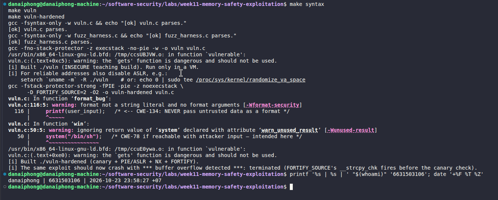
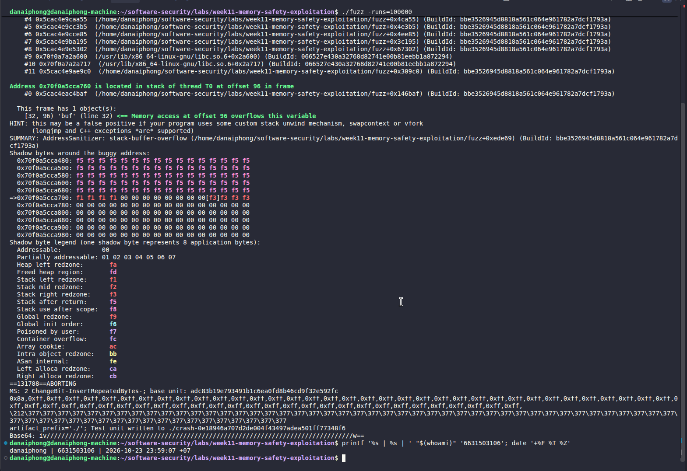

# Worksheet 11 — Memory-Safety & Exploitation (3 hrs)

> **Course:** Software Security (KOSEN69) · Week 11
> **Aligned:** CWE-121 (stack-based buffer overflow) · CWE-787 (out-of-bounds write) · CWE-134 (externally-controlled format string) · CWE-242 (dangerous `gets`)
> **Signature game:** 💥 Fuzzing Race → Pwn the Binary
>
> **Ethics note:** The binaries built from `vuln.c` are **intentionally exploitable** and `win()` spawns `/bin/sh`. Build and run them **only inside the isolated toolbox container** (or a VM) — never on your host. Never run these on a machine you care about, and never aim these techniques at software you are not authorized to test.

## Part 1 — Student Information

| Name | Student ID | Date | Group |
|------|-----------|------|-------|
| Danaiphong Songsikhwa | 6631503106 | 24 October 2026 | Not provided |

**Evidence status:** Screenshots are included for Tasks 0, 1, 3, and 4. Task 2 currently has only an image of the target address and payload generation; offset verification and successful ret2win output still need to be captured. Pending evidence is identified in the relevant sections.

**AI use:** Codex helped draft and explain the answers. The student should review the reasoning before submission. These answers do not replace the practical evidence requested by the worksheet.

## Part 2 — Lecture Questions

1. Draw the x86-64 stack frame for `parse_input()` in `vuln.c` (buf[64], saved RBP, saved return address). Where does `strcpy` start writing and which word must the exploit overwrite?

**Answer:** In the simplified x86-64 layout below, the stack grows toward lower addresses, but `strcpy` fills the buffer toward higher addresses. It starts at `buf[0]` and keeps copying until it reaches a NUL byte in the source, including that byte. If the input is too long, it can overwrite the saved frame pointer and then the saved return address.

```text
Higher addresses
+----------------------------------+
| Saved return address (8 bytes)    | <- target for ret2win
+----------------------------------+
| Saved RBP (8 bytes)               |
+----------------------------------+
| buf[64]                          | <- copy starts at buf[0]
+----------------------------------+
Lower addresses

Stack growth: toward lower addresses
Copy direction: toward higher addresses
```

The exploit needs to replace the saved return address with the address of `win()`. In this simplified layout, the offset is 64 + 8 = 72 bytes. That is an example, not a verified offset: compiler options, padding, optimization, and architecture can change the actual layout. The diagram is a theoretical illustration, not runtime evidence.

2. Why is `gets()` (CWE-242) impossible to use safely, and why did C11 remove it from the standard library?

**Answer:** `gets()` has no argument for the destination buffer size. It keeps reading until a newline or EOF, so the caller cannot make it stop when the buffer is full. Checking the length afterward is too late because the overwrite has already happened. C11 removed it because this design cannot safely handle input of an unknown length. A bounded read still needs a clear policy for input that is too long, such as rejecting it rather than silently using part of it.

3. Explain CWE-134: why is `printf(user_input)` dangerous but `printf("%s", user_input)` safe? What can `%n` do?

**Answer:** In `printf(user_input)`, the user controls the format string. Text such as `%x` or `%p` can make the function interpret nonexistent arguments and may expose memory. `%n` is more dangerous because it writes the number of characters printed so far through a pointer argument; an attacker who can control the needed address may use it to modify memory. With `printf("%s", user_input)`, the format stays fixed and the input is printed as data. This prevents the format-string issue, provided the input pointer refers to a valid, NUL-terminated string.

4. Name the four mitigations in the hardened build (`make vuln-hardened`) — stack canary, PIE/ASLR, NX/DEP, FORTIFY — and say which one each defeats: ret2win, shellcode-on-stack, return-address overwrite detection.

**Answer:** Each mitigation stops a different part of an attack; none of them makes the unsafe copy correct.

| Mitigation | What it does | Effect on this lab |
| --- | --- | --- |
| Stack canary | Checks a guard value before the function returns | Can detect an overflow that crosses the guard on its way to the saved return address and abort before returning |
| PIE with ASLR | Allows the executable's load address to change between runs | Makes a hard-coded `win()` address unreliable for ret2win; PIE needs ASLR to provide randomization |
| NX / DEP | Prevents execution from memory such as a non-executable stack | Blocks injected stack shellcode, but does not by itself stop ret2win because `win()` is already executable code |
| FORTIFY | Adds checks to supported library operations when the compiler knows the destination size | A checked `strcpy` can detect that the input does not fit and abort before the return-address attack succeeds |

The hardened build combines these controls. Which one stops a particular run must be identified from its diagnostic output, rather than guessed from the fact that it crashed.

5. The CISA/ONCD roadmaps push memory-safe languages. Using `safe.rs`, explain why CWE-121 is *impossible* in safe Rust, not merely harder.

**Answer:** This Rust routine borrows a `&str` and counts characters instead of copying arbitrary input into a 64-byte stack buffer. The input is stored in a growable `String`, and safe indexing checks bounds rather than allowing a write outside an allocation. In safe Rust, a bad index can cause a panic, but it cannot turn into this unchecked stack overwrite. That removes the mechanism behind CWE-121/787 in this routine, which is the reason memory-safe rewrites offer more than another exploit mitigation. This claim assumes sound compiler and library implementations and excludes unsafe code or foreign code that breaks Rust's safety rules. Memory safety also does not prevent every logic bug or resource-exhaustion problem.

## Part 3 — Hands-on Lab (145 min)


*This course illustration is conceptual: its example address and 72-byte offset are not measured evidence for my run. The screenshots below record the observed results.*

**Learning goals:** Find the overflow with a coverage-guided fuzzer, exploit it (ret2win), watch mitigations break the exploit, then port the routine to safe Rust.

**Prerequisites:** the **toolbox container** (bundles `clang`+libFuzzer, `gdb`, `objdump`, `python3`) — Apple clang has no libFuzzer and `gdb` is painful on macOS, so do this week in the container. (`pip install pwntools` and `rustc` inside as needed; an isolated Linux VM also works.)

**Environment setup**
```bash
# from the repo root, build the toolbox once, then open a shell IN this week's folder:
docker build -t softsec-toolbox labs/toolbox
docker run -it --rm --cap-add=SYS_PTRACE --security-opt seccomp=unconfined \
    -v "$PWD/labs/week11-memory-safety-exploitation":/work -w /work softsec-toolbox
# --- inside the container ---
make vuln                                          # teaching build: mitigations OFF
make vuln-hardened                                 # mitigations ON
clang -g -fsanitize=address,fuzzer fuzz_harness.c -o fuzz   # libFuzzer + ASan
setarch `uname -m` -R ./vuln                       # disable ASLR for repeatable addresses
```

**What to submit per task:** the exact command(s) + crash/exploit output, a screenshot, and a 2–3 sentence mitigation note tied to the CWE.

### Task 0 — Onboarding (15 min)
Run `make syntax` (parses both C files even on macOS) and confirm `make vuln` / `make vuln-hardened` build. Read the bug-class banner in `vuln.c`.
**Deliverable:** build output + the list of CWEs `vuln.c` claims to demonstrate.

#### Answer — observed result and explanation

The bug-class banner lists CWE-121 (stack-based buffer overflow), CWE-787 (out-of-bounds write), and CWE-134 (externally controlled format string). The source also identifies `gets()` as CWE-242. The vulnerable build removes the stack protector, permits stack execution, and disables PIE. The hardened build enables stack protection, PIE, a non-executable stack, and FORTIFY with optimization.

A syntax-only check confirms the C files parse, while the two build commands produced both the teaching and hardened binaries. The screenshot shows the successful syntax check and build messages. The compiler also warns about the intentionally unsafe `gets()` and format-string demonstration, which is expected for this lab.

**Mitigation note:** Remove `gets()` and unchecked copies rather than relying on successful compilation. Fixed format strings address CWE-134, while bounded input handling or a safe Rust rewrite removes the unsafe-copy path behind CWE-121/787.



### Task 1 — Fuzzing Race: find the crash (35 min)
**Goal:** Make libFuzzer + AddressSanitizer crash on the `strcpy` overflow in `parse_input()` — CWE-121/787.
**Steps:**
1. `./fuzz -runs=100000` (or just `./fuzz`).
2. Read the ASan report — note `stack-buffer-overflow` inside `parse_input` and the saved `crash-<hash>` file.
3. Replay it: `./fuzz crash-<hash>`.
**Deliverable:** the ASan crash summary + the byte length of the crashing input + mitigation note.

#### Answer — observed result

The fuzzer repeatedly supplies different byte sequences to the harness. The harness copies them into a larger temporary buffer and adds a NUL terminator, but then passes the result to `parse_input()`, which copies into `buf[64]` without checking the length. A string containing 64 non-NUL bytes already needs 65 bytes including its terminator, so it does not fit. An earlier NUL byte can shorten the copied string even when the fuzz input file is longer. The supplied run produced an AddressSanitizer stack-buffer-overflow report in `strcpy` and saved the crashing input shown below.

AddressSanitizer identified the out-of-bounds write while `strcpy` was copying into the local stack buffer. The saved 64-byte input can be replayed to check that the same crash occurs again.

| Required result | Status in this revision |
| --- | --- |
| ASan crash summary | `AddressSanitizer: stack-buffer-overflow` while copying in `strcpy` |
| Saved crash filename | `crash-0e18946a707d2de004f43497adea501ff77348f6` |
| Crashing file length | 64 bytes |
| Replay result | Replayed during preparation; ASan reproduced the stack-buffer-overflow in `strcpy`. The supplied screenshot does not show the replay command. |

**Mitigation note (CWE-121/787):** The destination must have room for the data and its terminator, or the input must be rejected. Fuzzing and ASan help find the bad write during testing; they do not replace the fix in the released program.



### Task 2 — Pwn the Binary: ret2win (40 min)
**Goal:** Overwrite the saved return address so the binary returns into `win()` and prints `FLAG{stack_smashing_for_fun_and_education}` — CWE-121.
**Steps:**
1. Find `win()`'s address: `objdump -d vuln | grep '<win>:'` (or `gdb -batch -ex 'p win' ./vuln`).
2. Verify the offset with a cyclic pattern (do **not** trust 72 blindly): feed `cyclic(200)`, crash in gdb, `cyclic_find` the value in RIP. (On an Apple Silicon/arm64 Mac the toolbox has no platform pin, so it builds as an **aarch64** container — there is no `RIP`; use `info registers pc` / `p/x $pc` instead, and expect `SIGBUS`, not `SIGSEGV`. The offset itself is still 72 here.)
3. Edit `exploit_skeleton.py`: set `WIN_ADDR` to the address from step 1, confirm `OFFSET`.
4. `python3 exploit_skeleton.py` (pwntools path) — or `python3 exploit_skeleton.py | ./vuln`. (On arm64: the flag still prints, but the process then loops forever re-printing `[+] win() reached` instead of exiting — ARM64 keeps the return address in register `x30`, which still holds `win()`'s own address when it starts, so `win()`'s `ret` returns into itself. Expected; `Ctrl-C` once you've captured the flag.)
**Deliverable:** the verified `OFFSET`, your `WIN_ADDR`, and the printed flag / `[+] win() reached` line.

Ret2win changes where the function returns instead of placing new machine code on the stack. The unchecked copy can overwrite the saved return address, and the function's return instruction then uses that value as its next code address. If it points to `win()`, the program can reach a function that normal execution never calls.

Conceptually, the input contains padding up to the saved return address, followed by the encoded address of `win()`. On x86-64, the address is normally represented as an eight-byte little-endian value. The exact padding and address must come from the binary being tested, not from an example in the worksheet.

An annotated reading of the expected x86-64 disassembly would look for allocation of the local stack space, the destination address passed to `strcpy`, and the final `leave`/`ret` sequence. The buffer's position relative to the saved return slot determines the offset. A cyclic pattern would provide a separate check: locate the pattern bytes in the saved return slot and find their position in the original input. With a non-canonical overwritten address on x86-64, the fault can happen at `ret`, so RIP may still point at that instruction rather than containing the pattern. Inspecting the saved slot or stack is then more useful than reading RIP alone.

| Item | Theory-only answer |
| --- | --- |
| OFFSET | 72 bytes in the simplified layout; not verified for a current binary |
| WIN_ADDR | `0x401216`, as shown by the student's `objdump` output in the attached terminal image; re-check if the binary is rebuilt |
| Flag output | Not captured; no successful exploit is claimed |
| Expected success indicator | The `[+] win() reached` message, if control actually reaches the function |

The flag string shown in the source is a built-in demo value. Reading that string in the file is not evidence that the exploit ran. Reaching `win()` also does not guarantee that its shell call completes: stack alignment and the later return path can cause another crash.

**Mitigation note (CWE-121):** Fix the unchecked copy to prevent the overwrite in the first place. Canaries and PIE/ASLR make this attack harder, but NX alone does not stop ret2win because the target is existing executable code.


[Insert Screenshot of Task 2B here: cyclic-pattern evidence verifying the offset, with identity stamp — still required]

[Insert Screenshot of Task 2C here: successful `win()` output and flag, with identity stamp — still required]

### Task 3 — Hardened rebuild: watch the exploit break (25 min)

```sim
stack-frame
```

**Goal:** Observe modern mitigations defeating the same payload.
**Steps:**
1. Run your Task 2 payload against `./vuln-hardened`.
2. Record the failure mode: `*** buffer overflow detected ***: terminated` (FORTIFY_SOURCE's `__strcpy_chk`, which on this build catches the overflow before the stack canary's epilogue check ever runs), or a SIGSEGV at a randomized address (PIE/ASLR makes `WIN_ADDR` wrong).
**Deliverable:** the crash message + a note explaining *which* mitigation fired and why the fixed `WIN_ADDR` no longer works.

#### Answer — observed result

I ran `python3 exploit_skeleton.py | ./vuln-hardened`. The program printed `*** buffer overflow detected ***: terminated` and aborted. This build's FORTIFY check detected that the `strcpy` input exceeded the destination buffer and stopped the copy before the function returned; the canary check did not need to run. PIE/ASLR also means the fixed `win()` address from the non-PIE teaching build cannot be relied on for the hardened binary.

PIE allows ASLR to relocate the executable, so an address copied from the non-PIE teaching binary is not a reliable address in the hardened process. Optimization can also change the stack layout, making the original offset unreliable. These changes are separate from NX, which blocks stack shellcode but does not stop execution of `win()` itself.

**Mitigation note (CWE-121/787):** Hardening can interrupt the exploit without removing the unsafe operation. The durable fix is still to replace the unbounded read and copy, then retain hardening as an extra layer.


### Task 4 — Rust rewrite: defend / fix it (30 min)
**Goal:** Show the bug class disappears in safe Rust using `safe.rs`.
**Steps:**
1. `rustc safe.rs && ./safe`, then `python3 -c "print('A'*5000)" | ./safe` — note it never overflows or crashes.
2. Feed format-string metacharacters: `printf '%%x %%n' | ./safe` — note the program just reports the character count with no crash and no stack leak; the input is treated as ordinary data (CWE-134 impossible: `println!`'s format string must be a compile-time literal, so `println!(line)` would not even compile).
3. From the inline comments, write *why* `String`/`&str` + bounds checks make CWE-121/787 impossible.
**Deliverable:** the safe output for both inputs + a 3–4 sentence explanation tying it to the CISA memory-safe roadmap.

#### Answer — theoretical analysis

`safe.rs` stores input in a `String` and passes a borrowed `&str` to the counting routine. It does not copy the input into a fixed 64-byte stack array. Its output uses a literal format string with the count passed as a value, so input such as `%x %n` never becomes a format instruction.

The current local rewrite also limits input to 8192 bytes. That addresses resource use separately from memory safety. Its handling of read errors and oversize input should still be tested before claiming the rewrite is verified.

| Input | Result |
| --- | --- |
| 5000 ASCII `A` characters followed by a newline | Observed: reports 5000 characters; no fixed-buffer copy occurs |
| Literal `%x %n` | Observed: reports 5 characters; the percent sequences are ordinary input data |
| Input above the 8192-byte limit | Reports that the input is too long and exits with an error |
| Invalid UTF-8 | The read into `String` returns an error, which the program handles |

The terminal run produced `Hello, your input was 5000 characters long.` for the long input and `Hello, your input was 5 characters long.` for `%x %n`, matching the expected behavior. The count is a count of Unicode scalar values from `.chars().count()`, not a byte count or a count of visible grapheme clusters. The program reads up to EOF, so running it interactively without ending input will make it wait; the piped commands in this test close the input automatically.

**Roadmap explanation:** The Rust version removes the unchecked stack copy instead of making it harder to exploit. Safe strings and checked access prevent this routine from writing outside its buffer. This matches the CISA roadmap's goal of moving away from recurring memory-safety mistakes rather than patching each exploit separately. A rewrite still needs tests for behavior, input limits, and dependencies; memory safety is not a promise that the whole program has no bugs.

**Mitigation note (CWE-121/787/134):** Keep the routine in safe Rust and keep the format string fixed. Review any future unsafe code or C-library boundary separately, since those can reintroduce the assumptions that the rewrite removed.


[Insert Screenshot of Task 4B here: oversize-input rejection and error handling, with identity stamp — supporting evidence pending]

## Part 4 — Reflection

1. **Mapping:** table — bug | function in `vuln.c` | CWE | mitigation that stops it (canary / PIE / NX / Rust).

**Answer:**

| Bug | Function | CWE | Relevant defense and its limits |
| --- | --- | --- | --- |
| Unbounded input read | `vulnerable()` using `gets()` | CWE-242 / CWE-121 / CWE-787 | Replace the read with bounded handling or safe Rust; a canary may detect resulting stack corruption but does not bound the read |
| Unchecked copy into `buf[64]` | `parse_input()` | CWE-121 / CWE-787 | Safe Rust removes this unchecked copy; FORTIFY can check it and a canary can detect certain overwrites |
| User-controlled format string | `format_bug()` | CWE-134 | Use a literal format with input as data, or Rust's checked formatting; stack canaries do not prevent a format-string leak |
| Redirected return to `win()` | Return from `parse_input()` | Consequence of CWE-121 | A canary can detect corruption; PIE/ASLR makes a fixed target address unreliable; NX alone does not prevent this code-reuse path |
| Injected code placed on the stack | Possible consequence of the overflow, not a separate supplied function | Exploitation of CWE-121/787 | NX blocks stack execution; it does not stop the original write or existing-code reuse |

2. **Real breach:** pick a memory-safety incident (Morris Worm fingerd overflow, or Heartbleed CVE-2014-0160). Which CWE applies, and would a stack canary or a Rust rewrite have prevented it?

**Answer:** Heartbleed, CVE-2014-0160, involved reading beyond a buffer in OpenSSL's heartbeat handling. An inconsistent supplied length was not properly checked against the available message data, so a response could include unrelated memory. CWE-125 is the broad out-of-bounds-read category; the more specific chain includes CWE-130 (inconsistent length handling) and CWE-126 (buffer over-read).

A stack canary would not solve this bug because the attack reads memory rather than overwriting a saved return address. A correctly written safe Rust implementation using checked slices would prevent the unchecked out-of-bounds read. It would still need to validate the protocol length and avoid unsafe code that bypasses those checks. This is a different memory error from the stack overwrite in the local lab.

3. **Best mitigation:** compare "harden the C build" vs. "rewrite in Rust." Which gives durable risk reduction for new code, and what is the cost?

**Answer:** For new code, I would choose a memory-safe implementation because it removes many opportunities for accidental invalid reads and writes. Hardening is still useful, especially for existing C code, but it mainly limits or detects attacks after unsafe behavior has been introduced. Rust has costs too: the team needs time to learn it, maintain library bindings, and test that the rewrite behaves correctly. For a large existing system, I would first fix known bugs and keep hardening enabled, then migrate the most exposed components in stages.

## Grading rubric (100)

| Criterion | Weight |
|-----------|--------|
| Lecture questions (Part 2) | 20 |
| Exploitation + evidence (Tasks 1–3: fuzz crash, ret2win flag, hardened break) | 40 |
| Defense (Task 4: Rust rewrite + explanation) | 25 |
| Reflection (Part 4: mapping, breach, best mitigation) | 15 |
| **Total** | **100** |

---

## Evidence & Integrity (required)

- **Identity proof:** every screenshot/diagram must show a terminal running `printf '%s | %s | ' "$(whoami)" '<YOUR-STUDENT-ID>'; date '+%F %T %Z'` **in the
  same image as the evidence**. When the evidence is a browser page, a DevTools panel or a
  rendered response, put that terminal **beside the browser and capture the whole screen** — a
  cropped window carries nothing that identifies you, and the lab's own output is
  byte-identical for the whole cohort *by design*, so the stamp is the only thing that makes
  the shot yours. Generic or borrowed evidence is not accepted.
- **Personalized flag:** Not obtained yet. The source's built-in demo string is not submitted as a recovered personal flag.
  *Flags are unique per student — submitting another student's flag is a violation. How to submit: **learn.zcr.ai/submit** (full guide: `SUBMISSION.md` in the repo root).*
- **Explain in your own words** *(graded on your reasoning, not copied text):*
  1. What did you do, and **why did the vulnerability work**?
  2. **Why does your fix actually stop it** — and what could still break it?

---

## 🤖 Audit the AI (required)

AI is a power tool you must **distrust** — you are graded on your *critique*, not the AI's answer.

1. Ask an AI assistant to exploit **or** fix this week's vulnerability. Paste its full answer.
2. **Find what's wrong or risky** in it — insecure code, a subtly incomplete fix, a hallucinated API/function/CVE, a missed edge case, or wrong reasoning. Quote the exact line(s).
3. Produce the **correct, verified** version yourself and explain in 2–3 sentences why the AI's output was insufficient.

> Disclose your AI use in the Part 1 table. This task counts toward your **Defense + Reflection** score.

### Audit answer — theoretical review

**Initial AI candidate, generated for this review (complete answer):**

> Replace `strcpy(buf, src)` with `strncpy(buf, src, sizeof(buf))`. This bounds the copy to the destination size, so the original overflowing copy is removed.

**What is incomplete:** The exact line `strncpy(buf, src, sizeof(buf))` does not guarantee a terminating NUL when the source is at least as long as the buffer. The following `strlen(buf)` could then read past the array. The suggestion also leaves the separate `gets()` and `printf(user_input)` bugs in place, so it is not a complete program fix.

**Corrected approach:** For a C routine that retains a 64-byte destination, first ensure that the source is a valid, terminated string from a bounded input path. Reject strings of 64 bytes or more, then copy the accepted bytes together with their terminator; do not silently truncate input that is supposed to be rejected. Replace `gets()` in the caller and use a fixed format string in `format_bug()` as separate changes. The safer design for this exercise is the Rust routine, which only borrows the input to count it and avoids the local copy entirely.

**Verification status:** This is a source-level critique only. No corrected program was compiled or executed for this revision, so runtime verification remains pending. The practical version of this task should check boundary lengths, long input, and literal format characters before recording a verified result.

[Insert Screenshot of Audit the AI here: boundary checks on the corrected routine, with identity stamp — practical verification pending]

---

## 🧠 Comprehension & Prompt (required)

**A. Explain in Plain English (EiPE).** In 2–3 sentences, in your own words, describe what this week's vulnerable code/endpoint actually *does* and *why it is exploitable* — explain the mechanism, don't dump jargon.

**B. Prompt Problem.** Write a **single prompt** that makes an AI produce a *correct, secure* fix for one finding. Run it: does the exploit now fail? If not, refine the prompt and try again. Submit the **final prompt + the verified result**.
*Graded on the prompt's precision and your verification — this trains problem decomposition and AI literacy (Denny et al. 2024).*

### A. Plain-English answer

The C program reads a name, copies it into a smaller local buffer, and reports its length. Because the read and copy do not check how much space is available, long input can overwrite nearby stack data, including the address used when the function returns. A separate function also treats user input as a formatting instruction, which can expose or modify memory.

### B. Final prompt and expected checks

**Final prompt:** "Review the Week11 C input routine and propose a safe Rust rewrite. Keep user input as data, avoid unsafe code and C string-copy functions, use a fixed output format, and set an explicit input-size limit with handled errors. State whether the result counts bytes or Unicode scalar values and whether it reads one line or all input. Explain how this removes the unchecked-copy mechanism behind CWE-121/787 and the format-string mechanism behind CWE-134. List checks for empty input, 63 and 64 ASCII characters, 5000 ASCII characters, literal %x %n, invalid UTF-8, and input above the size limit. Do not report any test as passed unless it was actually run."

**Result:** The prompt is written, but it has not been run to generate and verify a new implementation. The separate Rust checks above confirm the current program's long-input and literal-percent behavior; they do not verify the AI-generated fix or the pending boundary and oversize cases.

## Practical evidence still required

Screenshots are included for Tasks 0, 1, 3, and 4. Task 2 has an image of the target address and payload generation, but the verified offset and successful `win()` output are still missing. The fuzz crash replay was confirmed, but its command is not shown in the supplied screenshot. The Rust oversize-input case also needs evidence. The AI audit critique is written, while running and verifying its proposed fix remains pending.

## References for further reading

- CISA, *The Case for Memory Safe Roadmaps*: https://www.cisa.gov/resources-tools/resources/case-memory-safe-roadmaps
- MITRE, CWE-125 (including the Heartbleed example): https://cwe.mitre.org/data/definitions/125.html
- Heartbleed background and CVE-2014-0160: https://heartbleed.com/
- Local source material: `vuln.c`, `fuzz_harness.c`, `Makefile`, and the current `safe.rs` in this folder.
