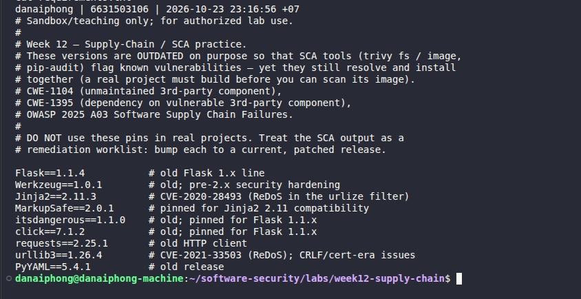
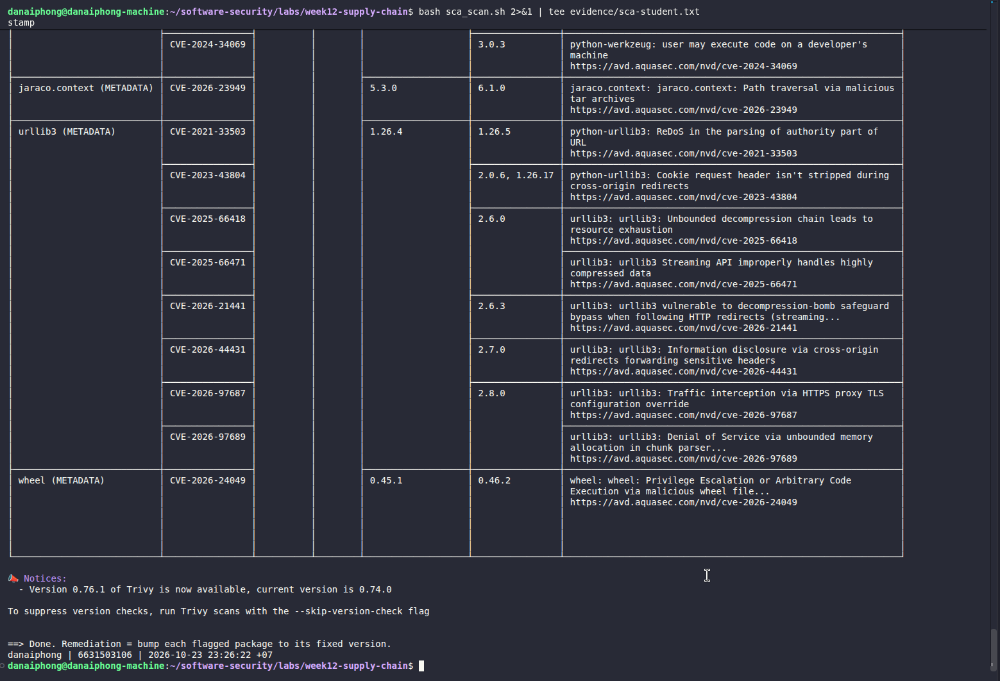
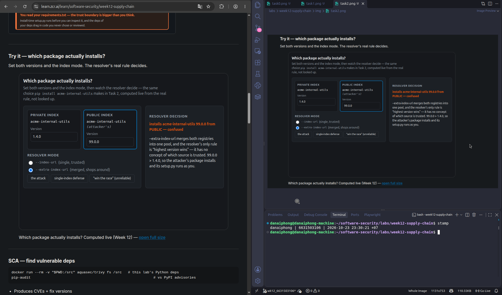
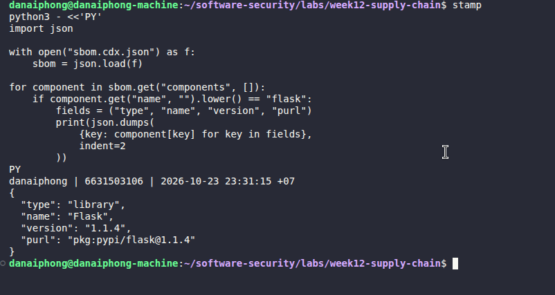
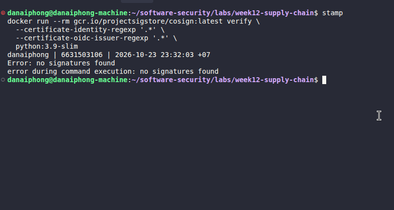
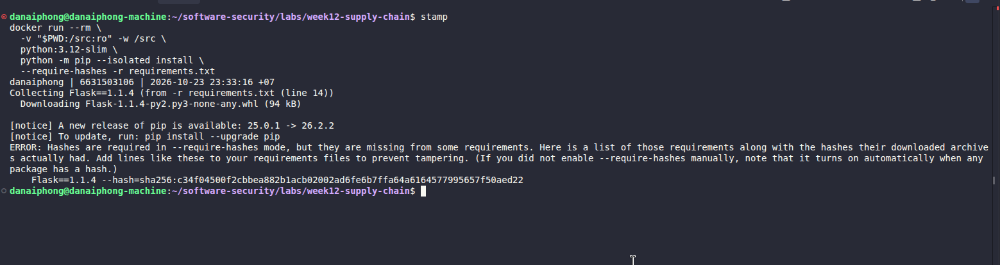

# Worksheet 12 — Software Supply-Chain Security (3 hrs)

> **Course:** Software Security (KOSEN69) · Week 12
> **Aligned:** OWASP 2025 — A03 Software Supply Chain Failures · A08 Software or Data Integrity Failures · **CWE:** CWE-1104, CWE-829, CWE-1357, CWE-1395
> **Signature game:** 📦 Dependency Confusion Heist
>
> **Ethics note:** This lab has **no live private/public registry to attack** — the dependency-confusion exercise is a controlled walkthrough (`dependency-confusion.md`) plus the interactive resolver simulation in Task 2, not a real package pull. **Never** plant or publish look-alike packages on the real PyPI or npm — that is an attack on every downstream user, and nothing in this lab requires it.

## Part 1 — Student Information

| Name | Student ID | Date | Group |
|------|-----------|------|-------|
| Danaiphong Songsikhwa | 6631503106 | 23 October 2026 | Not provided |

**AI use:** Codex helped explain the questions, draft these answers, and run the local scans, build, hash check, and SBOM generation. The student has supplied six screenshots, included below. The remaining evidence and account-based signing steps are still pending. The results below are assistant-run results, not a claim that the student has already repeated them.

**Branch:** `wk12_6631503106`. Work stays in this branch; it is not merged into `main`.

## Part 2 — Lecture Questions

1. Explain **dependency confusion** (substitution). Why does a public `acme-internal-utils==99.0.0` win over a private `==1.4.0` when a resolver shops both indexes?

**Answer:** Dependency confusion happens when a build accepts a public package with the same name as an internal one. In merged-index mode, the resolver can choose public version 99.0.0 over private version 1.4.0 if both satisfy the requirement, because it prefers the higher eligible version rather than the private source. There is an important detail in the question: if the requirement is actually pinned to `acme-internal-utils==1.4.0`, then 99.0.0 is not eligible. A pin alone still does not prove the package came from the right source; use a trusted index and reviewed hashes too. [1]

2. How does **typosquatting** (`reqeusts`, `urlib3`) achieve code execution *at install time* before any of your code runs?

**Answer:** Typosquatting uses a name close to a real package so a typing mistake selects the attacker's package. Installing a source distribution can run its build backend or setup code before the application starts. This is not true of every wheel installation: a wheel does not normally run `setup.py` during installation, although malicious package code can run when it is imported. I would check the package name and source and use reviewed dependency files.

3. What is an **SBOM** (CycloneDX/SPDX) and why is it a prerequisite for both incident response and SLSA provenance?

**Answer:** An SBOM is a list of the components in an artifact, usually including their names, versions, and identifiers. CycloneDX and SPDX are common formats. It helps incident response answer which images contain an affected library. It also supports checking build inputs, but an SBOM is not build provenance: provenance records who built an artifact, how it was built, and from which inputs. SLSA does not make an SBOM a strict prerequisite for generating provenance. [2]

4. Sigstore **keyless** signing uses Fulcio (CA) + Rekor (transparency log) tied to an OIDC identity. Why is that safer than a long-lived private key (CWE-321)?

**Answer:** Keyless signing uses a short-lived signing key and a certificate from Fulcio that connects it to an OIDC identity. Rekor provides a public record that helps others check the signing event. This avoids keeping one private signing key around for months or copying it into code or CI settings. It still depends on protecting the OIDC account and verifying the expected signer and issuer. CWE-321 applies to hard-coded keys; a managed long-lived key is not automatically that weakness. [3]

5. Summarize the **SLSA** levels. Which level does "signed artifact + SBOM + provenance gate before deploy" put you at, and what is still missing?

**Answer:** Using the SLSA v1.2 Build track: L0 has no guarantees; L1 requires build provenance; L2 adds provenance generated and signed by a hosted build platform; L3 requires a hardened build platform with stronger isolation and protection of signing material. A signed image, an SBOM, and a verification command do not automatically reach L2 or L3. This local exercise has not shown a trusted hosted builder or a complete provenance policy, so I would not claim those levels. Even L1 needs generated and distributed build provenance, not just an SBOM. Version 1.2 also has a separate Source track. [2]


## Part 3 — Hands-on Lab (150 min)

**Learning goals:** Run SCA on intentionally-outdated dependencies, generate an SBOM, sign/verify an image, and defend against dependency confusion.

**Prerequisites:** Docker; the lab folder (`requirements.txt`, `Dockerfile`, `app.py`, `sca_scan.sh`, `sign.sh`). For signing: browser for the OIDC flow + registry push access.

**Environment setup**
```bash
cd labs/week12-supply-chain
bash sca_scan.sh                 # trivy fs + pip-audit on requirements.txt (+ optional image scan)
docker build -t week12-supplychain:lab .
bash sign.sh week12-supplychain:lab   # CycloneDX SBOM -> sbom.cdx.json, then cosign sign + verify
```

**What to submit per task:** the exact command(s) + output, a screenshot, and a 2–3 sentence remediation note mapping the finding to A03/A08 or the CWE.

### Task 0 — Onboarding (15 min)
Read `requirements.txt` and list the pinned packages with their versions. Note why they are intentionally outdated (each is deliberately an old release so SCA tools flag its known CVEs).
**Deliverable:** the package/version table + which OWASP/CWE this maps to.


#### Answer and results

The dependency file pins the following packages:

| Package | Pinned version |
| --- | --- |
| Flask | 1.1.4 |
| Werkzeug | 1.0.1 |
| Jinja2 | 2.11.3 |
| MarkupSafe | 2.0.1 |
| itsdangerous | 1.1.0 |
| click | 7.1.2 |
| requests | 2.25.1 |
| urllib3 | 1.26.4 |
| PyYAML | 5.4.1 |

These old versions make the lab useful for SCA practice. They map to A03:2025 and CWE-1395 when they contain known vulnerabilities; CWE-1104 applies when a component is no longer maintained. An old version is not proof of a particular CVE, so the scan is needed. For example, the comment beside Jinja2 mentions CVE-2020-28493, but version 2.11.3 fixed that issue; other advisories still affect this version. [4]

Command: `cat requirements.txt`.

**Task 0 screenshot**




### Task 1 — SCA scan: build the remediation worklist (35 min)
**Goal:** Flag the known-vulnerable dependencies — A03.
**Steps:**
1. `bash sca_scan.sh` — read the `trivy fs` table (CVE, installed vs. fixed version) and the `pip-audit` advisory IDs (GHSA-/PYSEC-).
2. Pick three findings; record CVE/advisory id, severity, and the fixed version.
**Deliverable:** the SCA output + a 3-row remediation table (package → current → fixed).


#### Answer and results

Command run from this folder:

```bash
bash sca_scan.sh
```

Trivy reported the findings below, and pip-audit reported **33 known vulnerabilities in 6 packages**, including transitive dependencies. The full output is saved in `evidence/sca.txt`.

| Package | Current | CVE | Severity from Trivy | Version fixing this CVE | pip-audit ID |
| --- | --- | --- | --- | --- | --- |
| Flask | 1.1.4 | CVE-2023-30861 | HIGH | 2.2.5 or 2.3.2 | PYSEC-2023-62 |
| Werkzeug | 1.0.1 | CVE-2023-25577 | HIGH | 2.2.3 | PYSEC-2023-58 |
| urllib3 | 1.26.4 | CVE-2021-33503 | HIGH | 1.26.5 | PYSEC-2021-108 |

These are fixes for the selected advisories, not a claim that those versions fix every current vulnerability. The worklist is to update the related packages together, test compatibility, regenerate the lockfile, and scan again. The intentionally old lab requirements have been kept for reproducing the exercise.

Remediation (A03 / CWE-1395): Keep a reviewed dependency set and check it in CI. A successful script exit is not enough here because `sca_scan.sh` uses `|| true`; read the actual reports and make scanner errors fail the real release pipeline.

**Task 1 screenshot**



The supplied screenshot shows part of the image-scan output. The three-row remediation table above comes from the full scan logs; those selected Flask/Werkzeug rows and the pip-audit summary are not all visible in this image.

[Insert an additional Screenshot of Task 1 here: the three selected findings and pip-audit summary]


### Task 2 — Dependency Confusion Heist (35 min)
**Goal:** Watch the wrong package win — A03 / CWE-1357.

**Reality check:** this lab does **not** stand up a live private/public registry. `acme-internal-utils` is
a worked example, not an installable package — there is nothing to actually `pip install` here (the name
doesn't exist on real PyPI either, so don't expect that to work as a shortcut). Task 2 is a controlled
walkthrough of the resolver's own rule, using the simulation below, which computes the real
"highest version wins" logic live instead of just asserting the outcome.

```sim
resolver-confusion
```

**Steps:**
1. Read `dependency-confusion.md`'s "Dependency confusion (substitution)" section for the mechanism.
2. In the simulation, load the **"the attack"** preset (private `1.4.0`, public `99.0.0`, merged /
   `--extra-index-url` mode) and record which index the resolver picks and why.
3. Keep the same version numbers and switch to the **single-index** (`--index-url`) mode; record how the
   verdict changes — this is the resolver behavior Task 4's "single trusted index" defense relies on.
4. Try the **"win the race"** preset (private version numerically higher than public) and note why the
   sim's own explanation calls that "not a defense."

**Deliverable:** a screenshot of the simulation's verdict in both index modes (merged vs. single) for the
same version pair, plus one sentence on why an attacker defeats the "keep my internal version number high"
idea.


#### Answer and results

The expected simulation results for the same version pair are:

| Mode | Private | Public | Selected source/version | Reason |
| --- | --- | --- | --- | --- |
| Merged / extra index | 1.4.0 | 99.0.0 | Public 99.0.0 | Highest eligible version across both sources |
| Single trusted private index | 1.4.0 | 99.0.0 | Private 1.4.0 | Public candidates are not queried |

These are the rule-based answers. The supplied screenshot confirms the merged-index result; the single-index and win-the-race screenshots are still missing. In the "win the race" preset, a higher private version may win today, but the attacker can publish a still higher public version. Increasing our version number does not remove the untrusted source.

The original Markdown contains a `resolver-confusion` simulation marker rather than a local executable registry. Use the course page that renders that simulation. Do not install or publish a package called `acme-internal-utils` as a substitute for this step.

Remediation (A03 / CWE-1357): Use one controlled index that keeps internal names internal, then verify approved hashes. A merged list of sources is not a trust policy.

**Task 2A screenshot - Merged index**



[Insert Screenshot of Task 2B here: single-index verdict for the same versions]

[Insert Screenshot of Task 2C here: win-the-race preset and its warning]


### Task 3 — SBOM + signing/verification (30 min)
**Goal:** Produce a component inventory and prove integrity — A08.
**Steps:**
1. After `bash sign.sh week12-supplychain:lab`, open `sbom.cdx.json` and find Flask's entry.
2. Read the `cosign verify` PASS for the signed image.
3. Negative test on an unsigned image (it **must** fail):
   `cosign verify --certificate-identity-regexp '.*' --certificate-oidc-issuer-regexp '.*' python:3.9-slim`
   → `Error: no signatures found`. (Both `--certificate-identity*` flags are required in keyless mode; without
   them cosign stops at `Error: --certificate-identity or --certificate-identity-regexp is required` — a usage
   error, which is *not* the same thing as proving the image is unsigned.)
**Deliverable:** the SBOM Flask component entry + the verify PASS + the negative-test failure.


#### Answer and results

The local image built successfully. SBOM generation used an exported archive, so the scanner did not need access to the host Docker socket:

```bash
docker build -t week12-supplychain:lab .
docker save -o /tmp/week12-supplychain.tar week12-supplychain:lab
docker run --rm   -v /tmp/week12-supplychain.tar:/image.tar:ro   -v "$PWD:/src" aquasec/trivy:latest image   --input /image.tar --format cyclonedx --output /src/sbom.cdx.json
```

The generated CycloneDX file contains this Flask component excerpt:

```json
{
  "type": "library",
  "name": "Flask",
  "version": "1.1.4",
  "purl": "pkg:pypi/flask@1.1.4"
}
```

The complete component is in `sbom.cdx.json`; build and SBOM logs are in `evidence/`. This inventory identifies Flask 1.1.4, but does not prove that its code is safe.

**Signing status:** Positive keyless signing and verification are not completed. They need a registry-hosted image digest, registry permission, and the student's OIDC login. A local Docker tag is not sufficient for registry-based signing, and mounting a Docker socket does not publish it. `sign.sh` is the course demo, but its wildcard identity filters should not be used as a real trust policy.

After the image is published to a registry you control, set `IMAGE_REF` to its immutable `registry/repository@sha256:...` reference. Set `EXPECTED_IDENTITY` to the exact approved certificate identity and `EXPECTED_ISSUER` to the expected OIDC issuer, then run:

```bash
: "${IMAGE_REF:?Set the published image digest}"
: "${EXPECTED_IDENTITY:?Set the approved signer identity}"
: "${EXPECTED_ISSUER:?Set the approved OIDC issuer}"
cosign sign --yes "$IMAGE_REF"
cosign verify --certificate-identity "$EXPECTED_IDENTITY"   --certificate-oidc-issuer "$EXPECTED_ISSUER" "$IMAGE_REF"
```

For the worksheet's negative test:

```bash
cosign verify --certificate-identity-regexp '.*'   --certificate-oidc-issuer-regexp '.*' python:3.9-slim
```

The broad filters above are only for asking whether the test image has any acceptable keyless signature, not for trusting a release signer. Record the actual result: a missing signature, an identity mismatch, and a network error are different failures. The negative check was run using `docker run --rm gcr.io/projectsigstore/cosign:latest` followed by the verification arguments above. The log is `evidence/unsigned-verify.txt`; the check returned a nonzero exit status (10) with `Error: no signatures found` and `error during command execution: no signatures found`. This confirms the negative test for the image tag at the time of this run; image tags can change.

Remediation (A08): Verify the immutable artifact digest and the exact approved identity before deployment. Signing establishes who approved the bytes, not whether those bytes contain a vulnerability. [3]

**Task 3A screenshot - SBOM**



[Insert Screenshot of Task 3B here: successful verification of your signed registry image - pending OIDC/registry setup]

**Task 3C screenshot - Unsigned image rejected**




### Task 4 — Defend / fix it (35 min)
**Goal:** Stop dependency confusion and lock integrity — defenses from `dependency-confusion.md` + `sign.sh`.
**Steps:**
1. **Pin + hashes:** run `pip install --require-hashes -r requirements.txt` against this lab's own
   `requirements.txt` (it has no hashes yet) and record pip's refusal — `ERROR: Hashes are required in
   --require-hashes mode...` plus the `--hash=sha256:…` line pip prints for you. That refusal is the same
   mechanism that would block a real confusion substitution: once hashes are required, a package that
   doesn't match — from *either* index — cannot install silently.
2. **Single trusted index:** use one `--index-url` instead of `--extra-index-url`; explain why the resolver stops shopping around (tie this back to Task 2's single-index verdict).
3. **Namespace scoping:** describe reserving/namespacing the internal package name.
4. **Provenance gate:** state how the `cosign verify` from `sign.sh` becomes a gate before a simulated deploy.
**Deliverable:** the `--require-hashes` refusal output (step 1) + the simulation's before/after verdict for merged vs. single index (from Task 2) + the one defense you found most effective and why.


#### Answer and results

The required-hash test ran in a disposable container, without installing the old dependencies on the host:

```bash
docker run --rm -v "$PWD:/src:ro" -w /src python:3.12-slim   python -m pip --isolated install --require-hashes -r requirements.txt
```

It failed as intended with:

```text
ERROR: Hashes are required in --require-hashes mode, but they are missing from some requirements.
Flask==1.1.4 --hash=sha256:c34f04500f2cbbea882b1acb02002ad6fe6b7ffa64a6164577995657f50aed22
```

The complete output is in `evidence/hash-refusal.txt`. The printed hash describes the archive pip downloaded; it should not be trusted just because pip printed it. A real lockfile needs approved versions and hashes for all required packages, including transitive dependencies.

For the index defense, use `--index-url` with one trusted private mirror and remove extra indexes from configuration and environment variables too. The mirror must enforce an internal-name policy; a public fallback for missing internal names can recreate the problem. This matches Task 2: public 99.0.0 stops being a candidate when only the private index is queried.

For naming, reserve important public names where practical and enforce ownership in the private registry. npm supports registry-scoped names; a Python package prefix by itself does not enforce registry isolation.

For a deploy gate, require a successful `cosign verify` for the expected signer and issuer on the same digest that will be deployed. A provenance gate must separately verify the signed attestation and check its subject digest, builder identity, source repository, commit, and build parameters against policy. Only continue when every required check succeeds; signature verification alone does not check those provenance fields.

My first choice would be a controlled index with enforced internal-name ownership, backed by a reviewed hash lockfile. It prevents an unrelated public package from becoming a candidate instead of hoping its version stays lower. These controls address A03/CWE-1357; the signature and provenance gate addresses A08. The refusal test is verified, while the registry-backed gate is still pending.

**Task 4A screenshot - Required hashes**



[Insert Screenshot of Task 4B here: single-index simulation verdict; the Task 2B image may be reused]

[Insert Screenshot of Task 4C here: configured deploy gate rejecting an unsigned or wrong-identity artifact - pending registry setup]


## Part 4 — Reflection

1. **Mapping:** table — finding | tool (`sca_scan.sh` / `sign.sh`) | OWASP 2025 id | CWE | fix.

**Answer:**

| Finding | Tool or check | OWASP 2025 | CWE | Fix |
| --- | --- | --- | --- | --- |
| Known-vulnerable dependencies | sca_scan.sh | A03 | CWE-1395 | Upgrade compatible versions and rescan |
| Unsupported components | Support-policy review plus SCA | A03 | CWE-1104 | Replace or upgrade to a maintained release |
| Public package selected for an internal name | Resolver simulation | A03 | CWE-1357 / CWE-829 | Trusted index, name ownership, reviewed hashes |
| Artifact accepted without an approved signature | sign.sh / cosign verify | A08 | CWE-345 | Verify digest, signer identity and issuer |
| Release accepted without checking its origin | Attestation and policy checks | A08 | CWE-345 | Check the signed provenance and approved build inputs |

A missing signature is an integrity/authenticity issue; it is different from a known CVE in the dependency itself.

2. **Real breach:** analyze the **XZ Utils backdoor (CVE-2024-3094)**. Which OWASP/CWE applies, and would an SBOM + signing + provenance gate have caught a maliciously-modified upstream dependency? (Compare with SolarWinds or Log4Shell if useful.)

**Answer:**

XZ Utils 5.6.0 and 5.6.1 contained malicious code in release material that could interfere with SSH authentication under specific build conditions. Red Hat described important differences between the release tarball and the Git source. This fits A03:2025, with CWE-506 for embedded malicious code and CWE-829 for taking functionality from an untrusted source. [5]

An SBOM could help locate affected XZ versions, especially after the advisory appeared. A valid signature would not automatically catch the backdoor if the compromised upstream release was signed by an accepted maintainer. Provenance and checks against reviewed source/build inputs could expose unexpected differences, but they cannot prove that approved source is harmless. The lesson is to combine origin checks with review and testing.

3. **Best mitigation + SLSA self-assessment:** one paragraph — which SLSA level your defenses reach and why, and the single highest-leverage control for your team.

**Answer:**

I would describe this as a local supply-chain exercise, not a demonstrated SLSA L2 or L3 build. A BuildKit attestation may be generated during a local build, but that is not proof of trusted hosted-builder controls or a verified release policy. L1 needs appropriate generated and distributed provenance; L2 needs hosted-platform provenance and its authenticity checked; L3 adds hardened isolation. My priority would be a CI release gate that verifies the approved digest, signer, and provenance before deployment, with locked dependencies as the input. At present, signing and the registry-backed gate remain unfinished. [2]


## Grading rubric (100)

| Criterion | Weight |
|-----------|--------|
| Lecture questions (Part 2) | 20 |
| Exploitation + evidence (Tasks 1–3: SCA findings, confusion proof, SBOM/verify) | 40 |
| Defense (Task 4: pinning/hashes, single index, scoping, provenance gate) | 25 |
| Reflection (Part 4: mapping, XZ breach, SLSA self-assessment) | 15 |
| **Total** | **100** |

---

## Evidence & Integrity (required)

- **Identity proof:** every screenshot/diagram must show a terminal running `printf '%s | %s | ' "$(whoami)" '<YOUR-STUDENT-ID>'; date '+%F %T %Z'` **in the
  same image as the evidence**. When the evidence is a browser page, a DevTools panel or a
  rendered response, put that terminal **beside the browser and capture the whole screen** — a
  cropped window carries nothing that identifies you, and the lab's own output is
  byte-identical for the whole cohort *by design*, so the stamp is the only thing that makes
  the shot yours. Generic or borrowed evidence is not accepted.
- **Personalized flag:** No personalized flag is issued by the local dependency-confusion walkthrough; no flag is claimed.
  *Flags are unique per student — submitting another student's flag is a violation. How to submit: **learn.zcr.ai/submit** (full guide: `SUBMISSION.md` in the repo root).*
- **Explain in your own words** *(graded on your reasoning, not copied text):*
  1. What did you do, and **why did the vulnerability work**?
  2. **Why does your fix actually stop it** — and what could still break it?

---

### Evidence explanation

The scan found known-vulnerable packages because the requirements intentionally pin old versions. The resolver example is vulnerable when it accepts candidates for an internal name from both trusted and untrusted sources. Hash checking rejects unapproved bytes, while a controlled index removes the untrusted candidates; either can still fail if the approved source or lockfile is compromised. Signing and provenance are separate checks and still need the student's registry/OIDC step.

## 🤖 Audit the AI (required)

AI is a power tool you must **distrust** — you are graded on your *critique*, not the AI's answer.

1. Ask an AI assistant to exploit **or** fix this week's vulnerability. Paste its full answer.
2. **Find what's wrong or risky** in it — insecure code, a subtly incomplete fix, a hallucinated API/function/CVE, a missed edge case, or wrong reasoning. Quote the exact line(s).
3. Produce the **correct, verified** version yourself and explain in 2–3 sentences why the AI's output was insufficient.

> Disclose your AI use in the Part 1 table. This task counts toward your **Defense + Reflection** score.

---

### Audit answer

**Full initial AI suggestion, generated for review:**

> Run `cosign verify --certificate-identity-regexp '.*' --certificate-oidc-issuer-regexp '.*' "$IMAGE_REF"` before deployment. If it succeeds, the image has a valid keyless signature.

**What is incomplete:** The two `'.*'` filters accept any matching identity and issuer, so success does not mean the approved release identity signed the image. The command also checks a signature rather than proving that the expected source and builder produced it. This is the same weakness as the verification filters in the course's `sign.sh`.

**Corrected answer:** Use the exact `--certificate-identity` and `--certificate-oidc-issuer` values shown in Task 3, bind verification to an immutable digest, and fail deployment if verification fails. Check the signed provenance separately against the expected builder, repository and commit. The hash rejection and unsigned-image rejection are verified locally; the corrected positive-signature and wrong-identity checks still need the student's registry and OIDC setup, so they are not reported as passed.

[Insert Screenshot of Audit the AI here: approved-identity check passes and a different identity is rejected - pending signing setup]

## 🧠 Comprehension & Prompt (required)

**A. Explain in Plain English (EiPE).** In 2–3 sentences, in your own words, describe what this week's vulnerable code/endpoint actually *does* and *why it is exploitable* — explain the mechanism, don't dump jargon.

**B. Prompt Problem.** Write a **single prompt** that makes an AI produce a *correct, secure* fix for one finding. Run it: does the exploit now fail? If not, refine the prompt and try again. Submit the **final prompt + the verified result**.
*Graded on the prompt's precision and your verification — this trains problem decomposition and AI literacy (Denny et al. 2024).*


### A. Plain-English answer

This app installs the versions listed in its requirements file, so an unsafe dependency can become part of the app even if the app code looks fine. If a build checks public and private indexes together, an attacker may also supply a matching package name that the resolver prefers. The problem is trusting a version or a package name without checking the source, approved bytes, and build origin.

### B. Final prompt and verification

**Final prompt:** "Review this Week12 package-install and image-verification workflow. Explain the effect of exact version pins and merged indexes. Propose a single trusted-index policy and a complete reviewed hash lockfile, including transitive packages. For the deploy gate, require an immutable image digest, an exact approved OIDC signer identity and issuer, and separate signed-provenance checks for the builder, source repository and commit. Fail closed on missing settings, failed verification, and scanner errors. Do not claim that a signature proves safe code or that an SBOM alone reaches SLSA L2. State which checks were actually run and which require registry/OIDC access."

**Result:** The review produced the corrected commands and policies in Tasks 3 and 4. The initial package install with required hashes failed as intended, the unsigned-image verification returned `no signatures found`, and the SBOM was generated from the local image. The merged-index result is shown in the student screenshot. The single-index and win-the-race screenshots are still needed. The signed-image acceptance and wrong-identity rejection tests remain pending, so the complete deploy gate is not yet verified.

## Screenshot checklist

Before each terminal screenshot, run:

```bash
printf '%s | %s | ' "$(whoami)" '6631503106'
TZ=Asia/Bangkok date '+%F %T %Z'
```

Keep the stamp and the relevant output in the same image. For the browser simulation, put the identity terminal beside the browser and capture both. Six student screenshots from `img/` are included at the relevant tasks. Any remaining `[Insert Screenshot ...]` text identifies evidence still to be added. The supplied Task 2 image shows only merged-index mode, so it cannot also prove the single-index defense.

## References

1. [pip install: package selection and index configuration](https://pip.pypa.io/en/stable/cli/pip_install/).
2. [SLSA v1.2 Build track levels](https://slsa.dev/spec/v1.2/build-track-basics).
3. [Sigstore: verifying signatures and OIDC identities](https://docs.sigstore.dev/cosign/verifying/verify/).
4. [Jinja2 CVE-2020-28493 advisory](https://github.com/advisories/GHSA-g3rq-g295-4j3m).
5. [Red Hat: XZ Utils backdoor alert, March 2024](https://www.redhat.com/en/blog/urgent-security-alert-fedora-40-and-rawhide-users).

Sources checked on 23 October 2026. Local results are in `evidence/sca.txt`, `evidence/hash-refusal.txt`, `evidence/build.txt`, `evidence/sbom.txt`, and `sbom.cdx.json`.
