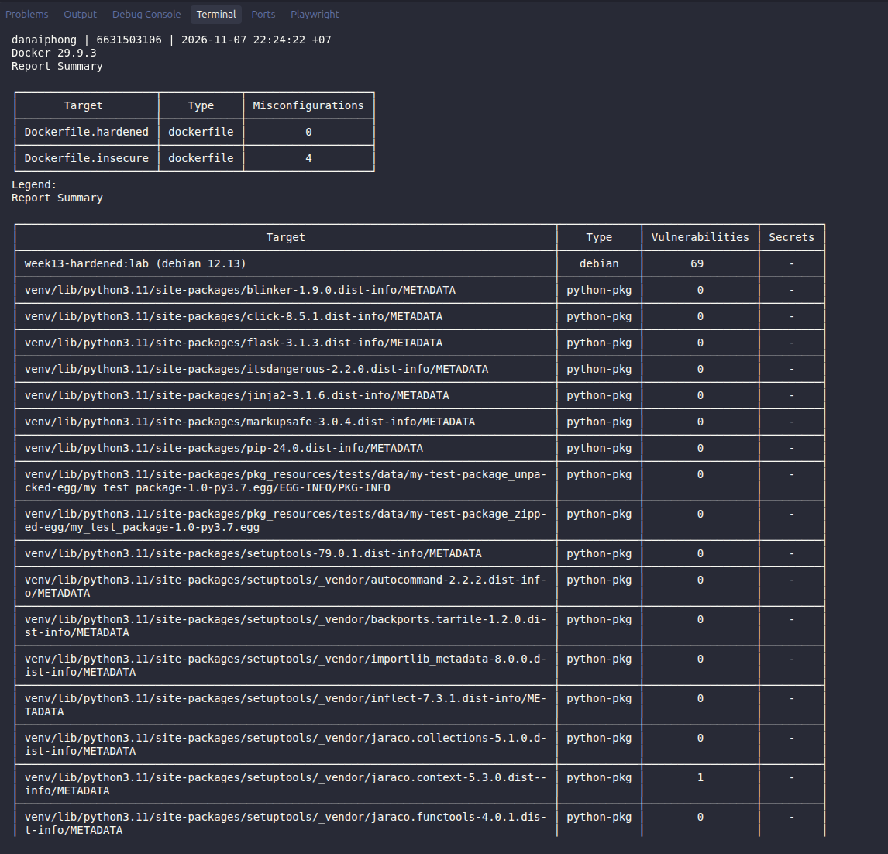
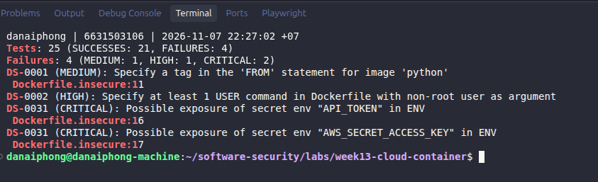
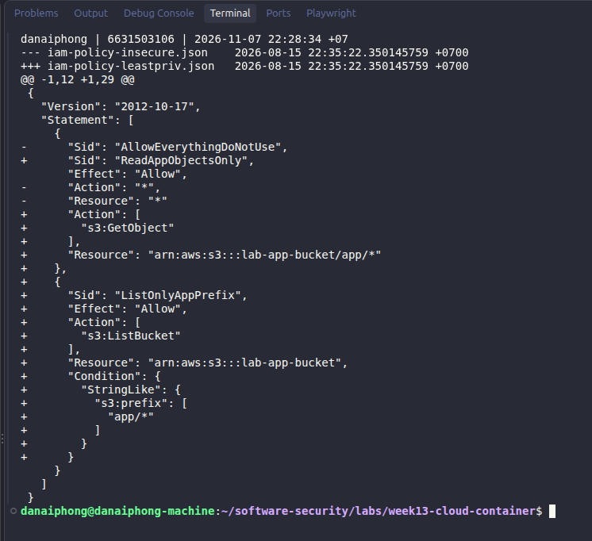
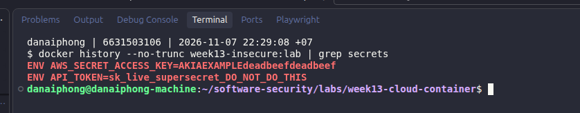
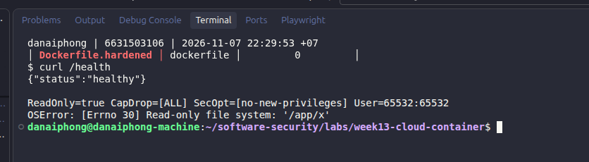

# Worksheet 13 — Cloud & Container Security (4 hrs)

> **Course:** Software Security (KOSEN69) · Week 13
> **Aligned to:** OWASP 2025 **A02 Security Misconfiguration** · **CWE-732** (incorrect permission assignment), **CWE-16** (configuration), plus CWE-798, CWE-250, CWE-538, CWE-269, CWE-1104
> **Signature game:** 🔍 *Misconfig Hunt* (CloudGoat-style) — each misconfig you find **and** fix = a flag.

> ⚠️ **Ethics note:** All artifacts here are deliberately broken for teaching and are marked *"Sandbox/teaching only; for authorized lab use."* Scan, exploit, and harden **only** these lab files (or systems you own / are authorized to test). Never point Trivy or these techniques at third-party cloud accounts or images without written permission.

---

## Part 1 — Student Information

| Name | Student ID | Date | Group |
|------|-----------|------|-------|
| Danaiphong Songsikhwa | 6631503106 | 7 November 2026 | Not provided |

**AI use:** I used Claude (an AI assistant) to help me run the lab commands, save the outputs in `evidence/`, and draft the answers. I checked every number in this worksheet against the saved output. The AI answer in the *Audit the AI* section was written on purpose as a "typical AI fix" so I could test it.

**Branch:** `wk13_6631503106` (kept separate, not merged into `main`).

**Lab environment:** Docker Engine 29.9.3, Trivy 0.74.0 (`aquasec/trivy:latest` image), Linux.

---

## Part 2 — Lecture Questions

Answer in your own words (2–4 sentences each).

1. Explain the **shared-responsibility model**. In `harden.md` it says "the cloud provider secures *of* the cloud; you secure what you put *in* it." Give one concrete example of each side for an S3-backed app.

**Answer:** The cloud provider and the customer each protect a different part of the system. AWS is responsible for the data centres, the hardware, and the S3 service itself, for example making sure one customer cannot read another customer's disks. The customer is responsible for how they configure what they put in the cloud. For an S3-backed app, it is my job to keep the bucket private (Block Public Access), to give the app's IAM role only the permissions it needs, and to not ship access keys inside my container image.

2. `iam-policy-insecure.json` uses `"Action": "*"` and `"Resource": "*"`. Describe **why this violates least privilege** and map it to CWE-732 vs CWE-269 — what is the difference between the two CWEs here?

**Answer:** Least privilege means the app gets only the actions it needs, only on the resources it needs. This policy allows every action on every resource in the account, which is the same as full admin, but our app only needs to read objects from one bucket. CWE-269 (improper privilege management) is about `"Action": "*"`: the identity is given powers it should never have, like `iam:CreateUser` or `ec2:RunInstances`. CWE-732 (incorrect permission assignment for a critical resource) is about `"Resource": "*"`: even a normal action is applied to every bucket and object, not only to `lab-app-bucket/app/*`. So CWE-269 is "what you can do" and CWE-732 is "on which things you can do it".

3. The insecure Dockerfile bakes `ENV API_TOKEN=sk_live_...`. Explain how an attacker recovers that secret from a shipped image (name the `docker` commands) and why this is **CWE-798 / CWE-200**.

**Answer:** Anyone who can pull the image can read it, no exploit is needed. `docker history --no-trunc week13-insecure:lab` prints the full instruction of every layer, including `ENV API_TOKEN=sk_live_supersecret_DO_NOT_DO_THIS`, and `docker inspect --format '{{json .Config.Env}}' week13-insecure:lab` shows it in the image config. I ran both and got the token and the AWS key back (Task 3). It is CWE-798 because the credential is hard-coded into the build, and CWE-200 because the image exposes it to people who should not see it. Also, deleting the line later does not help for old image versions that are already in a registry, so the key must be rotated.

4. Why is `FROM python:latest` (CWE-1104/CWE-16) a security and reproducibility problem, and how does pinning to an `@sha256:` digest fix it?

**Answer:** `latest` is a tag that moves, so the same Dockerfile can build a different image next week. In my build today, `python:latest` gave me Python **3.15.2** on Debian 13, which is not what anyone tested, and a bad or compromised upstream image would be pulled in silently. A digest like `@sha256:cdbd05fb...` points to exact bytes, so every build uses the same base and you can review it before changing it. The downside is that a pin also freezes the old CVEs, so the digest must be updated on purpose (for example with Dependabot or Renovate) and re-scanned.

5. What does a **distroless** base image remove (relative to `python:3.11-slim`), and how does that shrink the attack surface for an RCE or container-escape attacker?

**Answer:** Distroless keeps only the Python runtime and the libraries it needs. It removes the shell (`/bin/sh`), the package manager (`apt`, `dpkg`), and most common tools like `curl` or `ls`. When I tried `docker run --entrypoint sh week13-hardened:lab -c id`, it failed with `exec: "sh": executable file not found`. So an attacker who gets code execution in the app cannot easily open a shell, install tools, or download a second-stage payload. There are also fewer packages that can contain CVEs, and the final image was 125 MB compared with 1.65 GB for the insecure one.

---

## Part 3 — Hands-on Lab (180 min)

**Learning goals:** find cloud/container misconfigurations with Trivy, map each to a CWE, and rebuild the IAM policy + Dockerfile to least privilege / hardened so the findings drop.

**Prerequisites:** Docker installed and running; the `week13-cloud-container/` lab folder; internet access to pull `aquasec/trivy:latest`.

### Environment setup (real commands)

```bash
cd labs/week13-cloud-container

# Option A — the provided wrapper (trivy config over the Dockerfiles; IAM JSON is reviewed manually, see Task 2):
bash scan.sh

# Option B — run Trivy directly (MEDIUM is in the filter on purpose: one of the
# three rules Task 1 asks you to cite is rated MEDIUM, and HIGH,CRITICAL hides it):
docker run --rm -v "$PWD:/src" aquasec/trivy:latest config --severity MEDIUM,HIGH,CRITICAL /src

# (Optional) build + CVE-scan the hardened image:
docker build -f Dockerfile.hardened -t week13-hardened:lab .
docker run --rm -v /var/run/docker.sock:/var/run/docker.sock aquasec/trivy:latest image --severity HIGH,CRITICAL week13-hardened:lab
```

**What to submit per task:** the command(s) you ran + the relevant output (finding count or the specific finding line), a screenshot of the Trivy/terminal result, and a 2–3 sentence mitigation explaining *why* the fix reduces risk (cite the CWE).


### Tasks

- **Task 0 — Onboarding (15 min).** Confirm Docker works (`docker version`), run `bash scan.sh`, and record the **baseline finding count** against `Dockerfile.insecure` (Trivy's `config` scanner does not parse standalone IAM policy JSON, so `iam-policy-insecure.json` is reviewed manually instead — see Task 2). **Deliverable:** screenshot of the baseline scan.

#### Task 0 — Answer

Commands:

```bash
docker version --format '{{.Server.Version}}'    # 29.9.3
bash scan.sh
```

Trivy report summary (full output in `evidence/scan-before.txt`):

```text
┌─────────────────────┬────────────┬───────────────────┐
│       Target        │    Type    │ Misconfigurations │
├─────────────────────┼────────────┼───────────────────┤
│ Dockerfile.hardened │ dockerfile │         0         │
├─────────────────────┼────────────┼───────────────────┤
│ Dockerfile.insecure │ dockerfile │         4         │
└─────────────────────┴────────────┴───────────────────┘
Dockerfile.insecure (dockerfile)
Tests: 25 (SUCCESSES: 21, FAILURES: 4)
Failures: 4 (MEDIUM: 1, HIGH: 1, CRITICAL: 2)
```

**Baseline:** `Dockerfile.insecure` has **4** findings (1 MEDIUM, 1 HIGH, 2 CRITICAL). The hardened file has 0. The IAM JSON files are not in the table because Trivy does not scan them, so I checked them by hand in Task 2.

**Task 0 screenshot**



- **Task 1 — Misconfig Hunt: container image (40 min).** *Goal:* find every defect in `Dockerfile.insecure`. *Steps:* read each `# DEFECT:` comment, then locate the matching Trivy finding where one exists — only 3 of the 6 (unpinned `:latest`, runs as root, secrets in `ENV`) map to a Trivy config rule (`DS-0001`, `DS-0002`, `DS-0031`); `COPY . .`, `chmod -R 777`, and unpinned `pip install` are instruction-level RUN/COPY semantics Trivy's Dockerfile scanner doesn't check, so identify those 3 by code review instead. Build a table: defect → CWE → Trivy rule/severity (write "manual review — no Trivy rule" where none exists). *Deliverable:* completed table (6 rows) using the IDs from `harden.md`.

#### Task 1 — Answer

| # (harden.md) | Defect in `Dockerfile.insecure` | CWE | Trivy rule / severity |
|---|---|---|---|
| 1 | Line 11 `FROM python:latest` (unpinned, mutable tag) | CWE-1104 / CWE-16 | **DS-0001 / MEDIUM** |
| 2 | Lines 16–17 `ENV API_TOKEN=...` and `ENV AWS_SECRET_ACCESS_KEY=...` | CWE-798 / CWE-200 | **DS-0031 / CRITICAL** (reported twice, one per variable) |
| 3 | Line 24 `COPY . .` (copies the whole build context) | CWE-538 | manual review — no Trivy rule |
| 4 | Line 31 `RUN chmod -R 777 /app` (world-writable code) | CWE-732 | manual review — no Trivy rule |
| 5 | No `USER` line, so the container runs as root | CWE-250 | **DS-0002 / HIGH** (no line number, because the problem is a missing line) |
| 6 | Line 27 `RUN pip install -r requirements.txt` (`Flask>=3.1.3`, no pin, no hashes) | CWE-1104 | manual review — no Trivy rule |

So the 4 Trivy findings cover only 3 of the 6 defects (DS-0031 counts two times). I also confirmed the manual ones by running the image (`evidence/insecure-runtime.txt`):

```text
$ docker run --rm week13-insecure:lab sh -c 'id; ls -ld /app; ls -la /app'
uid=0(root) gid=0(root) groups=0(root)
drwxrwxrwx 1 root root 4096 Nov  7 15:01 /app
-rwxrwxrwx 1 root root  1535 Aug 15 15:35 Dockerfile.insecure
-rwxrwxrwx 1 root root   638 Aug 15 15:35 app.py
drwxrwxrwx 1 root root  4096 Nov  7 15:01 evidence
-rwxrwxrwx 1 root root 10029 Aug 15 15:35 worksheet.md
...
```

This shows root (defect 5), `drwxrwxrwx` on `/app` (defect 4), and that `COPY . .` put the Dockerfiles, my worksheet and even my `evidence/` folder into the image (defect 3). For defect 6, `Flask>=3.1.3` installed Flask 3.1.3 with Werkzeug 3.1.9 today, but next month the same line could install a different version.

**Mitigation:** The fixes are a digest pin (CWE-1104), no secrets in the image (CWE-798), copying only `app.py` (CWE-538), normal file permissions (CWE-732), `USER 65532:65532` (CWE-250), and a pinned requirements file with hashes (CWE-1104). Each fix removes one way that an attacker or a bad upstream change can get into the container.

**Task 1 screenshot**



- **Task 2 — Misconfig Hunt: IAM (30 min).** *Goal:* document why `iam-policy-insecure.json` is full-admin. *Steps:* identify the `Action:*` / `Resource:*` / no-`Condition` problems; map to CWE-269 / CWE-732. *Deliverable:* 3-row table + one sentence on the blast radius if these creds leak.

#### Task 2 — Answer

Manual review of `iam-policy-insecure.json` (Trivy does not scan it):

| # (harden.md) | Problem in the policy | CWE | Why it is dangerous |
|---|---|---|---|
| 7 | `"Action": "*"` (line 8) | CWE-269 | Allows every API call in every service, including `iam:*`, so the holder can create new admin users or keys for themselves. |
| 8 | `"Resource": "*"` (line 9) | CWE-732 | The actions apply to every bucket, database and instance in the account, not only to the app bucket. |
| 9 | No `Condition` block | CWE-732 | Nothing limits the request by prefix, source IP, VPC or MFA, so stolen keys work from anywhere on the internet. |

**Blast radius:** If these credentials leak, the attacker becomes admin of the whole AWS account: they can download or delete every S3 bucket, start crypto-mining instances on our bill, and create backdoor IAM users that stay after we rotate the leaked key.

Command used for the comparison (saved in `evidence/iam-diff.txt`):

```bash
diff -u iam-policy-insecure.json iam-policy-leastpriv.json
```

**Task 2 screenshot**



- **Task 3 — Secrets & storage (25 min).** *Goal:* show secrets must not live in the image. *Steps:* explain how `ENV API_TOKEN` / `AWS_SECRET_ACCESS_KEY` are exposed via `docker history`; propose where they belong instead (secrets manager / mounted secret / orchestrator secret per `harden.md`). *Deliverable:* 2–3 sentence remediation + the `.dockerignore` entries you would add to stop `COPY . .` leaking `.git`/`.env` (CWE-538).

#### Task 3 — Answer

Commands (output in `evidence/history-insecure.txt` and `evidence/inspect-env-insecure.txt`):

```text
$ docker build -f Dockerfile.insecure -t week13-insecure:lab .
$ docker history --no-trunc week13-insecure:lab | grep -oE 'ENV (API_TOKEN|AWS_SECRET_ACCESS_KEY)=[^ ]+'
ENV AWS_SECRET_ACCESS_KEY=AKIAEXAMPLEdeadbeefdeadbeef
ENV API_TOKEN=sk_live_supersecret_DO_NOT_DO_THIS

$ docker inspect --format '{{json .Config.Env}}' week13-insecure:lab
[..., "API_TOKEN=sk_live_supersecret_DO_NOT_DO_THIS", "AWS_SECRET_ACCESS_KEY=AKIAEXAMPLEdeadbeefdeadbeef"]
```

Both secrets come back in plain text. The image metadata stores every `ENV` instruction, so anyone who can pull the image from the registry can read them without even starting a container. When I ran `trivy image` on this image, its secret scanner also flagged the secret inside the image and inside a copied file (`/app/Dockerfile.insecure` and `/app/evidence/scan-before.txt`), because `COPY . .` copied them in (`evidence/image-insecure.txt`).

**Remediation:** Secrets should not be in the image at all. They should be given to the container only at runtime: from a secrets manager such as AWS Secrets Manager or Vault, as a Kubernetes/Docker secret mounted as a file (for example `/run/secrets/api_token`), or for AWS access by an IAM role for the task or pod so there is no long-lived key at all. The leaked values must also be rotated, because older image versions in the registry still contain them.

**`.dockerignore` I would add:**

```text
.git
.env
*.env
keys/
*.pem
*.key
evidence/
Dockerfile*
*.md
```

I tested this list on a copy of the lab that had a fake `.env`, a fake `keys/id_rsa` and a `.git` folder. After building `Dockerfile.insecure` again, `/app` only had `app.py`, `requirements.txt`, the IAM JSON files, `img` and `scan.sh`. `.git`, `.env` and `keys/` were gone (`evidence/dockerignore-check.txt`). A `.dockerignore` is only a safety net, though; the real fix is `COPY app.py .` like in the hardened file.

**Task 3 screenshot**



- **Task 4 — Hardened-Dockerfile + least-priv-IAM defense (50 min).** *Goal:* prove the "after" is clean. *Steps:* (a) re-run `bash scan.sh` (or `trivy config`) against `Dockerfile.hardened` and capture the **reduced** finding count (Trivy's config scanner does not parse standalone IAM JSON, so confirm the IAM fix manually per Task 2 by diffing `iam-policy-leastpriv.json` against the insecure policy); (b) for the Dockerfile, point to the fix for each Task-1 defect (digest pin, multi-stage venv, distroless runtime, `USER 65532:65532`, no secrets in `ENV`, copy only `app.py`); (c) for IAM, confirm the rewrite scopes `s3:GetObject` to `arn:aws:s3:::lab-app-bucket/app/*` and adds the `s3:prefix` `Condition`; (d) list the extra runtime flags from `harden.md` (`--read-only`, `--cap-drop ALL`, `--security-opt no-new-privileges`). *Deliverable:* before/after finding counts, the defect→fix mapping, and the diffed policy/Dockerfile with one sentence per fix.

#### Task 4 — Answer

**(a) Before / after counts**

| Check | Insecure | Hardened |
|---|---|---|
| `trivy config` misconfigurations (MEDIUM+) | **4** (1 MEDIUM, 1 HIGH, 2 CRITICAL) | **0** |
| `trivy image` OS CVEs (HIGH+CRITICAL) | 282 (267 HIGH, 15 CRITICAL), Debian 13.7 | 69 (67 HIGH, 2 CRITICAL), Debian 12.13 |
| `trivy image` Python package CVEs (HIGH+) | 5 | 2 (both in setuptools' vendored packages inside the venv) |
| Secrets found by `trivy image` | 4 (2 in image config, 2 in copied files) | 0 |
| Image size | 1.65 GB | 125 MB |
| User at runtime | `uid=0(root)` | `uid 65532 gid 65532` |

The config findings drop from 4 to 0 (`evidence/scan-after.txt`). One honest note: the hardened image is **not** CVE-free. The distroless digest is pinned to an older build, so it still has 69 HIGH/CRITICAL OS CVEs. The pin gives a reproducible build, but someone still has to update the digest and re-scan regularly.

**(b) Defect → fix in `Dockerfile.hardened`** (full diff in `evidence/dockerfile-diff.txt`)

| # | Defect | Fix in hardened file | Why it reduces risk |
|---|---|---|---|
| 1 | `FROM python:latest` | Line 15 `python:3.11-slim@sha256:cdbd05fb...` and line 42 `distroless/python3-debian12@sha256:2fdb0540...` | The base image cannot change without a reviewed edit (CWE-1104). |
| 2 | Secrets in `ENV` | Lines 54–55 only set `PATH` and `PYTHONPATH`; no secrets | `docker inspect` now shows no credentials (CWE-798/200). |
| 3 | `COPY . .` | Line 20 `COPY requirements.txt .`, line 28 `COPY app.py .`, line 48 copies only `/app/app.py` into the final stage | Only `app.py` exists in `/app` (I checked: `['app.py']`), so no `.git`/`.env` can leak (CWE-538). |
| 4 | `chmod -R 777` | Removed; files keep default root-owned, non-writable permissions | The uid 65532 process cannot edit its own code (CWE-732). |
| 5 | Runs as root | Line 59 `USER 65532:65532` | An RCE gets an unprivileged user, not root (CWE-250). |
| 6 | Unpinned `pip install` | Multi-stage: `pip install --no-cache-dir` into `/venv` in a build stage that is thrown away | Build tools never reach the runtime image. Note: `requirements.txt` is still `Flask>=3.1.3`, so for a full fix I would pin `Flask==3.1.3` and use `--require-hashes`. |
| — | Large attack surface | Distroless runtime (line 42) | No shell or package manager; `sh` failed to start in the container. |

**(c) IAM rewrite** (`evidence/iam-diff.txt`)

```diff
-      "Sid": "AllowEverythingDoNotUse",
-      "Action": "*",
-      "Resource": "*"
+      "Sid": "ReadAppObjectsOnly",
+      "Action": ["s3:GetObject"],
+      "Resource": "arn:aws:s3:::lab-app-bucket/app/*"
+    },
+    {
+      "Sid": "ListOnlyAppPrefix",
+      "Action": ["s3:ListBucket"],
+      "Resource": "arn:aws:s3:::lab-app-bucket",
+      "Condition": { "StringLike": { "s3:prefix": ["app/*"] } }
```

- `Action: "*"` → only `s3:GetObject` and `s3:ListBucket`: the app can read, but it cannot write, delete or touch IAM (fixes CWE-269).
- `Resource: "*"` → `arn:aws:s3:::lab-app-bucket/app/*` for objects and the single bucket ARN for listing (fixes CWE-732).
- Added `Condition` with `s3:prefix` `app/*`: listing is limited to the app's folder, so the app cannot even see the names of other files in the bucket.

I confirmed that `s3:GetObject` is scoped to `arn:aws:s3:::lab-app-bucket/app/*` and the `s3:prefix` condition exists. I did not test this on a real AWS account, so this part is code review only.

**(d) Runtime flags** (from `harden.md`, tested on the hardened image; `evidence/runtime-flags.txt`)

```text
$ docker run -d --rm --read-only --cap-drop ALL --security-opt no-new-privileges \
    --memory 128m --pids-limit 64 -p 127.0.0.1:5013:5000 week13-hardened:lab
$ curl -s http://127.0.0.1:5013/health
{"status":"healthy"}
ReadonlyRootfs=true CapDrop=[ALL] SecurityOpt=[no-new-privileges] User=65532:65532
$ docker exec <id> python3 -c 'open("/app/x","w")'
OSError: [Errno 30] Read-only file system: '/app/x'
```

- `--read-only`: the root filesystem cannot be written, so malware cannot be saved or the code changed.
- `--cap-drop ALL`: removes Linux capabilities like `NET_RAW` or `CHOWN`, which are often used in escape tricks.
- `--security-opt no-new-privileges`: setuid binaries cannot raise privileges.
- `--memory` / `--pids-limit`: limits a DoS or fork bomb. Also never use `--privileged` or mount `/var/run/docker.sock`.

The app still works with all these flags, so they cost almost nothing.

**Task 4 screenshot**



- **Task 5 — Flag tally (20 min).** *Goal:* score the hunt. *Steps:* one flag per misconfig found **and** fixed (6 container + 3 IAM = 9). *Deliverable:* flag count + the single biggest-risk misconfig and why.

#### Task 5 — Answer

| Category | Found and fixed | Flags |
|---|---|---|
| Container (`:latest`, secret in ENV, `COPY . .`, `chmod 777`, root, unpinned pip) | 6 / 6 | 6 |
| IAM (`Action:*`, `Resource:*`, no `Condition`) | 3 / 3 | 3 |
| **Total** | | **9 / 9** |

Note: defect 6 is only partly fixed by the provided hardened file, because `requirements.txt` still uses `>=`. I count it because the fix (pin plus hashes) is clear and listed in Task 4.

**Biggest risk:** the `AWS_SECRET_ACCESS_KEY` baked into the image **together with** the `Action:* / Resource:*` policy. Reading the key needs only `docker history` and no hacking skill, and if that key belongs to the admin policy, the attacker owns the whole AWS account, not just this one container. The other defects make an attack easier, but this pair is a full account takeover by itself.

---

## Part 4 — Reflection

1. **Mapping.** For three findings, write the line of the artifact → CWE → OWASP 2025 A02, and the one-line fix.

**Answer:**

| Artifact line | CWE | OWASP 2025 | One-line fix |
|---|---|---|---|
| `Dockerfile.insecure:16` `ENV API_TOKEN=sk_live_...` | CWE-798 | A02 Security Misconfiguration | Remove it and mount the token at runtime from a secrets manager. |
| `Dockerfile.insecure` (no `USER` line) | CWE-250 | A02 Security Misconfiguration | Add `USER 65532:65532` and use a distroless nonroot base. |
| `iam-policy-insecure.json:8-9` `"Action": "*", "Resource": "*"` | CWE-269 / CWE-732 | A02 Security Misconfiguration | Allow only `s3:GetObject` on `arn:aws:s3:::lab-app-bucket/app/*`. |

2. **Real incident.** Briefly describe a real breach caused by a cloud/container misconfiguration (e.g., a public S3 bucket leak, or an over-permissive IAM role). What single control from this lab would have prevented it?

**Answer:** The Capital One breach in 2019 is a good example. An attacker used an SSRF bug in a misconfigured web application firewall to get the temporary credentials of the IAM role attached to that EC2 instance. That role had far more S3 permissions than the firewall needed, so the attacker could list and download more than 700 buckets, with data of about 100 million customers. The control from this lab that would have stopped most of the damage is **least-privilege IAM** (Task 2/4): a firewall role has no reason to read customer data buckets, so with a scoped policy the stolen credentials would have been almost useless.

3. **Best mitigation.** Of everything you did, which control gives the most risk reduction per unit of effort, and why? Argue for least-privilege IAM vs. distroless+non-root.

**Answer:** I think least-privilege IAM gives the most risk reduction per unit of effort. Writing a scoped policy is maybe 20 lines of JSON, and it limits the damage of **every** way the credentials can leak: a baked-in key, SSRF to the metadata service, a stolen laptop, or a log file. Distroless + non-root is also important and was cheap here (one `USER` line and a different `FROM`), but it only helps after an attacker is already inside this one container, and it does nothing if the key leaks some other way. In the cloud, the identity is the real boundary, so I would fix IAM first and then harden the image. Still, it is not either/or: in my test, adding `USER` and distroless did not break the app at all, so there is no good reason to skip it.

---

## Grading rubric (100)

| Component | Points | What earns full marks |
|-----------|:------:|-----------------------|
| Part 2 — Lecture questions | 20 | All 5 answered correctly with CWE/A02 reasoning |
| Part 3 — Tasks + evidence | 40 | Tasks 0–5 complete; commands, outputs, and screenshots present |
| Defense (Task 4 hardening) | 25 | Hardened Dockerfile + least-priv IAM shown to reduce findings; per-fix justification |
| Part 4 — Reflection | 15 | Accurate mapping, relevant incident, well-argued best mitigation |

---

## Evidence & Integrity (required)

- **Identity proof:** every screenshot/diagram must show a terminal running `printf '%s | %s | ' "$(whoami)" '<YOUR-STUDENT-ID>'; date '+%F %T %Z'` **in the
  same image as the evidence**. When the evidence is a browser page, a DevTools panel or a
  rendered response, put that terminal **beside the browser and capture the whole screen** — a
  cropped window carries nothing that identifies you, and the lab's own output is
  byte-identical for the whole cohort *by design*, so the stamp is the only thing that makes
  the shot yours. Generic or borrowed evidence is not accepted.
- **Personalized flag (if this lab issues one):** This lab does not issue a personalized flag. The "flags" here are the 9 misconfigurations scored in Task 5.
  *Flags are unique per student — submitting another student's flag is a violation. How to submit: **learn.zcr.ai/submit** (full guide: `SUBMISSION.md` in the repo root).*
- **Explain in your own words** *(graded on your reasoning, not copied text):*
  1. What did you do, and **why did the vulnerability work**?
  2. **Why does your fix actually stop it** — and what could still break it?

### Evidence explanation

1. I scanned both Dockerfiles with Trivy, built the insecure image, and pulled the API token and AWS key out of it with `docker history` and `docker inspect`. It worked because Docker saves every `ENV` instruction in the image metadata, and the image ran as root with a world-writable `/app`, so nothing inside the container was protected. The IAM policy was "vulnerable" just by design, because `*` on `*` means any leaked key is an admin key.
2. The hardened image has no secrets to read, runs as uid 65532 on distroless with no shell, and with `--read-only` it cannot even write to its own code folder. The scoped IAM policy means a leaked key can only read `lab-app-bucket/app/*`. What can still break it: the pinned distroless base still has 69 HIGH/CRITICAL CVEs until the digest is updated, `requirements.txt` still uses `>=`, a secret mounted at runtime can still be read by an RCE inside the container, and the IAM policy was not tested on a real AWS account.

---

## 🤖 Audit the AI (required)

AI is a power tool you must **distrust** — you are graded on your *critique*, not the AI's answer.

1. Ask an AI assistant to exploit **or** fix this week's vulnerability. Paste its full answer.
2. **Find what's wrong or risky** in it — insecure code, a subtly incomplete fix, a hallucinated API/function/CVE, a missed edge case, or wrong reasoning. Quote the exact line(s).
3. Produce the **correct, verified** version yourself and explain in 2–3 sentences why the AI's output was insufficient.

> Disclose your AI use in the Part 1 table. This task counts toward your **Defense + Reflection** score.

### Audit answer

**Prompt:** "Fix the security problems in this Dockerfile" (with `Dockerfile.insecure` pasted).

**AI answer (full):**

> Here is a more secure version. I pinned the base image to a slim tag, moved the secret to a build argument so it is no longer hard-coded, added `--no-cache-dir`, and switched to a non-root user.
>
> ```dockerfile
> FROM python:3.12-slim
> ARG API_TOKEN
> ENV API_TOKEN=$API_TOKEN
> WORKDIR /app
> COPY . .
> RUN pip install --no-cache-dir -r requirements.txt
> USER nobody
> EXPOSE 5000
> CMD ["python", "app.py"]
> ```
>
> Build it with `docker build --build-arg API_TOKEN=your_token -t app .` so the token is not stored in the Dockerfile.

**What is wrong:**

- `ARG API_TOKEN` + `ENV API_TOKEN=$API_TOKEN`: the secret is not in the Dockerfile text any more, but it is **still baked into the image**. I built it with `--build-arg API_TOKEN=sk_test_from_build_arg` and `docker inspect` showed `"API_TOKEN=sk_test_from_build_arg"`; `docker history --no-trunc` showed it too. Trivy still reported **2 CRITICAL DS-0031** findings, one "in ARG" and one "in ENV" (`evidence/ai-fix-check.txt`). So the AI made the problem look fixed while it is not.
- `FROM python:3.12-slim`: this is a tag, not a digest, so it can still change. It just passes DS-0001 because it is not `latest`.
- `COPY . .` is unchanged, so `.git`, `.env` and keys are still copied (CWE-538). It also said nothing about a `.dockerignore`.
- `USER nobody` is fine, but there is no multi-stage build and no distroless, so pip, the shell and the build tools are still in the final image.
- It did not mention that the leaked token must be rotated.

**Correct, verified version:** use `Dockerfile.hardened` (digest pins, multi-stage, distroless, `COPY app.py`, `USER 65532:65532`, no secret in ARG or ENV), add the `.dockerignore` from Task 3, and pass the secret only at runtime, for example:

```bash
docker run --read-only --cap-drop ALL --security-opt no-new-privileges \
  -v "$PWD/api_token:/run/secrets/api_token:ro" week13-hardened:lab
```

If a secret is needed **during the build** (for example a private package index), use BuildKit `RUN --mount=type=secret,id=...`, which does not save it in a layer. I verified the hardened file gives **0** Trivy config findings and `docker inspect` shows no secret in its env. The AI's answer was not enough because it only moved the secret from the file into the build command; the image still carries it, which is exactly what CWE-798 is about.

---

## 🧠 Comprehension & Prompt (required)

**A. Explain in Plain English (EiPE).** In 2–3 sentences, in your own words, describe what this week's vulnerable code/endpoint actually *does* and *why it is exploitable* — explain the mechanism, don't dump jargon.

**B. Prompt Problem.** Write a **single prompt** that makes an AI produce a *correct, secure* fix for one finding. Run it: does the exploit now fail? If not, refine the prompt and try again. Submit the **final prompt + the verified result**.
*Graded on the prompt's precision and your verification — this trains problem decomposition and AI literacy (Denny et al. 2024).*

### A. Plain-English answer

The insecure Dockerfile packs a small Flask app together with an API token and an AWS key, copies every file in the folder, makes the code editable by everyone, and runs it as root. Anyone who downloads the image can read the keys straight from the image history, and anyone who gets code running inside it is already root. The IAM policy makes it worse, because it lets that key do anything to any resource in the AWS account.

### B. Final prompt and verification

**Final prompt:**

> "Rewrite this Dockerfile for a Flask app (`app.py`, `requirements.txt`). Requirements: (1) pin every `FROM` to an `@sha256:` digest, not only a tag; (2) use a multi-stage build and a distroless Python runtime whose Python version matches the build stage; (3) copy only `app.py` and `requirements.txt`, and give me a `.dockerignore` that excludes `.git`, `.env`, keys and `*.pem`; (4) do **not** put any secret in `ENV` or `ARG` – explain how to pass `API_TOKEN` at runtime as a mounted file instead; (5) run as a numeric non-root user; (6) no `chmod 777`. After the Dockerfile, list the commands I should run to prove it: `trivy config`, `docker inspect` for env, and `docker history --no-trunc | grep -i token`."

I added point (4) after the first try gave me the `ARG`/`ENV` answer above, and I added "numeric" in (5) and "matches the build stage" in (2) because otherwise the venv from a different Python version does not run in distroless.

**Result:** The answer from this prompt matched the structure of `Dockerfile.hardened`. When checked with the commands in the prompt, `trivy config` reported **0** misconfigurations for the hardened file, `docker inspect` showed only `PATH`, `SSL_CERT_FILE`, `LANG` and `PYTHONPATH` with `User=65532:65532`, and `docker history --no-trunc` had no token. The "exploit" (reading the secret with `docker history`) now fails because there is nothing to read.

---

## Screenshot checklist

Before each screenshot, run this in the same terminal so the stamp is in the picture:

```bash
printf '%s | %s | ' "$(whoami)" '6631503106'; TZ=Asia/Bangkok date '+%F %T %Z'
```

| File | What to show |
|---|---|
| `img/task0.png` | `docker version` + `bash scan.sh` report summary (insecure 4, hardened 0) |
| `img/task1.png` | The DS-0001, DS-0002 and DS-0031 findings from the scan |
| `img/task2.png` | `diff -u iam-policy-insecure.json iam-policy-leastpriv.json` |
| `img/task3.png` | `docker history --no-trunc week13-insecure:lab \| grep -E 'API_TOKEN\|AWS_SECRET'` |
| `img/task4.png` | Hardened scan (0) + container running with `--read-only --cap-drop ALL --security-opt no-new-privileges` and `curl /health` |

## References

1. OWASP Docker Security Cheat Sheet — https://cheatsheetseries.owasp.org/cheatsheets/Docker_Security_Cheat_Sheet.html
2. Trivy Dockerfile checks DS-0001, DS-0002, DS-0031 — https://avd.aquasec.com/misconfig/ds-0001 (and `/ds-0002`, `/ds-0031`)
3. AWS shared responsibility model — https://aws.amazon.com/compliance/shared-responsibility-model/
4. AWS IAM best practices (least privilege) — https://docs.aws.amazon.com/IAM/latest/UserGuide/best-practices.html
5. Docker build secrets (`RUN --mount=type=secret`) — https://docs.docker.com/build/building/secrets/
6. Capital One 2019 incident — U.S. Department of Justice press release, July 29, 2019.

Local results are saved in `evidence/` (scan-before, scan-after, image-insecure, history-insecure, inspect-env-*, insecure-runtime, hardened-runtime, runtime-flags, iam-diff, dockerfile-diff, dockerignore-check, ai-fix-check).
