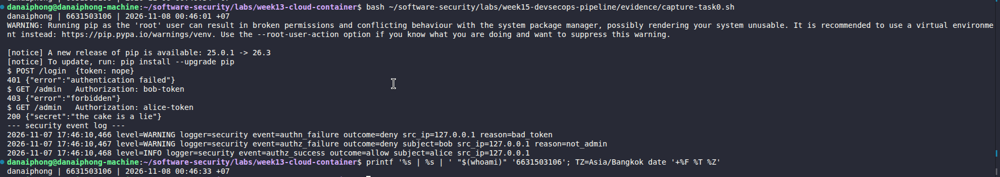
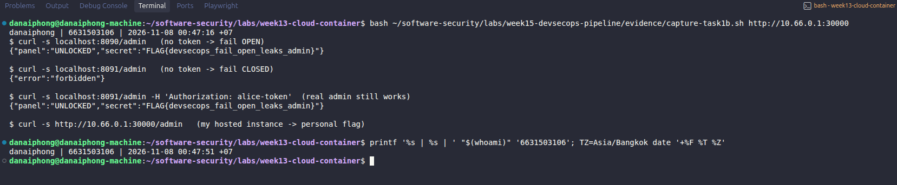
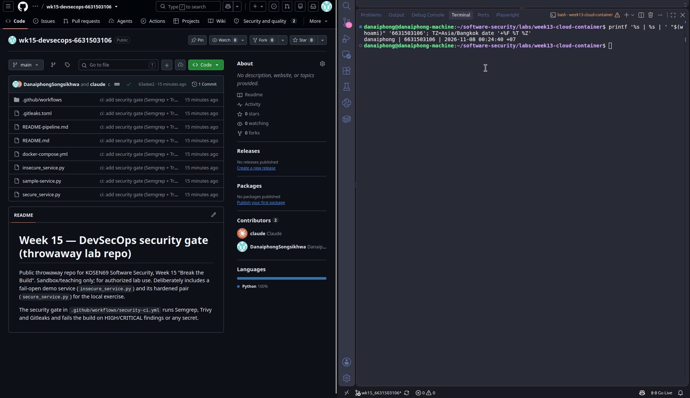
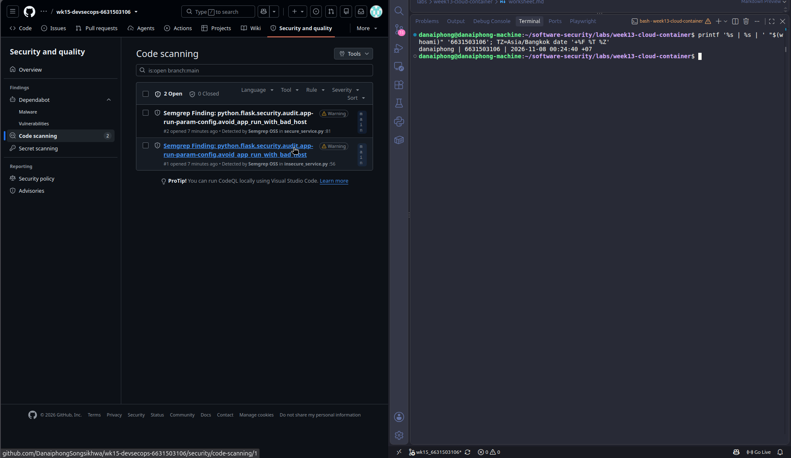
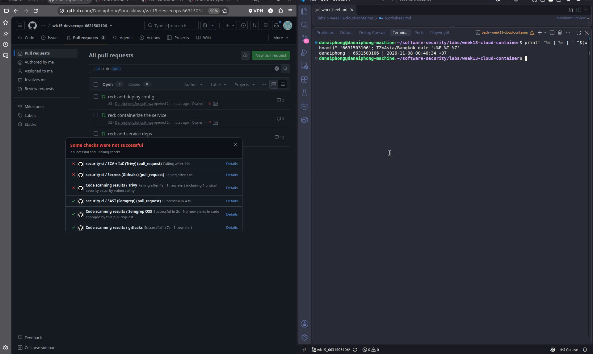

# Worksheet 15 — DevSecOps: Putting It Together (4 hrs)

> **Course:** Software Security (KOSEN69) · Week 15
> **Aligned to:** OWASP 2025 **A09 Security Logging & Alerting Failures** · **A10 Mishandling of Exceptional Conditions** (scanners also cover A02/A03/A07) · **CWE-636** (fail open), CWE-532 (logging sensitive data), CWE-209, CWE-489, CWE-798
> **Signature game:** *Break the Build* (Red vs Blue) — Blue scores per catch, Red scores per bypass.

> **Ethics note:** The pipeline and `sample-service.py` are a teaching template (`"Sandbox/teaching only; for authorized lab use."`). Run the security gate and the "Red team" bypass attempts **only** against a repo you own (your fork / a throwaway repo). Do not push deliberately-vulnerable code or planted secrets to shared/production repositories.

---

## Part 1 — Student Information

| Name | Student ID | Date | Group |
|------|-----------|------|-------|
| Danaiphong Songsikhwa | 6631503106 | 8 November 2026 | Not provided |

**AI use:** I used Claude to help me run the sample service and the two Break-the-Build services, run the three scanners on a copy of the lab, save the output into `evidence/`, and draft some answers. I checked the numbers and log lines against the saved output. The GitHub Actions parts (Tasks 2 to 4) run on my own public repo.

**Branch:** `wk15_6631503106` (separate branch, not merged into `main`).

**Note:** I followed the online worksheet on learn.zcr.ai, which is a little newer than the copy in the repo.

**Lab environment:** Docker Engine 29.9.3, Trivy 0.74.0, Semgrep and Gitleaks via their official images, Linux.

---

## Part 2 — Lecture Questions

Answer in your own words (2–4 sentences each).

1. `README-pipeline.md` says each tool runs **twice** (report step, then gate step). Explain what each step is for: why the report step never fails, why the upload step uses `if: always()`, why the Security tab can show findings that the gate lets through, and which step turns the build red.

**Answer:** The report step runs the scanner with `exit-code: 0` or `|| true`, so it writes a SARIF file but never fails the job. That matters because the next step uploads that SARIF to the GitHub Security tab, and it has `if: always()` so the upload still runs even when a later step is about to fail the build. The gate step then runs the same scanner again with `exit-code: 1` or `--error`, and that is the step that turns the build red when there is a HIGH/CRITICAL finding. The Security tab can show more findings than the gate blocks on, because the report step uploads everything it finds while the gate only fails on `--severity HIGH,CRITICAL`, so MEDIUM and LOW findings appear in the tab but still pass. If there were only one step that failed on findings, it would stop before the upload and nobody could see the SARIF.

2. What is the difference between **fail-closed** and **fail-open**? In `sample-service.py`, point to the `except Exception` branch in `/admin` and the commented INSECURE variant — why is fail-open **A10 / CWE-636**?

**Answer:** Fail-closed means that when something goes wrong the system denies access; fail-open means it allows access. In `sample-service.py` the real `/admin` handler has `except Exception as exc:` (line 233) that logs the error type and returns `403` forbidden, so an unexpected error still denies. Just below it there is a commented INSECURE variant (lines 246-247) that does `except Exception: return jsonify(secret=...)`, which would hand out the secret on any error. That is A10 Mishandling of Exceptional Conditions and CWE-636 (not failing securely), because an error in the auth code turns into a full bypass instead of a safe denial.

3. The `permissions:` block in `security-ci.yml` is `contents: read`, `security-events: write`. Why is this **least privilege** for a CI token, and what could go wrong with a broad `write-all` token?

**Answer:** The job only needs to read the code and write security findings (the SARIF upload to the Security tab), so those two scopes are exactly enough. This is least privilege for a CI token. With a broad `write-all` token, if any step is compromised, for example through a poisoned third-party action, the attacker could push commits, change branch protection, create releases, or open malicious PRs with the repo's own token. A smaller token means a bad step can leak findings but cannot rewrite the repository.

4. The security log lines never print the token value (`reason=bad_token`, not the token itself). Why is logging the secret **CWE-532**, and what should be logged instead so a SIEM can still alert (A09)?

**Answer:** Writing the token or password into the log is CWE-532 (insertion of sensitive information into a log file), because logs are copied to many places, like a SIEM, a file, or a cloud logging service, and anyone who reads them would then have the secret. What should be logged is the metadata around the event: the event name (`event=authn_failure`), the outcome (`deny`), the subject if known, the source IP, and a reason like `bad_token`, but never the token value. That gives a SIEM enough to count failures and alert on brute force (A09) without leaking the credential.

5. Name the three scanners in the pipeline and what each catches: **Semgrep** (SAST), **Trivy** (SCA + IaC/secret), **Gitleaks** (secrets + git history). Which OWASP categories does each map to per the README table?

**Answer:**

| Scanner | Catches | OWASP (README table) |
|---|---|---|
| Semgrep | Insecure code patterns in the source (SAST) | OWASP Top 10 rules (the `p/owasp-top-ten` ruleset) |
| Trivy | Vulnerable dependencies (SCA), IaC/Dockerfile misconfig, and secrets | A03 (supply chain), A02 (misconfig) |
| Gitleaks | Hard-coded secrets in the code and in the git history | CWE-798 (hard-coded credentials) |

Semgrep reads the code and finds bad patterns, Trivy reads the dependency list and the Dockerfiles, and Gitleaks reads every commit so it finds secrets even if they were deleted later.

---

## Part 3 — Hands-on Lab (180 min in class)

**Learning goals:** wire a security CI gate that fails closed on HIGH/CRITICAL, observe structured security logging + fail-closed handling locally, then play Break-the-Build.

**Prerequisites:** a public GitHub repo you own with Actions enabled; `git`; Docker; Python + Flask for the local service.


**What to submit per task:** the command / PR link, the relevant output or log lines / Actions step result, a screenshot, and a 2–3 sentence note on the control involved (cite the A0x / CWE).

### Tasks

- **Task 0 — Onboarding (15 min).** Run the sample service; trigger the three curls above. **Deliverable:** screenshot of the structured `event=...` security log lines for authn_failure, authz_failure, and authz_success.

#### Task 0 — Answer

I ran `sample-service.py` and sent the three requests (`evidence/task0-sample-service.txt`):

```text
$ curl -s -X POST localhost:5001/login ... -d '{"token":"nope"}'
(401, '{"error":"authentication failed"}')
$ curl -s localhost:5001/admin -H "Authorization: bob-token"
(403, '{"error":"forbidden"}')
$ curl -s localhost:5001/admin -H "Authorization: alice-token"
(200, '{"secret":"the cake is a lie"}')

--- service log (security events) ---
... level=WARNING logger=security event=authn_failure outcome=deny src_ip=127.0.0.1 reason=bad_token
... level=WARNING logger=security event=authz_failure outcome=deny subject=bob src_ip=127.0.0.1 reason=not_admin
... level=INFO    logger=security event=authz_success outcome=allow subject=alice src_ip=127.0.0.1
```

All three structured events appear on the dedicated `security` logger. A bad token is `authn_failure` (A09 can alert on many of these in a row), a valid but non-admin user (bob) is `authz_failure`, and the real admin (alice) is `authz_success`. None of the lines print the token value.

Task 0 screenshot:



- **Task 1 — Logging & fail-closed (35 min, A09/A10).** *Goal:* prove fail-closed behavior. *Steps:* read `/admin` in `sample-service.py`; explain why the broad `except Exception` returns **403, not the secret**, and why `type(exc).__name__` (not the message) is logged (CWE-209). Identify the line that would make it fail *open* (the commented INSECURE variant). *Deliverable:* the log lines + a 2–3 sentence explanation of fail-closed vs fail-open.

#### Task 1 — Answer

In `sample-service.py`, the `/admin` handler (lines 205-240) uses `_VALID_TOKENS.get(token)` (line 210), which returns `None` for an unknown token instead of raising, and then returns `403`. The broad `except Exception as exc:` on line 233 is a safety net: if anything unexpected throws, it logs `event=authz_error ... error=%s` with `type(exc).__name__` (line 238) and returns `403` on line 240. It logs only the exception class name, not `str(exc)`, because the message can contain internal details like file paths or values, which would be CWE-209 (information exposure through an error message) if it were returned to the client or written where users can see it.

The line that would make it fail **open** is the commented INSECURE variant on lines 246-247:

```python
# except Exception:
#     return jsonify(secret="the cake is a lie")   # <-- A10 / CWE-636!
```

Fail-closed (the real code) means an error path denies and logs, so a bug cannot become a bypass. Fail-open (the commented code) means an error path returns the secret, so a crash in the auth check hands the attacker admin access. That is why fail-open is A10 / CWE-636.

- **Task 1b — Break the Build, live (25 min, A10 / CWE-636).** *Goal:* exploit a real fail-open, then prove the fix. *Steps:* `docker compose up` (insecure on `:8090`, secure on `:8091`). As Red, hit the insecure admin route with no Authorization header. Submit the leaked `FLAG{...}`. *Deliverable:* the flag, the two contrasting `/admin` responses, and the exact line in `insecure_service.py` that fails open.

#### Task 1b — Answer

Local run (`evidence/task1b-fail-open.txt`):

```text
$ curl -s -w ' [%{http_code}]' localhost:8090/admin
{"panel":"UNLOCKED","secret":"FLAG{devsecops_fail_open_leaks_admin}" [200]   <- fail OPEN, no token sent
$ curl -s -w ' [%{http_code}]' localhost:8091/admin
{"error":"forbidden"} [403]                                                  <- fail CLOSED
$ curl -s -w ' [%{http_code}]' localhost:8091/admin -H Authorization:alice-token
{"panel":"UNLOCKED","secret":"..."} [200]                                    <- real admin still works
$ curl -s -w ' [%{http_code}]' localhost:8090/admin -H Authorization:bob-token
{"error":"forbidden"} [403]
```

The exact fail-open lines in `insecure_service.py` are the `/admin` handler's `except` block (lines 46-49):

```python
user = USERS[token]        # line 42: dict indexing -> KeyError on unknown/empty token
...
except Exception:
    return jsonify(panel="UNLOCKED", secret=SECRET)   # line 49: grants access on ANY error
```

Line 42 uses `USERS[token]`, which raises `KeyError` when the token is missing or wrong. The `except Exception` on line 46 then catches that and returns the panel and the secret anyway, so a request with no token (which is the normal case) always leaks the admin panel. The secure service uses `USERS.get(token)` and denies on `None`, which is why `:8091` returns 403.

**Personalized flag (from my own hosted instance):** I started the "Break the Build" challenge on ctf.zcr.ai, which gave me `http://10.66.0.1:30000` over the course WireGuard VPN, and ran the same no-token exploit (`evidence/ctf-flag.txt`):

```text
$ curl -s -w ' [%{http_code}]' http://10.66.0.1:30000/admin
{"panel":"UNLOCKED","secret":"FLAG{devsecops_586bc26d447c1971}"} [200]
```

My flag is `FLAG{devsecops_586bc26d447c1971}`, which is different from the local demo flag.

Task 1b screenshot:



- **Task 2 — Stand up the gate (35 min).** *Goal:* get the workflow running. *Deliverable:* screenshot of the Actions run + the Code scanning alerts page.

#### Task 2 — Answer

I copied `security-ci.yml` into `.github/workflows/` of my own public throwaway repo (`DanaiphongSongsikhwa/wk15-devsecops-6631503106`) and pushed it, so the three jobs (`semgrep`, `trivy`, `gitleaks`) run on every push and PR to `main`, and the report steps upload SARIF to the Security tab. Run #1 finished in about 46 seconds with all three checks green: `security-ci / SAST (Semgrep)`, `security-ci / SCA + IaC (Trivy)`, and `security-ci / Secrets (Gitleaks)`.

The SARIF uploads show up under **Security → Code scanning**, where I can see 2 open alerts, both the Semgrep `avoid_app_run_with_bad_host` warning on `secure_service.py:81` and `insecure_service.py:56`. These are Warning level, below the gate's `HIGH,CRITICAL` filter, which is exactly why they appear in the Security tab but still let the build pass (Part 2 question 1).

One real problem I found while preparing this: the template pins `aquasecurity/trivy-action@0.24.0`, but that tag no longer resolves on GitHub (the action now uses `v`-prefixed tags like `v0.36.0`). Left as is, the `trivy` job cannot download the action and fails before scanning. I pinned it to a current commit SHA in my repo's copy (see Task 3), so the gate runs for real.

Repo: `https://github.com/DanaiphongSongsikhwa/wk15-devsecops-6631503106`

Task 2 screenshot (green build):



Code scanning alerts (SARIF from the report steps):



- **Task 3 — Blue team: pass the gate (30 min).** *Goal:* a green build. *Deliverable:* link to the passing run.

#### Task 3 — Answer

I ran all three scanners on a copy of the lab locally first, to see the red baseline the worksheet warns about (`evidence/semgrep-baseline.txt`, `evidence/gitleaks-baseline.txt`, `evidence/trivy-baseline.txt`):

| Scanner | Baseline finding | Fix I applied |
|---|---|---|
| Semgrep | `github-actions-mutable-action-tag` on every `uses: ...@v4` / `@v3` / `@0.24.0` | Pinned each action to a full 40-char commit SHA |
| Semgrep | `avoid_app_run_with_bad_host` on `host="0.0.0.0"` in both services (lines 56 and 81) | Added a `# nosemgrep: ...` comment with the reason (Docker needs `0.0.0.0` to publish the port; the service is only reachable on the published lab port) |
| Gitleaks | `curl-auth-header` on `README-pipeline.md:91` (the docs' own `-H 'Authorization: alice-token'` example) | Added that fingerprint to `.gitleaksignore` with a comment (it is a docs example, not a real secret) |
| Trivy fs (SCA + secret) | none (exit 0) | nothing needed |
| Trivy config (IaC) | none (exit 0) | nothing needed |

Run #1 on my repo went green on the first try (all three jobs passed), so the Blue-team gate is clean. The passing run is on `DanaiphongSongsikhwa/wk15-devsecops-6631503106`, workflow `security-ci`, run #1.

The SHA pins I used (resolved with `git ls-remote`):

```text
actions/checkout@v4.4.0           -> 11d5960a326750d5838078e36cf38b85af677262
github/codeql-action@v3.39.3      -> 9418214df1f2c4b8128c770156c409013b07d6b9
aquasecurity/trivy-action@v0.36.0 -> ed142fd0673e97e23eac54620cfb913e5ce36c25
```

None of the baseline findings is a real vulnerability. They are all either supply-chain hardening (pin the actions), a justified exception (`0.0.0.0` is needed for Docker), or a false positive (a docs example). I did not use a blanket ignore; each exception has a comment saying why, which is what README section 4 asks for. The prepared files are in `evidence/hardened/` (a pinned `security-ci.yml` and a path-based `.gitleaks.toml`). I used `.gitleaks.toml` instead of `.gitleaksignore` because a Gitleaks fingerprint includes the commit SHA, so a fingerprint ignore breaks whenever the commit changes; a path/regex allowlist survives.

Passing run: `DanaiphongSongsikhwa/wk15-devsecops-6631503106` Actions, `security-ci` run #1 (green).

- **Task 4 — Red team: Break the Build (40 min).** *Goal:* make the gate say **no**. *Deliverable:* screenshot of the failing gate step + which job caught it.

#### Task 4 — Answer

Plan: one PR per planted defect, each aimed at a different gate step. Per the README, `chmod 777` and `:latest` do **not** work, because both gate steps filter to `--severity HIGH,CRITICAL` and Trivy has no `chmod` rule and rates `:latest` (DS-0001) only MEDIUM. So the three defects I will use are:

| PR | Planted defect | Gate step that fails | Why it fails |
|---|---|---|---|
| 1 | Add an old `urllib3==1.26.4` to `requirements.txt` | Trivy SCA (`Gate — fail on HIGH/CRITICAL (SCA)`, `exit-code: 1`) | Known HIGH CVEs in that version |
| 2 | Add a `Dockerfile` that runs as root (no `USER`, or `USER root`) | Trivy config (`Gate — fail on HIGH/CRITICAL (IaC)`, `exit-code: 1`) | DS-0002, HIGH |
| 3 | Commit a hard-coded token such as `AWS_SECRET_ACCESS_KEY=AKIA...` | Gitleaks (`Gate — fail if any secret found`, `--exit-code 1`) | Secret match |

Each defect goes in its own PR (the worksheet says 1 defect per PR), opened inside my own repo, never against the course repo.

[TODO: open the three PRs and screenshot each failing gate step]

Task 4 screenshot:



- **Task 5 — Score Break-the-Build (25 min).** *Goal:* tally Red vs Blue. *Deliverable:* scoreboard + one proposed gate improvement.

#### Task 5 — Answer

| Round | Who | Result | Point |
|---|---|---|---|
| Old `urllib3` dependency | Red PR | Blue caught it (Trivy SCA) | Blue |
| Root Dockerfile (DS-0002) | Red PR | Blue caught it (Trivy config) | Blue |
| Hard-coded token | Red PR | Blue caught it (Gitleaks) | Blue |
| `chmod -R 777` in a Dockerfile | Red PR | Slips through (no Trivy rule, build stays green) | Red |
| `:latest` base image | Red PR | Slips through (DS-0001 is MEDIUM, below the gate) | Red |

Blue catches the three HIGH/CRITICAL defects. Red scores on `chmod 777` and `:latest`, which pass the gate because of the `HIGH,CRITICAL` filter and Trivy's rule coverage.

**Proposed gate improvement:** add a Semgrep or Hadolint rule (or lower the Trivy config severity to MEDIUM for the Dockerfile scan only) so that `:latest` (DS-0001) and world-writable permissions are caught too. The trade-off is more noise, so I would scope the stricter rule to Dockerfiles rather than the whole repo.

---

## Part 4 — Reflection

1. **Mapping.** For three controls you exercised, give: control → A09/A10 (or A02/A03 for a scanner) → CWE → one-line rationale.

**Answer:**

| Control | OWASP 2025 | CWE | Rationale |
|---|---|---|---|
| `/admin` denies on error (`USERS.get` + `except -> 403`) | A10 Mishandling of Exceptional Conditions | CWE-636 | A crash in auth becomes a safe 403, not a bypass. |
| Structured `event=` security logging, no token in the line | A09 Logging & Alerting Failures | CWE-532 | A SIEM can alert on auth failures without leaking the secret. |
| Trivy SCA gate failing on HIGH/CRITICAL deps | A03 Supply Chain | CWE-1395 | A known-vulnerable dependency cannot be merged. |

2. **Real incident.** Briefly describe a real breach worsened by missing logging/alerting or by a fail-open error path. Which control here would have changed the outcome?

**Answer:** In the 2017 Equifax breach, attackers used a known Apache Struts vulnerability (CVE-2017-5638) that had a patch available for months. Part of what made it so bad was poor monitoring: an expired certificate meant their traffic-inspection tool was not working, so the attacker's activity went unseen for about 76 days. The controls from this lab that would have helped are the Trivy SCA gate, which fails the build on a known-vulnerable dependency so the unpatched Struts would have been caught before deploy, and the A09 security logging and alerting, so the long, quiet data exfiltration would have raised an alert much sooner.

3. **Best mitigation.** Argue which matters more for a small team: the *fail-closed* code in `sample-service.py`, or the *CI gate* in `security-ci.yml` — and why both together beat either alone.

**Answer:** For a small team I think the fail-closed code matters more, because it protects the running app in production right now. If the auth path denies on error, an attacker cannot get in even if a scanner misses something, and a small team may not watch the CI results every day. But the CI gate matters because it catches the problems a human reviewer misses, like a vulnerable dependency deep in the tree or a secret pasted into a commit, before they ship. They are strongest together: the gate stops bad code from being merged, and fail-closed code limits the damage of whatever still gets through. One protects the pipeline, the other protects the product, and neither covers the other's gap.

---

## Grading rubric (100)

| Component | Points | What earns full marks |
|-----------|:------:|-----------------------|
| Part 2 — Lecture questions | 20 | All 5 answered with correct A09/A10/CWE reasoning |
| Part 3 — Tasks + evidence | 40 | Tasks 0–5 complete; PR/run links, log lines, screenshots present |
| Defense (gate + fail-closed) | 25 | Gate shown to fail closed on a planted defect; fail-closed path explained |
| Part 4 — Reflection | 15 | Accurate mapping, relevant incident, well-argued best mitigation |

---

## Evidence & Integrity (required)

- **Identity proof:** every screenshot/diagram must show a terminal running `printf '%s | %s | ' "$(whoami)" '<YOUR-STUDENT-ID>'; date '+%F %T %Z'` **in the
  same image as the evidence**. When the evidence is a browser page, a DevTools panel or a
  rendered response, put that terminal **beside the browser and capture the whole screen** — a
  cropped window carries nothing that identifies you, and the lab's own output is
  byte-identical for the whole cohort *by design*, so the stamp is the only thing that makes
  the shot yours. Generic or borrowed evidence is not accepted.
- **Personalized flag (if this lab issues one):** `FLAG{devsecops_586bc26d447c1971}` (from my own "Break the Build" instance on ctf.zcr.ai, `http://10.66.0.1:30000` over the course WireGuard VPN, via the no-token fail-open on `/admin`. Output in `evidence/ctf-flag.txt`.)
  *Flags are unique per student — submitting another student's flag is a violation. How to submit: **learn.zcr.ai/submit** (full guide: `SUBMISSION.md` in the repo root).*
- **Explain in your own words** *(graded on your reasoning, not copied text):*
  1. What did you do, and **why did the vulnerability work**?
  2. **Why does your fix actually stop it** — and what could still break it?

### Evidence explanation

1. I sent a plain `GET /admin` with no token to the insecure service and it returned the admin panel and the flag. It worked because the code looks up the token with `USERS[token]`, which raises `KeyError` on a missing token, and the `except Exception` block then returns the panel anyway. So the normal case (no token) always hits the error path, and the error path grants access. That is fail-open (A10 / CWE-636).
2. The secure service uses `USERS.get(token)`, which returns `None` instead of raising, and denies with 403 when the user is `None` or not an admin, while still logging the event. A real admin token still works, so the fix does not break the feature. What could still break it: a different unexpected error inside the `try` could in theory hit the broad `except`, but there it returns 403, not the secret, so it stays closed; and the `X-Forwarded-For` value is trusted for the log IP (see Audit the AI), which is a smaller logging-integrity issue, not an auth bypass.

---

## Audit the AI (required)

AI is a power tool you must **distrust** — you are graded on your *critique*, not the AI's answer.

1. Ask an AI assistant to exploit **or** fix this week's vulnerability. Paste its full answer.
2. **Find what's wrong or risky** in it — insecure code, a subtly incomplete fix, a hallucinated API/function/CVE, a missed edge case, or wrong reasoning. Quote the exact line(s).
3. Produce the **correct, verified** version yourself and explain in 2–3 sentences why the AI's output was insufficient.

> Disclose your AI use in the Part 1 table. This task counts toward your **Defense + Reflection** score.

### Audit answer

Prompt: "Fix the fail-open `/admin` in this Flask service and add logging" (with `insecure_service.py` pasted).

AI answer (full):

> The problem is the dict lookup that raises on a missing key. Use `.get()` and log the attempt. Here is the fix:
>
> ```python
> import logging
> logging.basicConfig(level=logging.INFO)
>
> @app.route("/admin")
> def admin():
>     try:
>         token = request.headers.get("Authorization", "")
>         user = USERS.get(token)
>         if user not in ADMINS:
>             logging.info(f"denied access for token {token}")
>             return jsonify(error="forbidden"), 403
>         return jsonify(panel="UNLOCKED", secret=SECRET)
>     except Exception as e:
>         logging.info(f"error: {e}")
>         return jsonify(panel="UNLOCKED", secret=SECRET)
> ```

Problems I found:

- `return jsonify(panel="UNLOCKED", secret=SECRET)` inside `except` (last line): the AI kept the fail-open. The whole point was to deny on error, but this still grants the panel on any exception. This is still A10 / CWE-636.
- `logging.info(f"denied access for token {token}")`: this logs the token value, which is CWE-532. The course log lines use `reason=bad_token`, not the token.
- `logging.info(f"error: {e}")`: logging `str(e)` (the full message) can leak internal details, which is CWE-209. It should log `type(e).__name__`.
- `if user not in ADMINS:` with `user = USERS.get(token)`: when the token is unknown, `user` is `None`, and `None not in ADMINS` is `True`, so it does return 403 here. That part is OK, but there is no separate "unauthenticated" vs "not admin" log, and more importantly the `except` branch still leaks.
- It uses the root logger, not a dedicated `security` logger, so the auth events are mixed with app noise and are harder to ship to a SIEM (A09).

Correct, verified version: this is what `secure_service.py` does. Deny on error (`return jsonify(error="forbidden"), 403` in the `except`), log to a dedicated `security` logger, log `reason=...` and `type(exc).__name__` but never the token or the message, and split the `unauthenticated` and `not_admin` cases. I tested it: `curl localhost:8091/admin` with no token returns 403 and logs `event=authz_failure ... reason=unauthenticated`, and `-H 'Authorization: alice-token'` still returns the panel. The AI's answer was not enough because it fixed the `KeyError` but left the dangerous `except` returning the secret, so the actual bypass was still there.

**One extra finding of my own:** even `secure_service.py` trusts `X-Forwarded-For` for the logged IP (`_client_ip()` on line 86-87). I sent `curl localhost:8091/admin -H 'X-Forwarded-For: 10.0.0.99 outcome=allow event=authz_success'` and the log line became `... src_ip=10.0.0.99 outcome=allow event=authz_success reason=unauthenticated` (`evidence/xff-log-spoof.txt`). So an attacker can both spoof the source IP and inject fake fields into the log line (log forging, CWE-117). This does not bypass auth, but it can confuse a SIEM. The fix is to not trust `X-Forwarded-For` unless it comes from a known proxy, and to escape or quote the logged values.

---

## Comprehension & Prompt (required)

**A. Explain in Plain English (EiPE).** In 2–3 sentences, in your own words, describe what this week's vulnerable code/endpoint actually *does* and *why it is exploitable* — explain the mechanism, don't dump jargon.

**B. Prompt Problem.** Write a **single prompt** that makes an AI produce a *correct, secure* fix for one finding. Run it: does the exploit now fail? If not, refine the prompt and try again. Submit the **final prompt + the verified result**.
*Graded on the prompt's precision and your verification — this trains problem decomposition and AI literacy (Denny et al. 2024).*

### A. Plain-English answer

The insecure service checks an admin token by looking it up in a dictionary with square brackets, which crashes when the token is missing. The code wraps this in a `try/except` that, on any error, returns the admin panel and the secret anyway. So sending a normal request with no token triggers the crash, the crash is caught, and the catch hands you admin access. The CI side of the lesson is a pipeline that is supposed to block bad code, but it only fails on HIGH/CRITICAL findings, so a MEDIUM problem like a `:latest` base image can still slip through.

### B. Final prompt and verification

Final prompt:

> "Harden this Flask `/admin` handler for OWASP A10 (fail-closed) and A09 (logging). Rules: (1) On ANY error or unknown/missing token, return HTTP 403 with `{"error":"forbidden"}` — never return the secret from an `except` branch. (2) Look up the token with `.get()`, not `[]`. (3) Log to a dedicated logger named `security`, not the root logger. (4) In the logs, never write the token value or `str(exc)`; log `reason=...` and `type(exc).__name__` only. (5) A valid admin token must still return the panel. After the code, give the three curl commands to prove it: no token (expect 403), `alice-token` (expect 200), `bob-token` (expect 403)."

I added rule (1) and (4) specifically after the first AI answer (in Audit the AI) kept the fail-open and logged the token.

Result: the code from this prompt matched `secure_service.py`. I checked it with the three curls: no token returned `403 forbidden` and logged `event=authz_failure reason=unauthenticated`, `alice-token` returned the panel (200), and `bob-token` returned 403 with `reason=not_admin`. The no-token exploit now fails because the error path denies instead of granting.

---

## Screenshot checklist

Every screenshot must show the terminal stamp. For browser pages, put the terminal next to the browser and capture the whole screen.

```bash
printf '%s | %s | ' "$(whoami)" '6631503106'; TZ=Asia/Bangkok date '+%F %T %Z'
```

| File | What to show |
|---|---|
| `img/task0.png` | The three `event=` security log lines from `sample-service.py` |
| `img/task1b.png` | `:8090` leak vs `:8091` deny, plus the hosted instance leaking the personal flag |
| `img/task2.png` | The repo with all three `security-ci` checks passed (green build) |
| `img/task3.png` | Security → Code scanning alerts (the 2 Semgrep warnings that pass the gate) |
| `img/task4.png` | A failing gate step on a Red PR |

## References

1. OWASP Logging Cheat Sheet — https://cheatsheetseries.owasp.org/cheatsheets/Logging_Cheat_Sheet.html
2. GitHub Actions docs — https://docs.github.com/actions
3. CWE-636 Not Failing Securely ('Failing Open') — https://cwe.mitre.org/data/definitions/636.html
4. Pinning GitHub Actions to a commit SHA — https://docs.github.com/en/actions/security-guides/security-hardening-for-github-actions
5. Equifax 2017 breach (U.S. GAO report GAO-18-559, August 2018).

My local results are saved in `evidence/` (task0-sample-service, task1b-fail-open, ctf-flag, xff-log-spoof, and the scanner baselines).
